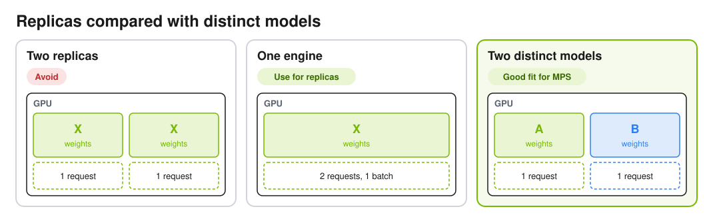
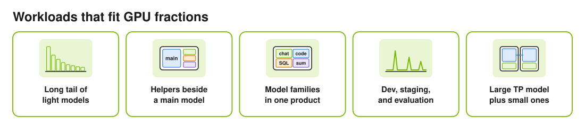

GPU fractions pays off for one kind of fleet: several **distinct** models that each leave a GPU mostly idle. For other fleets, a dedicated GPU, MIG, or a single engine serving many requests is the better choice. This page walks through four questions, in order. Each one either rules GPU fractions out, with the alternative to use, or moves you to the next.

<Steps toc={true}>
<Step title="Check whether one model can keep a GPU busy" id="check-whether-one-model-can-keep-a-gpu-busy">

Look at each model's traffic: requests per second, input and output lengths, and how many requests are in flight at peak. A model with enough traffic to keep a GPU busy loses throughput when it shares one.

In the [GPU fractions benchmark](benchmark-gpu-fractions.mdx), two models sharing an A100 kept 63.5% of a dedicated GPU's throughput at one request per model, rising to 87.9% at 16 requests per model. At 32 concurrent requests per model, the cost advantage of sharing was gone.

**If a model is busy,** give it dedicated GPUs, and add whole-GPU replicas behind the Dynamo router as its traffic grows. Continue with the models that are left.

</Step>
<Step title="Check that the models are distinct" id="check-that-the-models-are-distinct">

On every decode step, an engine reads its model's full weights from GPU memory, so at low and moderate load decode time is set mostly by memory bandwidth. Whether sharing helps depends on whether the models on the GPU have the same weights:

- **Replicas of one model.** Two replicas on one GPU store the same weights twice and read them twice on every step. One engine serving the same requests holds one copy, batches the requests together, and reads the weights once per step for all of them. Packing replicas onto one GPU spends memory and bandwidth for no gain.
- **Distinct models.** Two models with different weights can't share a batch, so no single engine can serve both. If each model alone uses a small part of a GPU, the only way to recover the idle part is to run both models on the same GPU. That is what GPU fractions is for.

Fine-tuned variants trained as LoRA adapters of one base model count as replicas here: they share the base weights.

**If the models are replicas or LoRA adapters,** serve them from one engine per base model, with batching or [LoRA adapters](../../kubernetes/operations/lora-adapters.md). Continue with the distinct models.

</Step>
<Step title="Check how much isolation you need" id="check-how-much-isolation-you-need">

GPU fractions caps each model's compute and memory, but the models on a GPU still share four things:

- **Memory bandwidth.** Each model reads its own weights on every step, and MPS does not divide the bandwidth between them, so a busy neighbor slows a model down.
- **The L2 cache.** One model's working set can evict another's.
- **Power.** When every model on a GPU is busy, the GPU can reach its power limit and lower its clocks.
- **The fault domain.** A fatal fault in one model, such as an illegal memory access, can force every model on its GPU to restart. [MPS Fault Isolation](../../developer-guide/knowledge-base/concepts/gpu-sharing/mps-fault-isolation.md) shows which faults spread.

**If one tenant must not affect another,** because the tenants don't trust each other or a neighbor's crash or latency spike is unacceptable, use MIG or separate GPUs. MIG partitions memory bandwidth, the L2 cache, and faults in hardware, at the cost of fixed instance sizes.

</Step>
<Step title="Match your workload" id="match-your-workload">

The models that are left are distinct, lightly loaded, and can tolerate a shared GPU. These workloads fit that description:

- **A long tail of lightly used models,** such as full fine-tunes per customer, internal tools, or language-specific models. Each would leave a dedicated GPU mostly idle, and their weights differ, so they can't share an engine.
- **Supporting models beside a main model,** such as embedding, reranking, guardrail and safety classifiers, and small routers. They are small, distinct, and lightly loaded, so they fill the share a larger model leaves.
- **Several model families behind one product,** such as chat, code, SQL, and summarization. Each sees part of the product's traffic, and none needs a whole GPU.
- **Development, staging, and evaluation,** with many candidate models used in bursts. Utilization is low and bursty, and GPU count matters more than peak throughput.
- **A large tensor-parallel model, plus small ones.** A model that spans GPUs for its memory may not need all of their compute, so it can be held to a share of each GPU. [Per-GPU Compute and Memory Limits with MPS](https://github.com/ai-dynamo/dynamo/blob/main/examples/gpu-sharing/docs/mps-per-gpu-limits.md) shows how.

These workloads are better served another way:

</Step>
<Step title="Compare the approaches" id="compare-the-approaches">

If your models passed the first three checks, GPU fractions is the approach that fits the most of them onto the fewest GPUs. Confirm it against the alternatives:

| | Dedicated GPUs | MIG | GPU fractions (MPS) | KAI + HAMi | Time-slicing |
|---|---|---|---|---|---|
| GPUs for N lightly loaded models | N | Fewer, with sizes rounded up to profiles | Fewest; each model gets the share it needs | Fewer, but models take turns | Fewer, but with no limits |
| Throughput kept per shared GPU | All of it | Each instance's own slice | 63.5% to 87.9% of a dedicated GPU, in the A100 benchmark | 44.5% to 72.8%, in the same benchmark | Not limited or measured here |
| Latency interference from neighbors | None | None | Memory bandwidth, L2 cache, and power are shared | Shared; models also wait for their turn | Shared, with no caps |
| Fault isolation | Full | Per instance | None within a GPU | Per process | Per process |
| Sizing | Whole GPUs | Fixed profiles, up to 7 per GPU | Any share and memory size, per pod | Any memory size | None |
| Resizing one model | Reschedule | Drain and repartition the GPU | Restart that model's pod | Restart that model's pod | Not applicable |
| Maturity on Kubernetes | Standard | Standard, through the GPU Operator | KAI-Scheduler and node agents built from pull requests; needs driver r615+, NRI, and GPU Operator v26.7.1+ | Released components | Standard, through the device plugin |

If the models don't need compute caps or to run at the same time, such as a development cluster with bursty, latency-tolerant traffic, time-slicing or HAMi is enough.

</Step>
</Steps>

## Make the Case

When you propose GPU fractions, or argue against it, frame it around how many GPUs your models need, and what the shared GPUs cost in latency and isolation. In your own numbers:

> We serve N distinct models. Each uses a small part of a GPU, so one GPU per model leaves most of N GPUs idle. GPU fractions packs them onto M GPUs, each model capped at the share of compute and memory it needs, and each still meets its latency targets in our measurements. Unlike MIG, each model gets exactly its share, so fewer GPUs are needed, and one model can be resized without disturbing the others. In the published A100 benchmark, sixteen models ran on eight GPUs instead of sixteen, at 22.9% lower cost per output token than one model per GPU at one request per model.

Back each claim with a measurement from your own models: the share each needs to meet its targets, measured next to a busy neighbor, and the GPU count before and after. The next two guides produce those numbers.

Before you commit, answer these with your own measurements:

1. Which of your models are distinct, and which are replicas or LoRA adapters of a shared base?
2. For each distinct model, what traffic does it see, and what are its time to first token (TTFT) and inter-token latency (ITL) targets?
3. What share of the SMs and how much memory does each model need to meet its targets, measured with the rest of the GPU loaded?
4. How many GPUs do those shares pack into, compared with one GPU per model, and compared with MIG profiles?
5. Which models are critical enough to keep on dedicated GPUs, or to spread across GPUs?
6. Can your clusters run driver r615 or newer, NRI, and the pinned KAI-Scheduler and node agent builds?

## Next Steps

- [Size Each Model's Share](size-each-models-share.mdx): turn questions 3 and 4 into numbers.
- [How GPU Sharing Works](../../developer-guide/knowledge-base/concepts/gpu-sharing/how-gpu-sharing-works.md): how MPS, MIG, HAMi, and time-slicing differ.
