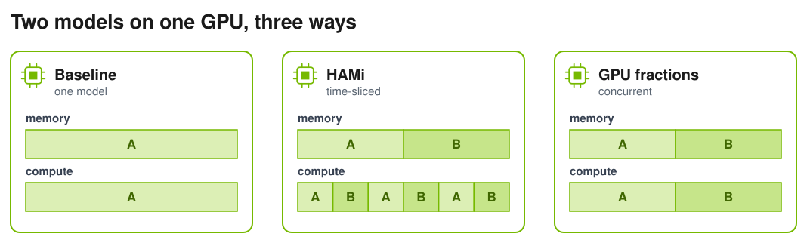

Many deployments serve models that each leave a GPU mostly idle: per-customer fine-tunes, embedding and guardrail models beside a main model, or a family of task-specific models behind one product. Giving each one a dedicated GPU wastes most of it. GPU fractions packs several of these models onto one GPU and gives each a fixed share of the GPU's compute and memory. KAI-Scheduler places each model on a share of a GPU, and CUDA Multi-Process Service (MPS) v3 enforces that share, so the models run at the same time instead of taking turns.

These pages walk you through it in order: deciding whether your models should share a GPU, sizing each model's share, trying MPS on one GPU, installing GPU fractions on Kubernetes, deploying models, benchmarking them, and operating the result.

<Warning>
GPU fractions is experimental. It depends on KAI-Scheduler and node agents built from pull requests that are not yet merged upstream, and on NVIDIA driver r615 or newer.
</Warning>



## What You Can Do

| I want to… | Use | Guide |
|---|---|---|
| Decide whether my models should share a GPU, or use MIG or dedicated GPUs instead | A four-question checklist | [Decide Whether to Share a GPU](decide-whether-to-share.mdx) |
| Work out how much compute and memory each model needs | Two budgets per GPU | [Size Each Model's Share](size-each-models-share.mdx) |
| See MPS limits work before touching a cluster | MPS v3 on one GPU, no Kubernetes | [Try MPS on One GPU](try-mps-on-one-gpu.mdx) |
| Set up a cluster that gives pods a share of a GPU | KAI-Scheduler and the GPU fractioning agents | [Install GPU Fractions on Kubernetes](install-gpu-fractions.mdx) |
| Run Dynamo models on GPU fractions | Fraction annotations on the worker | [Deploy Models on GPU Fractions](deploy-models-on-gpu-fractions.mdx) |
| Measure what sharing costs in throughput and latency | A concurrency sweep with every model loaded | [Benchmark GPU Fractions](benchmark-gpu-fractions.mdx) |
| See how many more models fit when shares are sized from targets | Sized shares against an even split, on one GPU | [Benchmark Sized Shares](benchmark-sized-shares.mdx) |
| Plan for faults, resize models, and fix common problems | Placement rules and troubleshooting | [Operate Shared GPUs](operate-shared-gpus.md) |

## Try It

A worker asks for its share with annotations on its pod template. This worker gets half of a GPU's streaming multiprocessors (SMs) and half of its memory:

```yaml {8-9}
- name: worker
  type: worker
  podTemplate:
    metadata:
      labels:
        kai.scheduler/queue: default-queue
      annotations:
        gpu-fraction: "0.5"
        nvidia.com/container.main.gpu-compute.mode: sm-sharing
    spec:
      schedulerName: kai-scheduler
      runtimeClassName: nvidia
      securityContext:
        runAsNonRoot: true
```

KAI-Scheduler finds a GPU with half its compute and memory free, and the node agents put the worker in its own MPS namespace capped at 50% of the SMs. A second worker with the same request lands on the same GPU, and the two run side by side. [Deploy Models on GPU Fractions](deploy-models-on-gpu-fractions.mdx) walks through every field.

## How It Works

```text
DynamoGraphDeployment worker (gpu-fraction: "0.5", sm-sharing)
  │
  ▼
KAI-Scheduler   picks a GPU with room for the compute share and the memory,
  │             and records the GPU and the share on the pod
  ▼
mpsd            creates an MPS namespace for the pod on that GPU's MPS server,
  │             with the pod's share of the SMs
  ▼
fractiond       gives the container only that namespace's pipe directory,
  │             and its memory cap
  ▼
the engine, such as vLLM, runs as an MPS client under the namespace's limits
```

MPS lets the models run at the same time, but it does not divide everything. Memory bandwidth, the L2 cache, power, and the fault domain stay shared, so a busy model can slow its neighbors, and a fatal fault in one model can stop every model on its GPU. The guides show how to plan for both.

## What to Expect

In a benchmark of 16 Qwen3-4B models on one 8× A100 node, two models per GPU:

- GPU fractions kept **63.5% to 87.9%** of a dedicated GPU's throughput per GPU, depending on load. Time-slicing with HAMi kept 44.5% to 72.8%.
- At one request per model, serving 16 models on 8 GPUs instead of 16 cost **22.9% less** per output token.
- At 32 requests per model, the cost advantage was gone: a busy model is better off on its own GPU.

[Benchmark GPU Fractions](benchmark-gpu-fractions.mdx) has the full results and shows how to run the same sweep.

## Where to Start

1. Follow [Decide Whether to Share a GPU](decide-whether-to-share.mdx). If the answer is no, it tells you what to use instead.
2. [Size each model's share](size-each-models-share.mdx) and check that the shares pack onto your GPUs.
3. [Try MPS on one GPU](try-mps-on-one-gpu.mdx) to see the limits work on a single machine.
4. [Install GPU fractions](install-gpu-fractions.mdx) on your cluster and run the smoke test.
5. [Deploy your models](deploy-models-on-gpu-fractions.mdx) and send them requests.
6. [Benchmark them](benchmark-gpu-fractions.mdx) with every model loaded, and adjust the shares. [Benchmark Sized Shares](benchmark-sized-shares.mdx) shows what sizing each share from its targets saves.
7. Read [Operate Shared GPUs](operate-shared-gpus.md) before you run them in production.

For the background, see the GPU sharing concepts in the Developer Guide: [How GPU Sharing Works](../../developer-guide/knowledge-base/concepts/gpu-sharing/how-gpu-sharing-works.md), [MPS v2 and v3](../../developer-guide/knowledge-base/concepts/gpu-sharing/mps-v2-and-v3.md), and [MPS Fault Isolation](../../developer-guide/knowledge-base/concepts/gpu-sharing/mps-fault-isolation.md).
