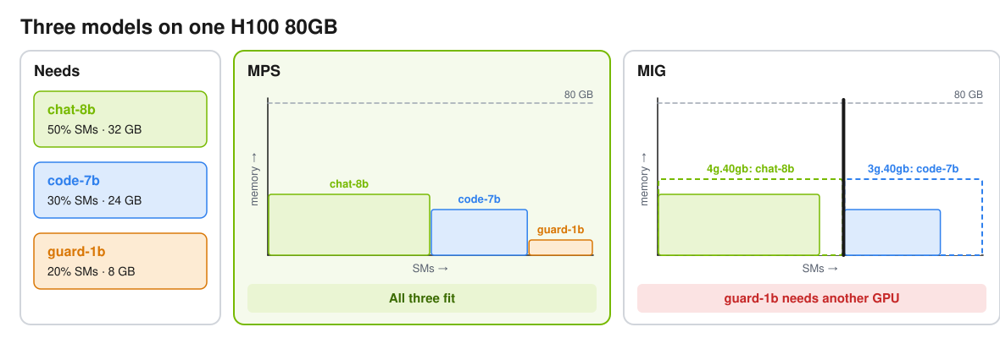

Under GPU fractions, each model asks for two things: a share of the GPU's streaming multiprocessors (SMs) and an amount of memory. This page walks through sizing both from the model and its traffic and checking that the shares pack onto your GPUs. It assumes you have already [decided that your models should share a GPU](decide-whether-to-share.mdx).

The example on this page packs three models onto one 80 GB H100 GPU. The model names and sizes are illustrative.

<Steps toc={true}>
<Step title="Measure each model's memory" id="measure-each-models-memory">

A model needs enough memory for three things:

- **Weights:**  an 8B model needs about 16 GB.
- **Engine overhead:** the CUDA context, activations, and CUDA graphs. Measure it by starting the engine with a small KV cache.
- **KV cache:** enough for the concurrency and context length the model must serve. Size it from the model's KV bytes per token, multiplied by the tokens in flight at peak.

Round the total up, and record it as the model's memory request.

| Model | Weights | Memory request |
|---|---:|---:|
| `chat-8b` | 16 GB | 32 GB |
| `code-7b` | 14 GB | 24 GB |
| `guard-1b` | 2 GB | 8 GB |

</Step>
<Step title="Find each model's compute share" id="find-each-models-compute-share">

The compute share is the smallest share of the SMs at which the model still meets its latency targets at its expected traffic. Instead of load-testing one share at a time, measure how the engine's speed changes with its share once, then work out which shares meet the targets.

1. **Measure the forward-pass curves.** For each share on a grid, such as 0.10 to 0.75 of the GPU, load the rest of the GPU with another engine and measure:
   - the time of one prefill pass at your input length;
   - the time of one decode step at batch sizes 1 to 32;
   - the memory the engine uses beyond its KV cache.

   Measure once per model and GPU type, and reuse the curves for every packing decision. [Try MPS on One GPU](try-mps-on-one-gpu.mdx) shows how to run a process at a chosen share without Kubernetes.
2. **Set the targets.** For each model, write down its expected request rate `R` (from your historical traffic), its TTFT ceiling `TTFT_max` (your latency tolerance), and its inter-token latency (ITL) ceiling `ITL_max` (your interactivity tolerance).
3. **Admit the shares that pass three checks.** A share is admitted only when it passes all three:

   | Check | Passes when |
   |---|---|
   | ITL | A decode step at the model's batch size is at most `ITL_max`. |
   | Load | The engine's load `rho`, the fraction of time it is busy serving `R`, is below 1. |
   | Violation | The expected time until the first request misses `TTFT_max`, `tau`, is at least one hour or your own setting. |

   The violation check is the one that usually decides. Every request queued ahead of a new one adds a full prefill to its TTFT, so a slower prefill both raises the load and lowers how many queued requests still fit within `TTFT_max`.
4. **Take the smallest admitted share.** Read the curves only at measured points: between two measured batch sizes, use the slower value. Look for plateaus, where a larger share is no faster.

<Note>
A share measured on an idle GPU is optimistic. When multiple models on the GPU are executing, the power limit is more likely to be hit, slowing the GPU's clocks. Always measure the forward passes under iso-power.
</Note>

The targets decide how many models fit. For Qwen3-4B on one RTX PRO 6000 with 2048-token inputs and 256-token outputs, at `ITL_max` = 100 ms, the procedure packs this many models per GPU:

| Rate per model (req/s) | `TTFT_max` 10 s | `TTFT_max` 20 s | `TTFT_max` 30 s |
|---:|---:|---:|---:|
| 0.02 | 10 | 10 | 10 |
| 0.05 | 5 | 10 | 10 |
| 0.10 | 2 | **5** | 10 |
| 0.20 | 1 | 2 | 4 |

At 0.1 req/s and a 20-second ceiling, it admits a share of 0.20 and rejects 0.15, so five models fit where an even split fits two. [Benchmark Sized Shares](benchmark-sized-shares.mdx) measures that packing under load.

For the rest of this page, the example models have these shares:

| Model | Compute share | Memory request |
|---|---:|---:|
| `chat-8b` | 0.5 | 32 GB |
| `code-7b` | 0.3 | 24 GB |
| `guard-1b` | 0.2 | 8 GB |

</Step>
<Step title="Pack models while both budgets hold" id="pack-models-while-both-budgets-hold">

Think of each GPU as two budgets, and pack models into it:

- **Compute:** the shares on a GPU add up to at most 1.
- **Memory:** the memory requests fit in the GPU's memory.

A model fits on a GPU only when both budgets have room. The three example models use 0.5 + 0.3 + 0.2 = 1.0 of the compute and 32 + 24 + 8 = 64 GB of the 80 GB, so they fill one GPU's compute with 16 GB of memory to spare. A fourth model needs another GPU, however small it is.

</Step>
<Step title="Compare with MIG profiles" id="compare-with-mig-profiles">

MIG can also put several models on one GPU, but each model gets a fixed instance, rounded up to the next profile. Compare the GPU count both ways before you commit:

| Model | Needs | GPU fractions share | Smallest MIG instance that fits |
|---|---|---|---|
| `chat-8b` | 50% of the SMs, 32 GB | 0.5, 32 GB | `4g.40gb`: 57% of the SMs, 40 GB |
| `code-7b` | 30% of the SMs, 24 GB | 0.3, 24 GB | `3g.40gb`: 43% of the SMs, 40 GB. A `2g.20gb` has too little memory |
| `guard-1b` | 20% of the SMs, 8 GB | 0.2, 8 GB | `2g.20gb`, but the GPU's 7 SM slices are already allocated |

With MIG, the first two models take the whole GPU, and the third needs another GPU. Across a cluster, rounding every model up to a profile strands capacity on every GPU.

</Step>
</Steps>

## Next Steps

- [Try MPS on One GPU](try-mps-on-one-gpu.mdx): run a process at a chosen share and memory cap, and measure it.
- [Benchmark Sized Shares](benchmark-sized-shares.mdx): see shares sized this way compared with an even split.
- [Deploy Models with GPU Sharing](deploy-models-with-gpu-sharing.mdx): request these shares for each worker.
