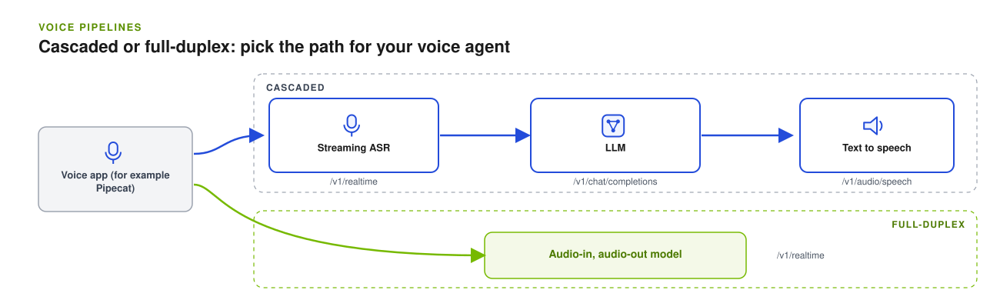
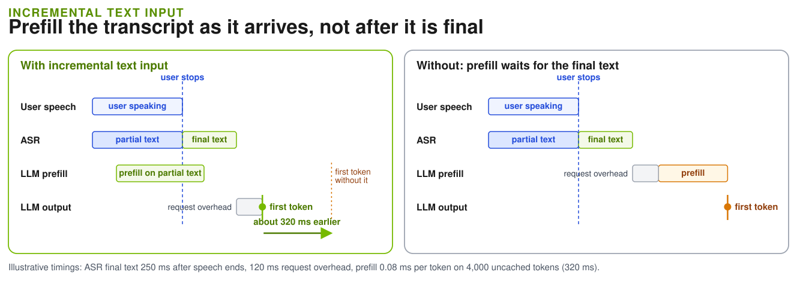

Dynamo serves voice workloads through OpenAI-compatible endpoints. Run separate
automatic speech recognition (ASR), LLM, and text-to-speech (TTS) workers for a
cascaded pipeline, or one vLLM-Omni model that takes audio in and returns audio
out.



## Endpoints

| Stage | Endpoint | Output | Guide |
| --- | --- | --- | --- |
| Streaming ASR | `/v1/realtime` WebSocket, `session.type="transcription"` | Transcript events | [Speech to Text](speech-to-text.md) |
| LLM | `/v1/chat/completions` with `stream: true` | Text deltas | [Local Guide](../../cli/getting-started/quickstart.mdx) |
| TTS | `/v1/audio/speech` | Audio, streamed for `wav` and `pcm` | [Text-to-Speech](text-to-speech.md) |
| Audio-in, audio-out model | `/v1/realtime` WebSocket, `session.type="realtime"` | Text and audio events | [Speech-to-Speech](speech-to-speech.md) |

For a cascaded voice agent, connect an application such as Pipecat to the three
stage endpoints. The application owns conversation history, turn detection,
interruptions, and orchestration; Dynamo serves and routes each stage.

## Set up the backend

<Tabs>
<Tab title="vLLM and vLLM-Omni">

The speech pages in this section run on vLLM (speech to text) and vLLM-Omni (TTS
and speech-to-speech).

- Speech to text needs a working
  [vLLM backend setup](../../developer-guide/knowledge-base/modular-components/backends/vllm/overview.md#installation)
  plus vLLM's audio dependencies:

  ```bash
  pip install 'vllm[audio]'
  ```

- Text-to-speech and speech-to-speech need vLLM-Omni:

<Markdown src="../_snippets/setup-vllm-omni.mdx" />

See the [vLLM backend setup](../../developer-guide/knowledge-base/modular-components/backends/vllm/overview.md) and the [vLLM-Omni Configuration reference](../../reference/backends/vllm-omni-configuration.mdx) for every flag.

</Tab>
<Tab title="Nemotron Speech NIMs (Kubernetes)">

The Nemotron Speech cascade deploys Nemotron ASR and Magpie TTS Speech NIMs with
Dynamo adapters, plus a Nemotron LLM served by vLLM. ASR, LLM, and TTS run in
separate pods.

Follow the
[deployment and smoke-test instructions](https://github.com/ai-dynamo/dynamo/tree/main/examples/nemotron_speech_cascaded_pipeline#deploy-on-kubernetes)
in the example. It requires compatible source-built Dynamo images; check the
example's runtime-image requirements before you deploy. The deployment smoke test
checks the speech endpoints, not a complete browser voice agent. See
[external orchestration](https://github.com/ai-dynamo/dynamo/tree/main/examples/nemotron_speech_cascaded_pipeline#external-orchestration)
for client integration.

</Tab>
</Tabs>

## Run a Pipeline Locally

Bring up and test each stage on its own before you connect them:

1. Start an ASR worker and stream an audio file to it:
   [Speech to Text](speech-to-text.md).
2. Start an LLM with any vLLM, SGLang, or TensorRT-LLM launcher, for example
   `bash examples/backends/vllm/launch/agg.sh`.
3. Start a TTS worker and synthesize a reply:
   [Text-to-Speech](text-to-speech.md).

Each launcher starts its own frontend on port 8000, so test the stages one at a
time on a single host.

## Incremental Text Input

Incremental text input lets an orchestrator send ASR text to the LLM while the user is still speaking. The worker starts prefilling the text it has received so far, in full KV cache blocks, so those tokens are already in the prefix cache when the final request arrives. The client sends `input_text.append` events with the partial text, then `input_text.commit` with the final text to start generation, or `input_text.clear` to discard the prefill work.



It applies to text-only `/v1/realtime` sessions on aggregated vLLM workers, without tools or disaggregation, and it needs prefix caching. Short or revised input can yield no benefit. The input events are Dynamo extensions, not standard OpenAI events, and realtime text does not yet apply `--dyn-reasoning-parser`. ASR and TTS orchestration remain external. Session recovery across worker failures is a further goal and is not provided by the examples above.
