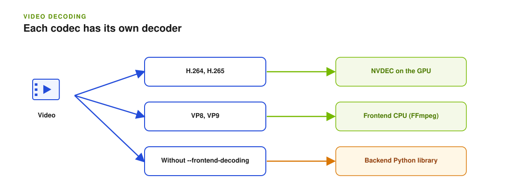

Dynamo provides two video-input decode paths. CUDA runtime images can use both;
vLLM CPU and XPU runtimes can use the frontend software path:

- H.264 and H.265 (HEVC) decode on the GPU using NVDEC, NVIDIA's dedicated
  hardware video decoder, through
  [PyNvVideoCodec](https://pypi.org/project/PyNvVideoCodec/).
- VP8 and VP9 decode on the CPU through Dynamo's codec-limited, in-tree FFmpeg
  when frontend decoding is enabled on vLLM, or SGLang on CUDA.

The in-tree FFmpeg does not include H.264, H.265, or AV1 decoders. Without
frontend decoding, video input remains owned by the backend and requires its
Python decode carrier (OpenCV, PyAV, or decord). The images deliberately omit
those wider software-decode carriers by default; vLLM does ship OpenCV, but it
is built without a video backend for still-image work only.

This page covers which GPUs provide NVDEC, what the container must expose, and how
Dynamo behaves when hardware decode is unavailable.



## GPU support

NVDEC is a fixed-function decode engine, separate from the SMs used for inference, so
decoding adds negligible load to the GPU beyond a small YUV-to-RGB conversion.

A common misconception is that datacenter GPUs have no video engines. That applies to
**NVENC**, the hardware *encoder*, which NVIDIA omits from datacenter parts. The
*decoder* is present:

| GPU | Architecture | NVDEC (decode) | NVENC (encode) | H.264 | HEVC |
|-----|--------------|----------------|----------------|-------|------|
| A100 | Ampere | 5 engines | none | Yes | Yes |
| H100, H200 | Hopper | 7 engines | none | Yes | Yes (Main, Main 10) |
| B200, GB200 | Blackwell | 7 engines | none | Yes | Yes (Main, Main 10, 422 10/12) |
| L4 | Ada Lovelace | 4 engines | 2 | Yes | Yes |
| L40, L40S | Ada Lovelace | 3 engines | 3 | Yes | Yes |
| RTX 6000 Ada | Ada Lovelace | 3 engines | 3 | Yes (8/10-bit) | Yes (8/10/12-bit, up to 4:4:4) |

Every GPU above decodes both codecs Dynamo routes to hardware, so H.264 and H.265 video
input works across the lineup. Hopper's NVDEC matches Turing's feature set and
does **not** decode AV1; Blackwell adds AV1 decode. The Ada parts (L4, L40S, RTX 6000 Ada)
decode AV1 as well, and unlike A100, H100, H200, B200, and GB200 they also carry NVENC.

> [!NOTE]
> Under Multi-Instance GPU (MIG), NVDEC engines are divided across instances. A given MIG
> profile may expose fewer decoders than the full GPU, and some profiles expose none.
> Verify decode works in the exact profile you deploy.


## Container requirements

NVDEC links `libnvcuvid` at runtime, which the NVIDIA container runtime only mounts when
the **`video` driver capability** is requested. Without it, `import PyNvVideoCodec` fails
and Dynamo falls back to software decode.

Dynamo's runtime images already declare it:

```dockerfile
ENV NVIDIA_DRIVER_CAPABILITIES=video,compute,utility
```

With Docker that is usually enough, because the toolkit reads the capability from the
image. To be explicit, or when overriding the variable for other reasons:

```bash
docker run --gpus all -e NVIDIA_DRIVER_CAPABILITIES=video,compute,utility ...
```

### Kubernetes

> [!IMPORTANT]
> On Kubernetes the image's `ENV` is **not** reliably sufficient. Set the variable on the
> container spec as well. Dynamo's own GPU test runners shipped images carrying the `ENV`
> and still had no hardware decode until the pod spec set it explicitly.

Add it to the container that runs the worker:

```yaml
spec:
  containers:
    - name: worker
      env:
        - name: NVIDIA_DRIVER_CAPABILITIES
          value: video,compute,utility
      resources:
        limits:
          nvidia.com/gpu: "1"
```

If it still does not take effect, the capability is being dropped below the pod. Check
`supported-driver-capabilities` in `/etc/nvidia-container-runtime/config.toml` on the
node, and — if the cluster runs in CDI mode — whether the generated device spec includes
the video libraries, since in that mode capabilities come from the spec rather than the
environment variable.

> [!WARNING]
> Missing the `video` capability is the most common cause of hardware decode being
> silently unavailable. The GPU itself is fine; the container simply cannot see the
> decoder.

## Verifying hardware decode

```bash
python3 -c "
from dynamo.common.multimodal.nvdec_decoder import nvdec_available
print('NVDEC available:', nvdec_available())
"
```

`False` means Dynamo will not use hardware decode in that container. Check, in order: the
`video` driver capability, that `PyNvVideoCodec` is installed, and that
`DYN_DISABLE_NVDEC` is unset.

To distinguish "capability missing" from every other cause, look for the decode library
itself. It is mounted by the container runtime, not installed by the image, so its absence
points squarely at the capability:

```bash
ldconfig -p | grep -i nvcuvid
```

Expect `libnvcuvid.so.1`. Nothing means the `video` capability did not reach this
container. If it is present on the node but not inside, the capability is being dropped
between the two.


## Behavior when NVDEC is unavailable

Hardware decode is additive and never blocks a request on its own: routing falls through
to a software decode path where one exists. VP8 and VP9 frontend decoding on vLLM, or
SGLang on CUDA, does not depend on NVDEC.

> [!IMPORTANT]
> The shipped images do not include a software H.264, H.265, or AV1 decoder.
> Therefore, if NVDEC is unavailable, H.264 and H.265 fail with an
> unsupported-codec error unless the backend's wider Python decode carrier is
> installed. AV1 also requires an additional carrier because Dynamo does not
> route it through NVDEC and the in-tree FFmpeg excludes it.
>
> Grant the container the `video` driver capability so NVDEC can serve H.264 and H.265.
> For VP8 and VP9, use frontend decoding on vLLM, or SGLang on CUDA. For
> other software-decoded cases, [install an additional decoder](#install-additional-decoders)
> or transcode the input before sending it.


## Install Additional Decoders

Dynamo's runtime images ship a deliberately small media stack: the in-tree FFmpeg decodes VP8 and VP9, NVDEC covers H.264 and H.265 on supported GPUs, and nothing else installs automatically. For AAC and other compressed audio, or for H.264 and H.265 on hosts without NVDEC, install a backend decoder package with `pip install`. No image rebuild is needed.

See [Additional Media Decoders](../image-understanding/additional-media-decoders.md) for the per-backend packages, the bundled installer, Kubernetes and air-gapped setups, and version-pinning notes.

## Video Output and NVENC

There is nothing to enable. Dynamo does not use NVENC on any path.

Video **output** — the generation path — encodes VP9 on the CPU with the in-tree FFmpeg.
That is deliberate and works everywhere: A100, H100, H200, B200, and GB200 have no
hardware encoder, so a hardware encode path would be unavailable on the GPUs most
deployments run. On GPUs that do have NVENC (L4, L40S, RTX 6000 Ada) it stays unused.

The same `video` driver capability governs both engines, so a container configured for
NVDEC as above needs no additional change. Encode performance does not depend on it.


## Configuration

| Variable | Default | Purpose |
|----------|---------|---------|
| `DYN_DISABLE_NVDEC` | unset | Set to `1` to skip hardware decode. In a shipped image that leaves H.264 and H.265 input with no decoder, so it is a debugging switch rather than a fallback for those codecs. VP8 and VP9 frontend decoding is unaffected. Read as a boolean: `1`/`true`/`yes` disable, anything else does not. |
| `DYN_NVDEC_GPU_ID` | `0` | GPU ordinal used for decode. |
| `DYN_MM_VIDEO_NUM_FRAMES` | `32` | Frames sampled uniformly from each clip. |
| `DYN_MM_MAX_FILE_SIZE_MB` | `64` | Maximum size in MiB for each remote image, audio, or video download. TensorRT-LLM uses its backend-specific `--max-file-size-mb` option (`DYN_TRTLLM_MAX_FILE_SIZE_MB`) instead. |


## Sources

- [NVIDIA Video Encode and Decode GPU Support Matrix](https://developer.nvidia.com/video-encode-and-decode-gpu-support-matrix-new)
- [NVDEC Application Note](https://docs.nvidia.com/video-technologies/video-codec-sdk/13.1/nvdec-application-note/index.html)

