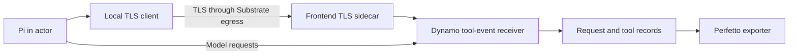

<!--
SPDX-FileCopyrightText: Copyright (c) 2025-2026 NVIDIA CORPORATION & AFFILIATES. All rights reserved.
SPDX-License-Identifier: Apache-2.0
-->

Capture Pi tool execution alongside Dynamo inference, then export the records
to Perfetto. This procedure extends a DGD from the selected model recipe. It
requires a frontend build with native request tracing and the tool-event receiver.
See [Agent tracing](../../../docs/fern/pages/use-cases/agents/agent-tracing.md)
for the record format and available settings.

## Prepare the transport

Pi publishes tool events over ZMQ. Substrate's TLS-passthrough egress carries
that connection through a local stunnel client to a sidecar in the frontend Pod.
The native receiver listens on loopback. HTTP model traffic uses its separate
endpoint and egress rule.



Set `MODEL_NAMESPACE` and `DGD_NAME` to the namespace and name from your model
recipe. Work from the example directory. Create a certificate for the trace
Service before changing the frontend:

```bash
export MODEL_NAMESPACE=inference
export DGD_NAME=your-model-deployment
export TRACE_HOST="harbor-tool-events.$MODEL_NAMESPACE.svc.cluster.local"
mkdir -p .local/trace-private .local/tool-trace
chmod 700 .local/trace-private
openssl req -x509 -newkey rsa:2048 -nodes -days 7 \
  -keyout .local/trace-private/tls.key -out .local/tool-trace/tls.crt \
  -subj "/CN=$TRACE_HOST" -addext "subjectAltName=DNS:$TRACE_HOST"
chmod 600 .local/trace-private/tls.key
envsubst '${TRACE_HOST}' < stunnel-client.conf > .local/tool-trace/stunnel-client.conf
kubectl --context "$KUBE_CONTEXT" -n "$MODEL_NAMESPACE" create secret tls harbor-tool-trace-tls \
  --cert=.local/tool-trace/tls.crt --key=.local/trace-private/tls.key
envsubst '${MODEL_NAMESPACE} ${DGD_NAME}' < tool-trace-service.yaml > .local/tool-trace-service.yaml
kubectl --context "$KUBE_CONTEXT" apply -f .local/tool-trace-service.yaml
```

Only the public certificate and client configuration go into actors. The
private key stays in the frontend Secret. The client verifies the certificate
chain and hostname. Use your normal certificate management for a longer-lived
installation.

## Add capture to the recipe frontend

Set `DEPLOYMENT_YAML` to the manifest selected from the model recipe. Save a
copy for the trace additions:

```bash
cp "$DEPLOYMENT_YAML" .local/traced-dgd.yaml
```

Edit `.local/traced-dgd.yaml`. In the `Frontend` entry under `spec.components`,
merge the following fields into `podTemplate.spec`. Append to the existing
`main` container's `env` and `volumeMounts` lists, add the sidecar to
`containers`, and add the volumes. Preserve the recipe's images, arguments,
other environment variables, worker components, and accompanying resources.
This fragment is not a standalone DGD:

```yaml
containers:
  - name: main
    env:
      - name: DYN_REQUEST_TRACE
        value: "1"
      - name: DYN_REQUEST_TRACE_TOOL_EVENTS_ZMQ_ENDPOINT
        value: tcp://127.0.0.1:20390
      - name: DYN_REQUEST_TRACE_OUTPUT_PATH
        value: /traces/request-trace
      - name: DYN_REQUEST_TRACE_FILE_FORMAT
        value: jsonl
    volumeMounts:
      - name: harbor-traces
        mountPath: /traces
  - name: tool-events-tls
    image: alpine:3.22
    command:
      - sh
      - -ec
      - apk add --no-cache stunnel; exec stunnel /config/stunnel.conf
    ports:
      - name: tls-zmq
        containerPort: 20391
    volumeMounts:
      - name: tool-trace-tls
        mountPath: /tls
        readOnly: true
      - name: tool-trace-config
        mountPath: /config
        readOnly: true
    resources:
      requests:
        cpu: 50m
        memory: 32Mi
      limits:
        cpu: "1"
        memory: 128Mi
volumes:
  - name: harbor-traces
    emptyDir:
      sizeLimit: 2Gi
  - name: tool-trace-tls
    secret:
      secretName: harbor-tool-trace-tls
  - name: tool-trace-config
    configMap:
      name: harbor-tool-trace-tls
```

The main container writes native JSONL records under `/traces`. The sidecar
terminates TLS on port 20391 and forwards events to the receiver on loopback
port 20390. It installs stunnel from Alpine repositories at startup. Use a
prebuilt approved image if Pod egress does not permit that.

If the frontend already has trace settings or these volume names, merge the
configuration without duplicate entries. Inspect the diff, then apply it:

```bash
diff -u "$DEPLOYMENT_YAML" .local/traced-dgd.yaml
kubectl --context "$KUBE_CONTEXT" -n "$MODEL_NAMESPACE" apply -f .local/traced-dgd.yaml
kubectl --context "$KUBE_CONTEXT" -n "$MODEL_NAMESPACE" wait \
  --for=condition=Ready "dgd/$DGD_NAME" --timeout=1800s
```

This example uses one frontend replica and an ephemeral 2-GiB trace volume.
For more replicas, collect every frontend's trace. For longer runs, use a
persistent volume or your normal trace export system. Copy all segments before
replacing or deleting the frontend Pod.

## Connect actor tool events

Append a rule to `rules` in `.local/egress.yaml`. Replace the example hostname
with the value of `TRACE_HOST` from the certificate step:

```yaml
  - tlsPassthrough:
      hostnames:
        - harbor-tool-events.inference.svc.cluster.local
      ports:
        numbers: [20391]
```

In `.local/harbor-job.yaml`, append these entries to the existing
`agents[0].env` mapping:

```yaml
DYN_REQUEST_TRACE: "1"
DYN_REQUEST_TRACE_TOOL_EVENTS_ZMQ_ENDPOINT: tcp://127.0.0.1:20390
DYN_TOOL_TRACE_TLS_CONFIG: /opt/tool-trace/stunnel-client.conf
```

Add this mapping under `environment.kwargs`:

```yaml
uploads:
  /work/tool-trace: /opt/tool-trace
```

The upload supplies the public certificate and stunnel configuration. The Pi
adapter starts stunnel, and the provider publishes tool events to its loopback
listener. These settings require the Dynamo frontend capture configured above.
Omit them when using an external endpoint.

Copy the policy and public client files to the runner, then return to the
tutorial to upload the edited job:

```bash
kubectl --context "$KUBE_CONTEXT" -n ate-env cp .local/egress.yaml harbor-runner:/work/example/egress.yaml
kubectl --context "$KUBE_CONTEXT" -n ate-env cp .local/tool-trace harbor-runner:/work/tool-trace
```

Run one trial and confirm that Pi's `toolCallId` values appear in native tool
records alongside model requests with the same session ID. Missing tool events
mean the transport is incomplete even if inference succeeds. Check the client,
sidecar, and frontend logs before starting a batch.

## Export the completed capture

After the job finishes, wait for the frontend's trace writer to flush. Find the
frontend Pod using your deployment's labels, then copy its trace directory:

```bash
kubectl --context "$KUBE_CONTEXT" -n "$MODEL_NAMESPACE" get pods \
  -l "nvidia.com/dynamo-namespace=$MODEL_NAMESPACE-$DGD_NAME,nvidia.com/dynamo-component=Frontend"
export FRONTEND_POD=your-frontend-pod
mkdir -p .local/results/traces
kubectl --context "$KUBE_CONTEXT" -n "$MODEL_NAMESPACE" cp -c main \
  "$FRONTEND_POD:/traces/." .local/results/traces
python3 ../../../benchmarks/request_trace/convert_to_perfetto.py \
  .local/results/traces/request-trace*.jsonl \
  --output .local/results/trace.perfetto.json
```

Open `trace.perfetto.json` in the [Perfetto UI](https://ui.perfetto.dev/).
Harbor's trial name identifies its agent session, and `substrate.json` records
the actor mapping. Join model request IDs and tool-call IDs rather than using
nearby timestamps as proof of identity.

Request duration includes queueing, prefill, and generation. Tool spans measure
Pi's observed tool invocation. Tool spans marked `inferred` or `synthetic` are
not measured execution. Check raw records when diagnosing missing events or
partial sessions. An external model service without Dynamo capture does not
provide these server-side spans.
