<!--
SPDX-FileCopyrightText: Copyright (c) 2025-2026 NVIDIA CORPORATION & AFFILIATES. All rights reserved.
SPDX-License-Identifier: Apache-2.0
-->

# DeepInfer Through OpenEngine and a Dynamo Sidecar

Run NVIDIA Dynamo inference serving locally with a Rust OpenEngine gRPC server,
the existing Dynamo OpenEngine sidecar, and the Dynamo HTTP frontend. Only the
DeepInfer execution/output implementation is mocked. Use the real DeepSeek V4.1
tokenizer, prompt renderer, reasoning parser, and tool parser without loading
model weights or using a GPU.

> [!NOTE]
> **Experimental.** The CPU mock is for protocol and frontend iteration. Its
> outputs are scripted, and it does not measure DeepInfer model quality,
> scheduling performance, or GPU behavior. The optional native adapter is a
> starting point for GPU qualification, not a qualified deployment recipe.

```mermaid
flowchart LR
    Client[HTTP client] --> Frontend[Dynamo HttpService\nV4.1 rendering and tokenization]
    Frontend -->|Dynamo TCP request plane| Sidecar[Dynamo OpenEngine sidecar]
    Sidecar -->|OpenEngine Generate gRPC| Server[Rust tonic server]
    Server -->|PyO3 calls / token callbacks| Driver[Python engine owner thread]
    Driver --> Engine[MockDeepInferEngine\nor native LLMEngine]
    Engine -->|Raw token outputs| Driver
    Driver --> Server
    Server --> Sidecar
    Sidecar --> Frontend
    Frontend -->|Parsed reasoning, tools and content| Client
```



Python starts the engine owner and loads `_deepinfer_openengine`, a PyO3 Rust
extension. The extension runs tonic on its own Tokio threads, retains a Python
runtime handle, and calls `submit()` / `abort()` directly. The owner returns raw
tokens through Rust callback objects into bounded response channels. This follows
[SGLang's native gRPC bridge](https://github.com/sgl-project/sglang/blob/c2e574246485a055c0e51d60d1eae027e5d629c0/python/sglang/srt/entrypoints/grpc_bridge.py).
The gRPC server and Python engine owner share one process; there is no engine
subprocess, stdin reader, pipe transport, or JSON serialization between them.
DeepInfer may still create its own GPU worker processes in native mode.

The OpenEngine client currently lives in `dynamo-trtllm-sidecar`. This example
reuses that binary and its vendored protocol, without importing or installing
TensorRT-LLM. Its log messages retain that client name. The server advertises
`engine_name=deepinfer`.

## Prepare the Environment

Run from the Dynamo repository root. Install the repository Rust toolchain,
the normal CPU build prerequisites, and Python 3.12 with development headers.
The build needs a modern
`protoc`; the commands below provide one in the virtual environment.

```bash
uv venv --python 3.12 .venv
uv pip install --python .venv/bin/python \
  -r examples/backends/deepinfer/requirements.txt protoc-wheel-0==30.2
```

The first launch downloads only the 6.4 MB V4.1 tokenizer from a pinned
`deepseek-recipe` revision and verifies its SHA256. It generates minimal mock
model metadata in `examples/backends/deepinfer/.cache/model`. It never downloads
model weights. Set `DEEPINFER_TOKENIZER_JSON` to the matching local
`tokenizer.json` for an offline launch. `TOKENIZER_SOURCE.txt` records provenance
and links the upstream tokenizer notices.

## Run and Verify the Complete Chain

```bash
bash examples/backends/deepinfer/launch.sh --verify
```

The command builds the Rust binaries and installs the Rust extension with
`maturin develop`, then starts the Python engine host, sidecar and
frontend as separate processes, waits for real gRPC/HTTP readiness, verifies the
chain, then stops its processes. The check covers streaming and non-streaming
text, reasoning, tools with thinking enabled/disabled, Unicode, token limits,
16 concurrent requests, and disconnect cancellation followed by recovery.
It also checks selected-token logprobs on `/v1/completions` and their deliberate
suppression by the unified parser on `/v1/chat/completions`.
Three focused checks also exercise single-thread engine ownership, closed-consumer
callbacks, initialization failure cleanup, and fatal engine failure propagation
into the Rust server. Results and all three process logs are retained in the
printed run directory.

File-backed discovery and TCP request/response planes keep the example local.
No etcd, NATS, Docker, Python Dynamo bindings or inference-engine packages are
required in mock mode. `deepinfer-example-frontend` is a thin Rust launcher for
the real Dynamo `HttpService` and `ModelWatcher`; it does not implement a second
HTTP API or parser.

For an interactive session, omit `--verify`:

```bash
bash examples/backends/deepinfer/launch.sh
```

In another terminal, send a request. This selects the one model exposed by this
isolated frontend:

```bash
MODEL=$(curl -fsS http://127.0.0.1:8000/v1/models | \
  .venv/bin/python -c 'import json,sys; print(json.load(sys.stdin)["data"][0]["id"])')

.venv/bin/python - "$MODEL" <<'PY' | curl -fsSN \
  http://127.0.0.1:8000/v1/chat/completions \
  -H 'Content-Type: application/json' --data-binary @-
import json, sys
print(json.dumps({
    "model": sys.argv[1],
    "messages": [{"role": "user", "content": "mock:tool"}],
    "tools": [{"type": "function", "function": {
        "name": "get_weather",
        "parameters": {"type": "object", "properties": {"city": {"type": "string"}}, "required": ["city"]},
    }}],
    "tool_choice": "auto",
    "chat_template_kwargs": {"thinking": True},
    "max_tokens": 256,
    "stream": True,
}))
PY
```

The frontend returns reasoning separately from a structured `get_weather` call
whose arguments decode to `{"city":"Tokyo"}`. The mock emits raw DSML tokens;
neither the Rust server nor the sidecar constructs an API tool call.

Use `mock:plain`, `mock:reasoning`, or `mock:unicode` for other scripted outputs.
Set `chat_template_kwargs.thinking=false` to disable reasoning. Press Ctrl-C in
the launcher terminal to stop the processes.

## Change Ports and Keep Logs

```bash
DYN_HTTP_PORT=8100 DEEPINFER_GRPC_PORT=30101 \
  bash examples/backends/deepinfer/launch.sh --verify
```

| Variable | Purpose |
| --- | --- |
| `DYN_HTTP_PORT` | Frontend HTTP port; default `8000` |
| `DEEPINFER_GRPC_PORT` | OpenEngine loopback port; default `30001` |
| `DYN_NAMESPACE` | Discovery namespace; default `deepinfer` |
| `DEEPINFER_RUN_DIR` | Directory for logs, process IDs and verification results |
| `DEEPINFER_MODEL_DIR` | Tokenizer and model metadata directory |
| `DEEPINFER_PYTHON` | Engine-owner Python executable; default repository `.venv/bin/python` |
| `DEEPINFER_TOKENIZER_JSON` | Local copy of the pinned official V4.1 tokenizer |
| `DEEPINFER_TICK_MS` | Mock per-step delay; default `2` ms |
| `DEEPINFER_SKIP_BUILD=1` | Use already-built binaries and the installed Rust extension |
| `DEEPINFER_BIN_DIR` | Override the Cargo debug binary directory |

## Replace Mock Execution With DeepInfer

The native adapter targets [DeepInfer revision
`774ce244`](https://github.com/deepseek-ai/DeepInfer/commit/774ce244)
and its `LLMEngine` / `RequestOutput` API. Keep that boundary in sync when
updating DeepInfer.

`engine.py:NativeDeepInferEngine` calls the real Python APIs:

1. Build `LLMEngine` from `EngineArgs` in a DeepInfer environment.
2. Convert input IDs to a one-dimensional NumPy int32 array and construct
   DeepInfer `SamplingParams`.
3. Submit with `add_request()`, drive `step()`, and clone each pooled native
   `RequestOutput` before advancing the engine.
4. Propagate `abort_request()` and drain inflight outputs before closing.

Only the engine owner thread touches its engine, including construction and
cleanup. Rust gRPC threads enqueue Python requests and receive typed callbacks;
blocking engine steps run on the owner. Callback values are copied before the
next engine step. A full response queue fails that request explicitly and aborts
its engine work. Request IDs are remapped internally so late cancellation cannot
cancel a newer request that reused an external ID.

The Python host handles SIGINT/SIGTERM. Rust releases the GIL while joining its
server thread, and the host stops the engine owner afterwards. Fatal engine
errors fail active streams and stop the Rust server. Both languages share the
host process's failure boundary.

After installing/building DeepInfer and obtaining a full checkpoint, use the
same server/sidecar/frontend path with a separate engine Python environment:

```bash
DEEPINFER_ENGINE=deepinfer \
DEEPINFER_MODEL_DIR=/absolute/path/to/DeepSeek-V4.1-Flash-1017 \
DEEPINFER_PYTHON=/absolute/path/to/deepinfer/.venv/bin/python \
DEEPINFER_ENGINE_ARGS=/absolute/path/to/engine-args.json \
  bash examples/backends/deepinfer/launch.sh
```

`engine-args.json` supplies DeepInfer `EngineArgs` overrides. This owner supports
one attention-DP rank; DeepInfer may create CP workers inside it. Multi-DP
launch/collective coordination needs a further launcher integration. The CPU
checks do not qualify this native mode or establish a GPU configuration that
fits the full model. The scripted verification suite is specifically for mock
mode and should not be used as a model-quality test.

## Supported Scope

- Aggregated text token generation with one output sequence.
- Temperature, top-p, top-k, seed, maximum tokens, ignore-EOS, token-ID stops,
  and selected-token logprob transport. The unified chat parser suppresses
  logprobs when rewriting output; use `/v1/completions` for raw token logprobs.
  Mock output is deterministic and does
  not simulate probabilistic sampling.
- OpenEngine metadata, readiness, load and abort RPCs; standard gRPC health.
- Streaming and non-streaming frontend reasoning/tool parsing with
  `deepseek_v41`. Parser selectors are registered by the sidecar.

Unsupported requests fail explicitly: disaggregation/KV sessions, KV events,
multimodal inputs, LoRA, guided decoding, required/named tool enforcement,
multiple sequences, sampling penalties, minimum output length, string stop
conditions and prompt logprobs. `tool_choice=auto` exercises tool parsing;
scripted valid output does not prove constrained decoding or strict tool schemas.
