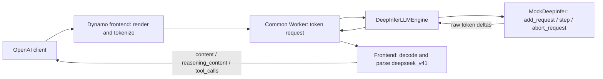

<!--
SPDX-FileCopyrightText: Copyright (c) 2025-2026 NVIDIA CORPORATION & AFFILIATES. All rights reserved.
SPDX-License-Identifier: Apache-2.0
-->

# DeepInfer Mock Backend

Run end-to-end NVIDIA Dynamo serving with a mocked DeepInfer inference engine.
The real frontend renders DeepSeek V4.1 prompts, tokenizes input, decodes streamed
token IDs, and parses reasoning and tool calls. Only engine inference is synthetic.
No model weights, GPUs, DeepInfer installation, etcd, or NATS are required.

> [!WARNING]
> Experimental, mock-only backend. Responses are deterministic fixtures selected
> by prompt markers. This does not load or run DSv4.1, enforce tool schemas, or
> measure DeepInfer inference performance.

## Run Locally

Use Python 3.11+ with Dynamo built and installed from this branch. For a source
build, follow [Building from Source](https://github.com/ai-dynamo/dynamo/blob/main/docs/fern/pages/developer-guide/advanced-customizations/building-from-source.md).
The mock additionally uses `numpy`, `tokenizers`, and `huggingface-hub`;
the smoke test uses `httpx`:

```bash
uv pip install numpy tokenizers huggingface-hub httpx
bash examples/backends/deepinfer/launch/agg.sh
```

The launcher downloads only five allowlisted configuration/tokenizer filenames
from a pinned DeepSeek V4.1 Flash revision into the Hugging Face cache. It starts
the frontend on `127.0.0.1:8000`, starts `python3 -m dynamo.deepinfer`, and uses an
isolated temporary file-discovery directory plus TCP request/response transport.
It removes the discovery directory and stops both processes on exit.

In another terminal with the same Python environment:

```bash
python3 examples/backends/deepinfer/smoke_test.py
```

The self-check covers unary and streamed chat, reasoning, single and parallel tool
calls, a tool-result continuation, token limits, and 16 concurrent requests.
Every output token is streamed separately by the backend, including tokens that
split DSML markers. Assertions verify parsed fields, finish reasons, tool IDs,
arguments, token usage, and absence of leaked markers.

To use existing tokenizer/config assets or another HTTP port:

```bash
MODEL_PATH=/absolute/path/to/tokenizer-directory DYN_HTTP_PORT=8100 \
  bash examples/backends/deepinfer/launch/agg.sh --mock-token-delay 0
python3 examples/backends/deepinfer/smoke_test.py --base-url http://127.0.0.1:8100
```

`MODEL_PATH` must contain the DeepSeek V4.1 tokenizer and config from
`prepare_model.py`. Passing a different tokenizer does not qualify its rendering
or parsing behavior. `DYN_SYSTEM_PORT` defaults to an automatically assigned port.
Stop the launcher with Ctrl+C after testing.

## Send a Tool Request

```bash
curl -sS http://127.0.0.1:8000/v1/chat/completions \
  -H 'Content-Type: application/json' \
  -d '{
    "model": "deepinfer-mock",
    "messages": [{"role": "user", "content": "DEEPINFER_TOOL"}],
    "max_tokens": 256,
    "tools": [{"type": "function", "function": {
      "name": "get_weather",
      "parameters": {"type": "object", "properties": {
        "city": {"type": "string"}
      }, "required": ["city"]}
    }}]
  }'
```

The frontend returns `reasoning_content: "I need the weather tool."`, a
`get_weather` call with `{"city":"Paris"}`, and `finish_reason: "tool_calls"`.
Add `"stream": true` for server-sent events. The client executes the tool and
submits its result using the returned `tool_call_id`; the smoke test demonstrates
this complete exchange.

| Marker in latest user turn | Mock engine output |
|---|---|
| Ordinary text | `Hello from the DeepInfer mock.` |
| `DEEPINFER_REASONING` | Reasoning plus `The answer is 42.` |
| `DEEPINFER_TOOL` | Reasoning plus one `get_weather(city="Paris")` call |
| `DEEPINFER_PARALLEL` | Reasoning plus calls for Paris and Tokyo |
| `DEEPINFER_TOOL_RESULT` in tool result | Reasoning plus `It is 21 C in Paris.` |

## Integration Boundary



Like TokenSpeed, `DeepInferLLMEngine` implements the shared `LLMEngine` contract;
the common Worker owns registration, networking, cancellation, and shutdown.
Worker registration selects `deepseek_v41` for both frontend parsers. The backend
never constructs OpenAI messages or parses tools/reasoning itself.

The adapter calls all engine operations on one dedicated owner thread. A shared
step loop advances concurrent requests, demultiplexes outputs by context ID,
emits token deltas and terminal usage, and releases requests on cancellation.
It enforces context/output limits and maps sampling names, including `seed` to
DeepInfer's `seq_seed`. The mock ignores probabilistic sampling parameters.

The mock mirrors the public
[DeepInfer token interface](https://github.com/deepseek-ai/DeepInfer/blob/774ce244b87cc0eb8d4b94ab9f5de2ab22049f01/deepinfer/engine/llm_engine.py)
and [RequestOutput fields](https://github.com/deepseek-ai/DeepInfer/blob/774ce244b87cc0eb8d4b94ab9f5de2ab22049f01/csrc/engine/outputs.hpp).
To connect real inference, replace `MockDeepInfer` construction on the owner
thread and normalize native outputs there. Native `step()` returns pooled
pointers, which must be dereferenced and copied before the next step; they are
not token IDs. Real initialization, distributed rank coordination, inflight-output
flushing, native resource cleanup, and GPU inference remain unqualified.

This example supports aggregated text serving with `n=1`. It rejects constrained
decoding and multimodal input. It does not implement KV events, prefix affinity,
disaggregation, KVBM, native logprobs, or production metrics. Use round-robin routing.

## Unit Checks

```bash
pytest -q components/src/dynamo/deepinfer/tests
```
