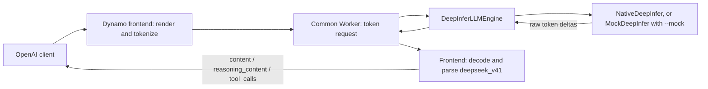

<!--
SPDX-FileCopyrightText: Copyright (c) 2025-2026 NVIDIA CORPORATION & AFFILIATES. All rights reserved.
SPDX-License-Identifier: Apache-2.0
-->

# DeepInfer Backend

Run end-to-end NVIDIA Dynamo serving with the native DeepInfer inference engine.
The real frontend renders DeepSeek V4.1 prompts, tokenizes input, decodes streamed
token IDs, and parses reasoning and tool calls. Add `--mock` to replace inference
with CPU-only synthetic output for local iteration.

> [!WARNING]
> Experimental. Native GPU inference has not been qualified by this example's
> CPU checks. The native adapter supports one data-parallel engine per worker;
> DeepInfer can spawn context-parallel workers across the visible GPUs.

## Run Native DeepInfer

Build and install DeepInfer and its accelerator dependencies in the same Python
environment as this Dynamo branch, following the
[DeepInfer build instructions](https://github.com/deepseek-ai/DeepInfer/tree/774ce244b87cc0eb8d4b94ab9f5de2ab22049f01#build-from-source).
That release requires Python 3.12 and CUDA 13 on NVIDIA SM100 GPUs. Provide a
complete local DeepSeek V4.1 checkpoint, including weights, `config.json`, and
`tokenizer.json`. The wrapper does not download model weights.

For an eight-GPU context-parallel engine, run:

```bash
CUDA_VISIBLE_DEVICES=0,1,2,3,4,5,6,7 \
MODEL_PATH=/absolute/path/to/DeepSeek-V4.1-Flash-1017 \
  bash examples/backends/deepinfer/launch/agg.sh \
    --engine-args '{"context_parallel_size":8,"expert_parallel_size":8,"max_num_seqs":4,"chunked_prefill":true}'
```

Size the parallelism and memory settings for your checkpoint and hardware; this
command is a launch example, not a qualified hardware sizing recommendation.
`--engine-args` accepts a JSON object of upstream `EngineArgs` options, such as
`gpu_memory_utilization`, `lookahead_tokens`, or `max_num_batched_tokens`.
Set `--max-model-len` separately (default: 4096). Model path and served name also
use Dynamo flags. Aggregated engine type and online mode use DeepInfer's defaults.
The native tokenizer uses the same model directory as the frontend; tokenizer
overrides in `--engine-args` are rejected.

The served model defaults to `deepinfer` in native mode. Send a normal prompt:

```bash
curl -sS http://127.0.0.1:8000/v1/chat/completions \
  -H 'Content-Type: application/json' \
  -d '{"model":"deepinfer","messages":[{"role":"user","content":"What is six times seven?"}],"max_tokens":256,"stream":true}'
```

Native mode requires `CUDA_VISIBLE_DEVICES` to be set before DeepInfer is imported.
Use distinct `MASTER_PORT` values when running independent engines concurrently;
DeepInfer uses this value to derive its process-group port. The adapter fixes
`data_parallel_size=1` and `engine_rank=0`, and allows `engram_parallel_size` only
when it is zero or equal to `context_parallel_size`. Multi-DP replicas require
coordinated collective scheduling and are rejected before engine construction.

## Run the CPU Mock

Use Python 3.11+ with Dynamo built and installed from this branch. For a source
build, follow [Building from Source](https://github.com/ai-dynamo/dynamo/blob/main/docs/fern/pages/developer-guide/advanced-customizations/building-from-source.md).
The mock additionally uses `numpy`, `tokenizers`, and `huggingface-hub`;
the smoke test uses `httpx`:

```bash
uv pip install numpy tokenizers huggingface-hub httpx
bash examples/backends/deepinfer/launch/agg.sh --mock
```

In mock mode, the launcher downloads only five allowlisted configuration/tokenizer filenames
from a pinned DeepSeek V4.1 Flash revision into the Hugging Face cache. It starts
the frontend on `127.0.0.1:8000`, starts `python3 -m dynamo.deepinfer`, and uses an
isolated temporary file-discovery directory plus TCP request/response transport.
It removes the discovery directory and stops both processes on exit.

In another terminal with the same Python environment:

```bash
python3 examples/backends/deepinfer/smoke_test.py
```

The self-check covers unary and streamed chat, reasoning, single and parallel tool
calls, a tool-result continuation, token limits, and 16 concurrent requests.
Every output token is streamed separately by the backend, including tokens that
split DSML markers. Assertions verify parsed fields, finish reasons, tool IDs,
arguments, token usage, and absence of leaked markers.

To use existing tokenizer/config assets or another HTTP port:

```bash
MODEL_PATH=/absolute/path/to/tokenizer-directory DYN_HTTP_PORT=8100 \
  bash examples/backends/deepinfer/launch/agg.sh --mock --mock-token-delay 0
python3 examples/backends/deepinfer/smoke_test.py --base-url http://127.0.0.1:8100
```

For the mock, `MODEL_PATH` must contain the DeepSeek V4.1 tokenizer and config from
`prepare_model.py`. Passing a different tokenizer does not qualify its rendering
or parsing behavior. `DYN_SYSTEM_PORT` defaults to an automatically assigned port.
Stop the launcher with Ctrl+C after testing.

The mock requires no model weights, GPUs, DeepInfer, etcd, or NATS. Its fixture
responses are selected by explicit prompt markers and ignore probabilistic
sampling options. They do not qualify model inference or tool-schema enforcement.
Native mode imports DeepInfer only when constructing the engine; it never falls
back to mock inference on an initialization error.

## Send a Mock Tool Request

```bash
curl -sS http://127.0.0.1:8000/v1/chat/completions \
  -H 'Content-Type: application/json' \
  -d '{
    "model": "deepinfer-mock",
    "messages": [{"role": "user", "content": "DEEPINFER_TOOL"}],
    "max_tokens": 256,
    "tools": [{"type": "function", "function": {
      "name": "get_weather",
      "parameters": {"type": "object", "properties": {
        "city": {"type": "string"}
      }, "required": ["city"]}
    }}]
  }'
```

The frontend returns `reasoning_content: "I need the weather tool."`, a
`get_weather` call with `{"city":"Paris"}`, and `finish_reason: "tool_calls"`.
Add `"stream": true` for server-sent events. The client executes the tool and
submits its result using the returned `tool_call_id`; the smoke test demonstrates
this complete exchange.

| Marker in latest user turn | Mock engine output |
|---|---|
| Ordinary text | `Hello from the DeepInfer mock.` |
| `DEEPINFER_REASONING` | Reasoning plus `The answer is 42.` |
| `DEEPINFER_TOOL` | Reasoning plus one `get_weather(city="Paris")` call |
| `DEEPINFER_PARALLEL` | Reasoning plus calls for Paris and Tokyo |
| `DEEPINFER_TOOL_RESULT` in tool result | Reasoning plus `It is 21 C in Paris.` |

## Integration Boundary



Like TokenSpeed, `DeepInferLLMEngine` implements the shared `LLMEngine` contract;
the common Worker owns registration, networking, cancellation, and shutdown.
Worker registration selects `deepseek_v41` for both frontend parsers. The backend
never constructs OpenAI messages or parses tools/reasoning itself.

The adapter calls all engine operations on one dedicated owner thread. A shared
step loop advances concurrent requests, demultiplexes outputs by context ID,
emits token deltas and terminal usage, and releases requests on cancellation.
It enforces context/output limits and maps sampling names, including `seed` to
DeepInfer's `seq_seed`. Native sampling receives these parameters directly.

The adapter uses the public
[DeepInfer token interface](https://github.com/deepseek-ai/DeepInfer/blob/774ce244b87cc0eb8d4b94ab9f5de2ab22049f01/deepinfer/engine/llm_engine.py)
and [RequestOutput fields](https://github.com/deepseek-ai/DeepInfer/blob/774ce244b87cc0eb8d4b94ab9f5de2ab22049f01/csrc/engine/outputs.hpp).
Native initialization calls `EngineArgs` and `LLMEngine.from_engine_args` on the
owner thread. The adapter reads owned scalar snapshots through native
`RequestOutput.get_*` accessors before another engine operation can reuse the
pooled pointers. It calls `flush_inflight_reqs()` when no scheduled work remains,
propagates per-request engine failures, and calls native `close()` on shutdown.
Sentinel token IDs are excluded from the token stream. The CPU contract tests
simulate pooled-pointer reuse and deferred outputs; they do not load DeepInfer
or validate GPU kernels or weights.

This example supports aggregated text serving with `n=1`. It rejects constrained
decoding and multimodal input. It does not implement KV events, prefix affinity,
disaggregation, KVBM, native logprobs, or production metrics. Use round-robin routing.

## Unit Checks

```bash
pytest -q components/src/dynamo/deepinfer/tests
```
