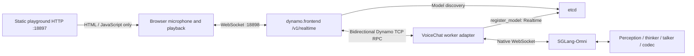

<!--
SPDX-FileCopyrightText: Copyright (c) 2025-2026 NVIDIA CORPORATION & AFFILIATES. All rights reserved.
SPDX-License-Identifier: Apache-2.0
-->

# Native full-duplex Nemotron VoiceChat demo

Speak with `nvidia/NVIDIA-NemotronLabs-VoiceChat-11B` through NVIDIA Dynamo's
standard `python -m dynamo.frontend` HTTP server and SGLang-Omni. Microphone
capture, text, and speaker playback run concurrently. The model decides when to
listen and speak, advancing one frame every 80 ms.

The frontend discovers a registered `ModelType.Realtime` worker through etcd.
Its existing Rust `/v1/realtime` handler selects that worker and carries **all
input and output audio over Dynamo's bidirectional TCP RPC**. A Python worker
adapter connects to the native SGLang-Omni WebSocket. The browser holds one
frontend connection for the conversation; no native backend URL reaches it.
A separate HTTP server serves playground assets only and has no WebSocket route.



## Prerequisites

- An existing namespace you can administer and a shared model-cache PVC.
- One supported NVIDIA GPU with sufficient memory; this demo was developed on a B200.
- Network access from the cluster to the pinned container images, GitHub, PyPI, and Hugging Face.
- A browser with microphone access. Use localhost port forwarding or an HTTPS origin.
- Headphones to prevent the microphone from picking up the generated speech.

The deployment uses one GPU and three pods: the backend (with the realtime worker
adapter sidecar), the frontend (with the static playground server), and an isolated
etcd instance. It creates only namespaced
Deployments, Services, and a ConfigMap. It reuses the supplied PVC and never creates
or deletes a namespace, PVC, or secret.

The SGLang-Omni source revision, GPU image digest, model checkpoint revision, and
backbone tokenizer revision are pinned in the source. The frontend uses the
published `ai-dynamo==1.6.0` package and `ai-dynamo-runtime==1.6.0`; no Rust changes
or custom frontend routes are required. Models are cached under
`/models/voicechat-demo/huggingface` on the supplied PVC.

A checked-in patch keeps the playback overlap window even at VoiceChat's
22.05 kHz rate. Without it, catch-up playback can read past its overlap tail and
produce non-finite speaker samples.

## Deploy

From the Dynamo repository root, set your authorized context and namespace:

```bash
export DEMO_CONTEXT=<development-context>
export DEMO_NAMESPACE=<owned-namespace>

python3 examples/backends/sglang/omni_voicechat/deploy.py \
  --context "$DEMO_CONTEXT" --namespace "$DEMO_NAMESPACE" \
  --cache-pvc shared-model-cache

kubectl --context "$DEMO_CONTEXT" --namespace "$DEMO_NAMESPACE" \
  rollout status deployment/voicechat-backend --timeout=30m
kubectl --context "$DEMO_CONTEXT" --namespace "$DEMO_NAMESPACE" \
  rollout status deployment/voicechat-frontend --timeout=10m
kubectl --context "$DEMO_CONTEXT" --namespace "$DEMO_NAMESPACE" \
  port-forward service/voicechat-frontend 18897:8082 18898:8080
```

Open [the microphone demo](http://localhost:18897), click **Start talking**, and
allow microphone access. The page connects directly to the frontend at
`ws://localhost:18898/v1/realtime`; keep both forwarded ports open. Keep the page open while speaking; it continues sending
microphone frames, including silence, while the model replies. **End** closes the
session and releases its retained model state. The browser limits a conversation
to four minutes; start another conversation to continue.

For a specific GPU node, pass `--node <node-name>` to `deploy.py`. Use `--dry-run`
to inspect all resources before applying them. Cold startup includes the model
download, pipeline initialization, and a two-frame kernel warmup.

## Validate speech and browser playback

Install client dependencies into a Python 3.12 environment:

```bash
uv pip install -r examples/backends/sglang/omni_voicechat/requirements-client.txt
python -m playwright install chromium
```

The vendor's stereo conversation fixture stores the caller on channel 0. Both
checks below use that channel, resample it as needed, and preserve the audio's
real-time cadence. Supply any suitable caller WAV with `--audio`.

```bash
curl -L --fail \
  https://huggingface.co/nvidia/NVIDIA-NemotronLabs-VoiceChat-11B/resolve/443794ea956ef0065f001967ffd00e77f519cb39/turn_taking.wav \
  -o /tmp/voicechat-caller.wav

python examples/backends/sglang/omni_voicechat/smoke.py \
  --url http://localhost:18898 --audio /tmp/voicechat-caller.wav \
  --output /tmp/voicechat-replay

python examples/backends/sglang/omni_voicechat/browser_smoke.py \
  --url http://localhost:18897 --audio /tmp/voicechat-caller.wav \
  --output /tmp/voicechat-browser
```

The protocol check requires audible output, spoken text, output arriving before
input finishes, and a completed input drain. It checks the native input acknowledgement count
returned in the final response metadata against the number of sent frames. It saves the output WAV, timed
protocol events, and a JSON summary. The browser check uses Chromium's fake
microphone with the supplied audio and exercises the real AudioWorklet capture,
WebSocket, and playback interface. It saves screenshots and event counts and
fails on browser or server protocol errors.
It also verifies that the actual speaker path produces finite, audible samples.
With Node.js installed, check the deployed catch-up playback regression directly:

```bash
node examples/backends/sglang/omni_voicechat/test_playback.mjs \
  http://localhost:18897/static/orb/worklet.js
```

`GET http://localhost:18898/v1/models` lists the realtime model discovered by
`dynamo.frontend`. `GET http://localhost:18897/api/status` reads that list and
reports frontend readiness. Worker logs record session open/close, the Dynamo
instance ID, native acknowledged input frames, and output chunk counts. Final
`response.done.response.metadata` includes those counters and `dynamo_worker_id`.

CPU worker tests can run without loading a model:

```bash
python -m unittest discover \
  -s examples/backends/sglang/omni_voicechat -p test_worker.py -v
```

## Protocol Adapter

This demo uses a fixed VoiceChat profile: mono PCM16 input at 16 kHz in 80 ms
frames, mono PCM16 output at 22.05 kHz, the checkpoint's default prompt and voice,
and `output_modalities: ["audio"]`. The adapter verifies the native negotiated
rates before emitting `session.updated`. Spoken text deltas accompany audio.
The frontend's typed OpenAI schema does not expose SGLang-Omni's negotiation,
per-frame receipts, or unit timing extensions. The playground uses the fixed
profile instead of those extensions. Native acknowledgement counts remain
available in final response metadata and worker logs.

Send `session.update` with `session.type: "realtime"`, `session.model` set to the
model above, and `output_modalities: ["audio"]`. Stream standard
`input_audio_buffer.append` events continuously, including silence. The adapter
adds the native sequence and media clock after the frontend transports each frame.
For this single continuous response, `input_audio_buffer.commit` ends and drains
the native input stream; `input_audio_buffer.committed` is emitted after the drain.
Further input requires a new session. Close the frontend WebSocket to end a live
conversation and cancel the worker. Native `session.close` and `sglang.*` client
events are not accepted by the frontend. This is a VoiceChat demo profile, not a
complete implementation of every OpenAI Realtime operation.

## Limits and teardown

- One active conversation per backend. Admission is enforced in the worker;
  concurrent callers receive a realtime `error` event with code `server_busy`
  after the frontend upgrades their WebSocket.
- The native SGLang-Omni model owns the checkpoint prompt, voice, model state, and interruption
  behavior. The adapter forwards continuous audio without applying an external VAD.
- Backend failure ends the current connection; sessions cannot migrate or resume.
- Model execution and stage placement remain within SGLang-Omni. This example does
  not enable Dynamo KV routing, prefill/decode disaggregation, or autoscaling.
- Services are cluster-internal. This development demo has no public ingress.

Stop port forwarding with Ctrl+C. Remove the demo's resources when finished:

```bash
python3 examples/backends/sglang/omni_voicechat/deploy.py \
  --context "$DEMO_CONTEXT" --namespace "$DEMO_NAMESPACE" --delete
```

The model-cache PVC and downloaded checkpoint remain available for reuse.

The browser playground is served from the pinned, Apache-2.0-licensed
[SGLang-Omni source](https://github.com/sgl-project/sglang-omni/tree/257301672237f04db12cd6aed3730c2824bba56b/playground/realtime/frontend/orb).
