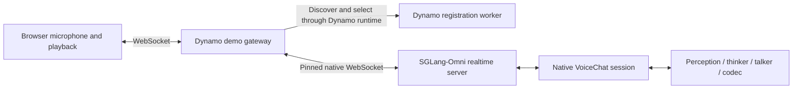

<!--
SPDX-FileCopyrightText: Copyright (c) 2025-2026 NVIDIA CORPORATION & AFFILIATES. All rights reserved.
SPDX-License-Identifier: Apache-2.0
-->

# Native full-duplex Nemotron VoiceChat demo

Speak with `nvidia/NVIDIA-NemotronLabs-VoiceChat-11B` through a Dynamo-discovered
SGLang-Omni backend. Microphone capture, text, and speaker playback run concurrently.
The model decides when to listen and speak, advancing one frame every 80 ms.

This example uses a Python realtime gateway and Dynamo's distributed runtime.
It does not add a realtime endpoint to the standard Rust frontend. Dynamo selects
the backend through etcd discovery and TCP RPC; media and native protocol events
then flow over a WebSocket pinned to that backend for the connection's lifetime.



## Prerequisites

- An existing namespace you can administer and a shared model-cache PVC.
- One supported NVIDIA GPU with sufficient memory; this demo was developed on a B200.
- Network access from the cluster to the pinned container images, GitHub, PyPI, and Hugging Face.
- A browser with microphone access. Use localhost port forwarding or an HTTPS origin.
- Headphones to prevent the microphone from picking up the generated speech.

The deployment uses one GPU and three pods: the backend (with a Dynamo registration
sidecar), the gateway, and an isolated etcd instance. It creates only namespaced
Deployments, Services, and a ConfigMap. It reuses the supplied PVC and never creates
or deletes a namespace, PVC, or secret.

The SGLang-Omni source revision, GPU image digest, model checkpoint revision, and
backbone tokenizer revision are pinned in the source. Models are cached under
`/models/voicechat-demo/huggingface` on the supplied PVC.

A checked-in patch keeps the playback overlap window even at VoiceChat's
22.05 kHz rate. Without it, catch-up playback can read past its overlap tail and
produce non-finite speaker samples.

## Deploy

From the Dynamo repository root, set your authorized context and namespace:

```bash
export DEMO_CONTEXT=<development-context>
export DEMO_NAMESPACE=<owned-namespace>

python3 examples/backends/sglang/omni_voicechat/deploy.py \
  --context "$DEMO_CONTEXT" --namespace "$DEMO_NAMESPACE" \
  --cache-pvc shared-model-cache

kubectl --context "$DEMO_CONTEXT" --namespace "$DEMO_NAMESPACE" \
  rollout status deployment/voicechat-backend --timeout=30m
kubectl --context "$DEMO_CONTEXT" --namespace "$DEMO_NAMESPACE" \
  rollout status deployment/voicechat-gateway --timeout=5m
kubectl --context "$DEMO_CONTEXT" --namespace "$DEMO_NAMESPACE" \
  port-forward service/voicechat-gateway 18897:8080
```

Open [the microphone demo](http://localhost:18897), click **Start talking**, and
allow microphone access. Keep the page open while speaking; it continues sending
microphone frames, including silence, while the model replies. **End** closes the
session and releases its retained model state. The browser limits a conversation
to four minutes; start another conversation to continue.

For a specific GPU node, pass `--node <node-name>` to `deploy.py`. Use `--dry-run`
to inspect all resources before applying them. Cold startup includes the model
download, pipeline initialization, and a two-frame kernel warmup.

## Validate speech and browser playback

Install client dependencies into a Python 3.12 environment:

```bash
uv pip install -r examples/backends/sglang/omni_voicechat/requirements-client.txt
python -m playwright install chromium
```

The vendor's stereo conversation fixture stores the caller on channel 0. Both
checks below use that channel, resample it as needed, and preserve the audio's
real-time cadence. Supply any suitable caller WAV with `--audio`.

```bash
curl -L --fail \
  https://huggingface.co/nvidia/NVIDIA-NemotronLabs-VoiceChat-11B/resolve/443794ea956ef0065f001967ffd00e77f519cb39/turn_taking.wav \
  -o /tmp/voicechat-caller.wav

python examples/backends/sglang/omni_voicechat/smoke.py \
  --url http://localhost:18897 --audio /tmp/voicechat-caller.wav \
  --output /tmp/voicechat-replay

python examples/backends/sglang/omni_voicechat/browser_smoke.py \
  --url http://localhost:18897 --audio /tmp/voicechat-caller.wav \
  --output /tmp/voicechat-browser
```

The protocol check requires audible output, spoken text, output arriving before
input finishes, and an input-drained receipt. It saves the output WAV, timed
protocol events, and a JSON summary. The browser check uses Chromium's fake
microphone with the supplied audio and exercises the real AudioWorklet capture,
WebSocket, and playback interface. It saves screenshots and event counts and
fails on browser or server protocol errors.
It also verifies that the actual speaker path produces finite, audible samples.
With Node.js installed, check the deployed catch-up playback regression directly:

```bash
node examples/backends/sglang/omni_voicechat/test_playback.mjs \
  http://localhost:18897/static/orb/worklet.js
```

`GET /api/status` reports the selected Dynamo instance and current connection
count. The WebSocket upgrade includes `X-Dynamo-Backend` for tracing affinity.
Gateway logs record session open/close with that same instance ID.

CPU gateway tests can run in the gateway container without loading a model:

```bash
kubectl --context "$DEMO_CONTEXT" --namespace "$DEMO_NAMESPACE" \
  exec deployment/voicechat-gateway -- bash -lc \
  'cd /demo && python -m unittest -v test_gateway.py'
```

## Limits and teardown

- One active conversation per backend and one gateway replica. Concurrent callers
  receive HTTP 503. Multiple gateways would need shared backend reservations.
- The native adapter owns the checkpoint prompt, voice, model state, and interruption
  behavior. The gateway preserves its protocol without applying an external VAD.
- Backend failure ends the current connection; sessions cannot migrate or resume.
- Model execution and stage placement remain within SGLang-Omni. This example does
  not enable Dynamo KV routing, prefill/decode disaggregation, or autoscaling.
- Services are cluster-internal. This development demo has no public ingress.

Stop port forwarding with Ctrl+C. Remove the demo's resources when finished:

```bash
python3 examples/backends/sglang/omni_voicechat/deploy.py \
  --context "$DEMO_CONTEXT" --namespace "$DEMO_NAMESPACE" --delete
```

The model-cache PVC and downloaded checkpoint remain available for reuse.

The browser playground is served from the pinned, Apache-2.0-licensed
[SGLang-Omni source](https://github.com/sgl-project/sglang-omni/tree/257301672237f04db12cd6aed3730c2824bba56b/playground/realtime/frontend/orb).
