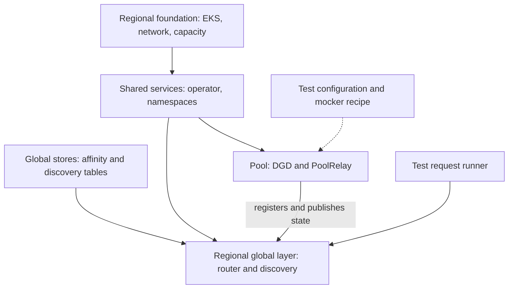

<!--
SPDX-FileCopyrightText: Copyright (c) 2025-2026 NVIDIA CORPORATION & AFFILIATES. All rights reserved.
SPDX-License-Identifier: Apache-2.0
-->
# Global Router infrastructure

Run commands from `examples/global-router/cdk`. This package separates shared infrastructure,
global services, individual serving pools, and test environments into independent deployments.
The current-runtime path uses `global-frontend`, `global-discovery-service`, and the
operator-managed `DynamoPoolRelay`.

| Area | Ownership | Lifecycle |
|---|---|---|
| `lib/foundation/` | Regional VPC/EKS/system capacity; shared operator and namespaces; independently managed GPU capacity | Provision once; change independently of workloads |
| `lib/global/stores.ts` | Two DynamoDB Global Tables and all their regional replicas | One owner stack in the home region; retained durable state |
| `lib/global/` | Regional global frontend, discovery service, IAM and optional internal ingress | Deploy per region, independently of pools |
| `lib/pools/` | One DGD and its PoolRelay | Add, update or remove one serving pool |
| `testing/` | CPU mocker recipes, environment composition, request runners and preserved POC | Tests consume the same global/pool stacks |

A serving pool is a DGD plus its PoolRelay. Node groups and reserved GPU capacity belong
to the foundation and can outlive many pools. Pool stacks take a complete DGD recipe;
they do not assume a mocker, GPU backend, node group, or particular model.



Arrows describe runtime prerequisites, not CloudFormation exports. Deployments use explicit
cluster references and table names, so deploying a pool does not redeploy its cluster or router.
The deployer is responsible for satisfying those prerequisites first.

## DynamoDB setup

Deploy `layer=stores` **once**, in `homeRegion`. It creates both tables and all configured
replicas; do not create a second owner stack in each region.

| Consumer | Partition / sort keys | TTL attribute | Runtime permissions |
|---|---|---|---|
| Global Router affinity | `itemHashKey` / `sortKey` | `expiresAt` | `GetItem`, `PutItem` |
| Global Discovery registrations | `pk` / `sk` | `expires_at` | `DescribeTable`, `Query`, `UpdateItem` |

Both use on-demand billing, eventual cross-region replication, point-in-time recovery,
replica deletion protection and CloudFormation retain policies. The store stack also has
termination protection. The global stack grants separate IRSA identities access only to
the appropriate **local regional table ARN**. Applications do not create tables.

Every global deployment must have a configured local replica. Keep table names and
`affinityScope` identical across a routing fleet. Use separate table names for independent
test environments: the discovery table is not isolated by `affinityScope`. TTL is eventual
cleanup; runtime expiry/lease checks determine validity. This configuration provides soft
affinity, not a cross-region lock or strongly consistent session owner.

## Configure and deploy

```bash
pnpm install --frozen-lockfile
pnpm test
pnpm synth:layer -c layer=stores -c configPath=config/examples/stores.json
```

`config/examples/` contains one configuration per layer. Each has `account`, `stackName`,
and `config`. Copy these to `*.local.json` and replace all example IDs, image tags and
names before deployment. Example chart versions are illustrative: select a tested operator
build with DGD `v1beta1` and PoolRelay `v1alpha1` support, and matching runtime images.
Images must explicitly specify a version tag or digest.

The new entrypoints use the standard CDK bootstrap and deployment roles in every target
account/region. The preserved fleet entrypoints retain their existing asset setup.
When reusing a fleet with a dedicated asset bucket, the layer configuration can set
top-level `fileAssetsBucketName` to that regional bucket. Deployment then uses the caller's
AWS credentials and the existing bucket, matching the preserved fleet entrypoints.
Foundation synthesis also uses CDK's account-specific Availability Zone lookup and needs
AWS credentials or cached context; workload/store examples synthesize without AWS lookups.

Deployment has **three phases**, with independent stacks inside each phase:

| Phase | Deploy in this order | Complete before advancing |
|---|---|---|
| 1. Foundational infrastructure | Regional `foundation`, then `services`; network and serving capacity | Clusters, private routes, operator, CRDs and namespaces ready |
| 2. Global layers | `stores` once in its home region, then regional `global` stacks | Both table replicas active; router and discovery instances healthy; router self-registration enabled |
| 3. Pools | One `pool` stack per DGD + PoolRelay | Relays register pools through discovery into DynamoDB; frontends reachable from all routers |

**Phase 1:** use existing clusters or deploy `layer=foundation` per region. The optional
foundation creates a private EKS cluster, two-AZ VPC, one NAT gateway, system node group,
ALB controller and kubectl provider. Copy outputs into `config.cluster` for later deployments.
Add administrator access, inter-region routing and required compute separately; this path
does not create a bastion, peering mesh or administrator access entry. See
[GPU compute](GPU_COMPUTE.md) for independently managed reserved capacity.
Deploy `layer=services` for the cluster-wide Dynamo operator and retained namespaces, unless
compatible services already exist. Bundled etcd/NATS are disabled. Namespace removal from
configuration does not delete it. Do not install another operator over an existing release.
For an existing operator, set `manageOperator=false` in the services configuration to create
only the new workload namespaces. Upgrade the operator through its existing owner stack;
the new services stack will not create or take ownership of its Helm release or namespace.
Global discovery uses DynamoDB registrations; no cluster federation is installed.

**Phase 2:** deploy `layer=stores` once and wait for both tables and their replicas. Then
deploy `layer=global` in each region. Every router uses `--router-policy affinity` and
`--affinity-store dynamodb`; every discovery service uses `--pool-discovery registrations`
and `--registration-storage dynamodb`, plus `--router-discovery registrations`. Each
router registers its pod endpoint automatically. Other discovery backends are rejected
at synthesis.
Global stacks own their service accounts and optionally an internal ALB ingress restricted
to configured CIDRs. Without a certificate the optional ingress uses HTTP. The router's
`/live` probe permits starting before any pool exists; it does not establish serving readiness.
Pin images containing the router self-registration change described below before deployment.

**Phase 3:** deploy `layer=pool` per serving pool. Set a stable, unique `clusterId` and the
reachable discovery-service URL. Supply `frontendUrls` reachable from every region's routers,
or set `frontendEndpoint.sourceCidrs` to create a pool-owned internal NLB. The stack waits
for the NLB hostname before configuring PoolRelay registration; the endpoint is removed
with that pool. These two endpoint options are mutually exclusive.
PoolRelays
register through the discovery API; discovery writes the shared DynamoDB table. Pools need
no DynamoDB credentials. A custom DGD recipe must enable frontend serving-load publication
(`DYN_SERVING_LOAD_PUBLISH=1`); the stack preserves the supplied recipe.

The three phases do not imply only three CloudFormation stacks. Keeping storage, regional
infrastructure, global services and individual pools independent preserves their lifecycles.

Use the same command shape to inspect and deploy any layer:

```bash
pnpm exec cdk diff --app 'node --require ts-node/register bin/deploy.ts' \
  -c layer=global -c configPath=config/global.local.json
pnpm exec cdk deploy --app 'node --require ts-node/register bin/deploy.ts' \
  -c layer=global -c configPath=config/global.local.json
```

For pool removal, destroy only that pool's stack. It owns neither namespaces nor operator,
node groups, global services, or tables. Stop pool registrations and let their leases expire.
Foundation and shared-services stacks have termination protection;
namespace resources are retained. Retaining the EKS cluster/node group does **not** make
foundation destruction safe: its network, IAM and kubectl provider are shared dependencies.
Decommission foundations only after their consumers are removed.

## DynamoDB discovery and endpoint requirements

Global discovery uses DynamoDB-backed **pool registrations exclusively**. Kubernetes discovery
inside an individual DGD remains local to that pool; it is not the global discovery backend.

DynamoDB records addresses; it does not provide network connectivity. Foundation must supply
private routes/security groups between the relevant regions and reachability for relay/router
state traffic and frontend HTTP. The generated ClusterIP names work only within their own
cluster; do not put a cluster-local Service DNS name in a cross-region `frontendUrls` list.
Use reachable private endpoints and replace every `.invalid` example hostname.

The global Deployment injects each router's pod UID and primary pod IP through the
Downward API. It sets `--router-replica-id <cluster>/<namespace>/<pod-uid>` and
`--router-advertise-url http://<pod-ip>:50051`; GDS uses `--router-discovery registrations`.
New pods register and renew leases in the discovery table. Old pods stop renewing and
expire. No configured router list or per-router load balancer is needed. Set
`podAddressFamily=ipv6` when the target cluster's primary pod addresses are IPv6; the
optional new foundation uses IPv4. Pod addresses must be privately routable between pools
and routers, and security groups must admit TCP 50051 between them.

**Runtime version requirement:** deployment images must include both
[router self-registration PR #18198](https://github.com/ai-dynamo/dynamo/pull/18198) and
[DynamoDB affinity PR #17675](https://github.com/ai-dynamo/dynamo/pull/17675).
Images predating router registration return HTTP 501 or reject the new CLI flags.
Pin frontend, GDS and PoolRelay images containing the required changes.
PoolRelays also need the updated discovery client
that preserves cached membership when a router listing is incomplete. The existing
`pk`/`sk` discovery table and `expires_at` TTL support router records without a third table.
`bash images/build.sh /path/to/integrated-dynamo` builds and checks all three Linux/amd64
images from a clean checkout. See [container build and registry push instructions](images/README.md).
PoolRelay includes rebuilt Python bindings. The build uses
release optimization with LTO disabled and a persistent compiler cache to limit memory
use; record this profile when comparing performance. For a configured remote builder,
set `DOCKER_CONTEXT` and `BUILDX_BUILDER` when invoking the script.
The script downloads and checksum-verifies the pinned Swagger UI archive locally,
then supplies it to Docker as a build context. This avoids a GitHub download during
Rust compilation; update the archive pin together with Dynamo's `.cargo/config.toml`.
Externally managed pool endpoints still require explicit reachable `frontendUrls`; the example
hostnames are placeholders. Managed internal NLBs resolve their own addresses and enable
cross-zone balancing so each NLB zone can reach a pool with one frontend replica.
This app does not provision a complete private routing mesh.

Session affinity, pool registrations and router registrations use DynamoDB. The runtime
defaults to a 20 ms affinity budget, including cold AWS credential retrieval. Set
`affinityTimeoutMs` explicitly for the deployment. The example uses 1000 ms;
tune it against measured latency before performance testing.
The runtime uses leases for membership expiry and retains known routers during incomplete reads;
DynamoDB TTL performs eventual storage cleanup. Offline synthesis checks configuration
and ownership, not live convergence or cross-region reachability.

## Tests and existing deployments

See [testing](testing/README.md) for a two-region mocker environment and request smoke runner.
The runner targets an existing endpoint; it never provisions or deletes infrastructure.

CPU and GPU entrypoints (`bin/dynamo-mocker-cpu.ts`, `bin/cpu-fleet.ts`, `bin/gpu-compute.ts`)
remain available. [Fleet networking](NETWORK_FLEET.md) uses `bin/network-fleet.ts`. The old combined CPU/POC code and charts now live under
`testing/legacy/`; its [original runbook](testing/legacy/README.md) remains available.
`cdk.json` retains its original default app so existing commands do not silently select a new
stack. Select `bin/deploy.ts` or `bin/test-environment.ts` explicitly for new deployments.

For local configurations, replace `multiCluster` with `peerNetworking: { peerCidrs: [...] }`
and the CPU fleet's `mcs` field with `network`. The `exportServices` option is removed.
Global and pool deployments use DynamoDB registrations.

This source cleanup does not migrate CloudFormation ownership of running resources. Keep
existing stack IDs, configuration and entrypoints for those resources. Introduce new stacks
with unused workload names/namespaces; move live ownership only through a separately reviewed
import/retention migration. Never deploy the new stacks over resources still owned by the old
Helm releases. The previous POC router chart is not the current global-frontend runtime.

### Incremental observability

The `observability` layer adds CloudWatch dashboards, alarms, container logs and Prometheus collection to an existing cluster. It does not redeploy foundation, global or pool stacks. See [configuration and metric semantics](lib/observability/README.md) and [example input](config/examples/observability.json).
