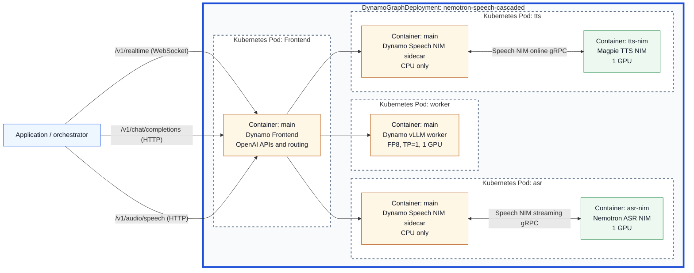

<!--
SPDX-FileCopyrightText: Copyright (c) 2025-2026 NVIDIA CORPORATION & AFFILIATES. All rights reserved.
SPDX-License-Identifier: Apache-2.0
-->

## Nemotron Speech Cascaded Pipeline

Deploy speech recognition, a language model, and speech synthesis behind NVIDIA
Dynamo's OpenAI-compatible APIs. These services provide the model endpoints for
a voice application: transcribe the user's speech, generate a reply, and turn
that reply into audio.

This example includes a Kubernetes deployment and a command-line check for the
speech services. Your application connects the stages and manages conversation
history, turn-taking, and interruptions.

## Components

The deployment creates four pods and uses three GPUs:

| Component | Purpose | Model | GPUs |
| --- | --- | --- | --- |
| Dynamo frontend | Provides the API endpoints and routes requests to each service. | — | 0 |
| Speech recognition (ASR) | Converts English audio into text. | Nemotron ASR Streaming 1.2.0 | 1 |
| Language model (LLM) | Generates text responses using vLLM. | NVIDIA Nemotron 3 Nano 30B A3B FP8 | 1 |
| Speech synthesis (TTS) | Converts text into audio. | Magpie TTS Multilingual 1.8.0 | 1 |

Each speech pod contains a
[NVIDIA Speech NIM](https://docs.nvidia.com/nim/speech/latest/index.html) and a
Dynamo Speech NIM sidecar that connects it to the frontend. The three model pods
share a persistent model cache so they can reuse downloaded model files after a
restart.



The blue border marks the Dynamo deployment, dashed borders mark pods, and
each inner box is a container. Your application runs outside the deployment.

## Deploy on Kubernetes

### Prerequisites

- A Kubernetes cluster with at least three NVIDIA GPUs supported by the selected
  models, and the
  [Dynamo Kubernetes Platform](https://github.com/ai-dynamo/dynamo/blob/main/docs/fern/pages/kubernetes/getting-started/quickstart.mdx)
  installed. The operator must support `nvidia.com/v1beta1` deployments.
- Docker, `kubectl`, and `envsubst` on your workstation, plus a container registry
  that the cluster can access.
- An NGC API key with access to the speech NIM images and a Hugging Face token
  with access to the LLM.
- A ReadWriteMany storage class with capacity for a 200 GiB model cache.
- Python 3.11 or newer in a virtual environment for the validation client.

### 1. Configure the deployment

Run the following commands from the Dynamo repository root. Replace the
placeholders with your Dynamo release tag, registry credentials, and storage
class. The frontend and vLLM images use NVIDIA's official Dynamo repositories.
Choose a release with realtime transcription and streaming speech support:

```bash
export NAMESPACE=voice-agent
export DYNAMO_RUNTIME_VERSION="<dynamo-version>"
export DYNAMO_FRONTEND_IMAGE="nvcr.io/nvidia/ai-dynamo/dynamo-frontend:${DYNAMO_RUNTIME_VERSION}"
export DYNAMO_VLLM_IMAGE="nvcr.io/nvidia/ai-dynamo/vllm-runtime:${DYNAMO_RUNTIME_VERSION}"
export CUSTOM_IMAGE_REGISTRY="<registry-host>"
export CUSTOM_IMAGE_REPOSITORY="<project>"
export DYNAMO_SPEECH_NIM_SIDECAR_IMAGE="${CUSTOM_IMAGE_REGISTRY}/${CUSTOM_IMAGE_REPOSITORY}/dynamo-speech-nim-sidecar:${DYNAMO_RUNTIME_VERSION}"
export CUSTOM_IMAGE_REGISTRY_USER="<username>"
export CUSTOM_IMAGE_REGISTRY_PASSWORD="<password>"
export NGC_API_KEY="<ngc-api-key>"
export HF_TOKEN="<hugging-face-token>"
export RWX_STORAGE_CLASS="<rwx-storage-class>"
```

### 2. Build and push the Dynamo Speech NIM sidecar image

Both speech pods use the same Dynamo Speech NIM sidecar image:

```bash
./examples/nemotron_speech_cascaded_pipeline/container/build.sh
printf '%s' "${CUSTOM_IMAGE_REGISTRY_PASSWORD}" | docker login "${CUSTOM_IMAGE_REGISTRY}" \
  --username "${CUSTOM_IMAGE_REGISTRY_USER}" --password-stdin
docker push "${DYNAMO_SPEECH_NIM_SIDECAR_IMAGE}"
```

### 3. Prepare the namespace, credentials, and storage

Create the namespace and the credentials referenced by the deployment:

```bash
kubectl create namespace "${NAMESPACE}" --dry-run=client -o yaml \
  | kubectl apply -f -

kubectl create secret docker-registry speech-nim-sidecar-image-pull-secret \
  --namespace "${NAMESPACE}" \
  --docker-server "${CUSTOM_IMAGE_REGISTRY}" \
  --docker-username "${CUSTOM_IMAGE_REGISTRY_USER}" \
  --docker-password "${CUSTOM_IMAGE_REGISTRY_PASSWORD}" \
  --dry-run=client -o yaml | kubectl apply -f -

kubectl create secret docker-registry ngc-secret \
  --namespace "${NAMESPACE}" \
  --docker-server nvcr.io \
  --docker-username '$oauthtoken' \
  --docker-password "${NGC_API_KEY}" \
  --dry-run=client -o yaml | kubectl apply -f -

kubectl create secret generic ngc-api \
  --namespace "${NAMESPACE}" \
  --from-literal=NGC_API_KEY="${NGC_API_KEY}" \
  --dry-run=client -o yaml | kubectl apply -f -

kubectl create secret generic hf-token-secret \
  --namespace "${NAMESPACE}" \
  --from-literal=HF_TOKEN="${HF_TOKEN}" \
  --dry-run=client -o yaml | kubectl apply -f -
```

If you override the frontend or vLLM image with a private image, add its registry
credentials to `podTemplate.spec.imagePullSecrets` for the corresponding
`Frontend` or `worker` component in
[the deployment manifest](https://github.com/ai-dynamo/dynamo/blob/main/examples/nemotron_speech_cascaded_pipeline/deploy/agg.yaml).
The speech pods already reference the sidecar and NGC pull secrets.

Create the shared model cache. ReadWriteMany allows the model pods to run on
different nodes:

```bash
kubectl apply --namespace "${NAMESPACE}" -f - <<EOF_CACHE
apiVersion: v1
kind: PersistentVolumeClaim
metadata:
  name: model-cache
spec:
  accessModes:
    - ReadWriteMany
  storageClassName: ${RWX_STORAGE_CLASS}
  resources:
    requests:
      storage: 200Gi
EOF_CACHE
```

### 4. Deploy the services

Apply the deployment with your image references:

```bash
envsubst '${DYNAMO_FRONTEND_IMAGE} ${DYNAMO_VLLM_IMAGE} ${DYNAMO_SPEECH_NIM_SIDECAR_IMAGE}' \
  < examples/nemotron_speech_cascaded_pipeline/deploy/agg.yaml \
  | kubectl apply --namespace "${NAMESPACE}" -f -
```

Watch the pods start. The first run downloads the models and can take several
minutes:

```bash
kubectl get dgd nemotron-speech-cascaded --namespace "${NAMESPACE}"
kubectl get pods --namespace "${NAMESPACE}" \
  --selector nvidia.com/dynamo-graph-deployment-name=nemotron-speech-cascaded --watch
```

Once the four pods appear, stop the watch with `Ctrl-C` and wait for readiness:

```bash
kubectl wait --namespace "${NAMESPACE}" --for=condition=Ready pod \
  --selector nvidia.com/dynamo-graph-deployment-name=nemotron-speech-cascaded \
  --timeout=45m
```

If a pod does not become ready, inspect its events. For a speech-model startup
failure, also inspect the NIM container logs:

```bash
kubectl describe pod --namespace "${NAMESPACE}" \
  --selector nvidia.com/dynamo-graph-deployment-name=nemotron-speech-cascaded
kubectl logs --namespace "${NAMESPACE}" \
  --selector nvidia.com/dynamo-component=asr \
  --container asr-nim --tail=100
```

For TTS logs, use `nvidia.com/dynamo-component=tts` and `--container tts-nim`.

### 5. Connect and validate

Forward the frontend service to your workstation:

```bash
kubectl port-forward --namespace "${NAMESPACE}" \
  service/nemotron-speech-cascaded-frontend 8000:8000
```

Keep this terminal open. The connection is available on localhost; the example
does not configure API authentication.

In a second terminal, from the repository root, activate your Python environment
and run the speech check:

```bash
python3 -m pip install aiohttp
python3 examples/nemotron_speech_cascaded_pipeline/smoke_speech_loop.py
```

The client synthesizes a sentence, sends the resulting audio to speech
recognition, and prints the transcript and response timings. A successful run
finishes without an error and returns a transcript close to
"Dynamo speech streaming is ready." No microphone is required.

Check the language model:

```bash
curl --fail --silent --show-error http://localhost:8000/v1/chat/completions \
  --header 'Content-Type: application/json' \
  --data '{
    "model": "nvidia/nemotron-3-nano",
    "messages": [{"role": "user", "content": "Reply with one short greeting."}],
    "max_tokens": 64,
    "chat_template_kwargs": {"enable_thinking": false}
  }'
```

A successful response contains a greeting in `choices[0].message.content`.

## External Orchestration

Point your voice application at these endpoints through the forwarded frontend:

| Service | Endpoint | Model name |
| --- | --- | --- |
| Speech recognition | `ws://localhost:8000/v1/realtime` | `nemotron-asr-streaming` |
| Language model | `http://localhost:8000/v1/chat/completions` | `nvidia/nemotron-3-nano` |
| Speech synthesis | `http://localhost:8000/v1/audio/speech` | `nvidia/magpie-tts-multilingual` |

The speech endpoints use 24 kHz mono PCM16 audio. For transcription, use a
transcription session and explicitly commit each completed utterance. For speech
synthesis, request `response_format="pcm"` and voice
`Magpie-Multilingual.EN-US.Aria`.

An application such as [Pipecat](https://docs.pipecat.ai/pipecat/learn/pipeline)
can connect recognition, text generation, and playback using clients for these
HTTP and WebSocket endpoints. The application handles conversation history,
turn detection, and interruptions. Application integration and a browser UI are
outside this example's deployment.

## Clean Up

Stop the port-forward with `Ctrl-C`, then remove the deployment to release its
GPUs:

```bash
kubectl delete dgd nemotron-speech-cascaded --namespace "${NAMESPACE}"
```

The model cache and credentials remain in the namespace for reuse.
