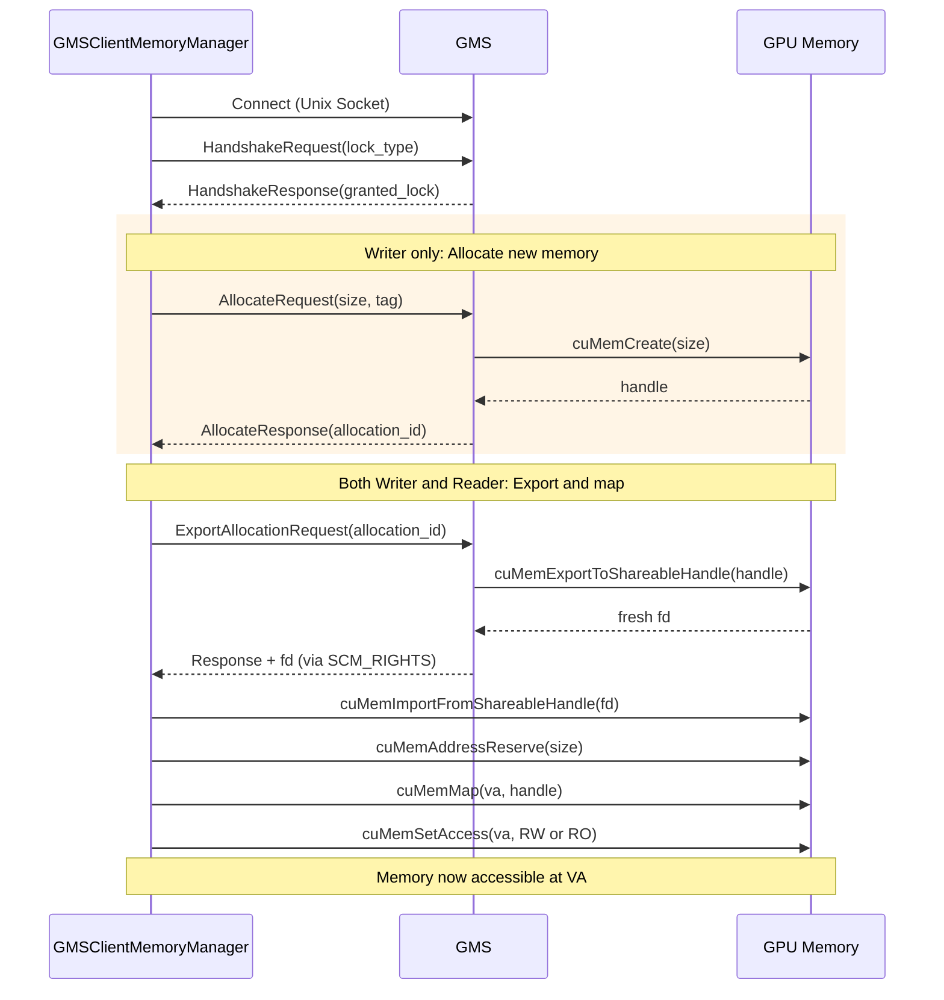
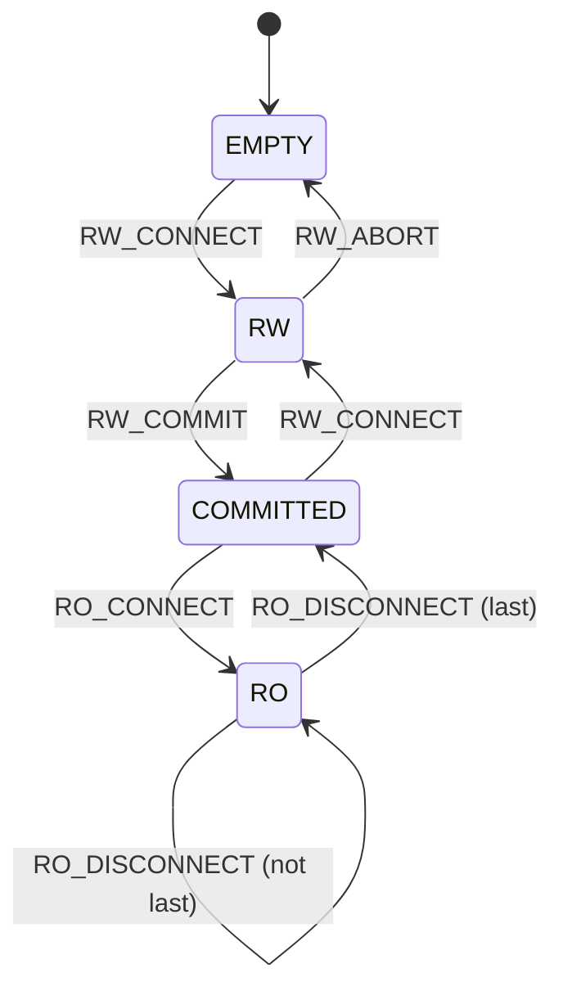
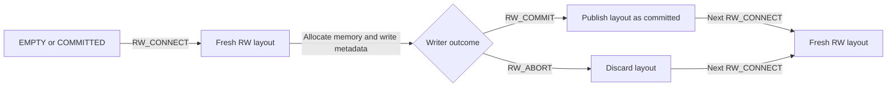
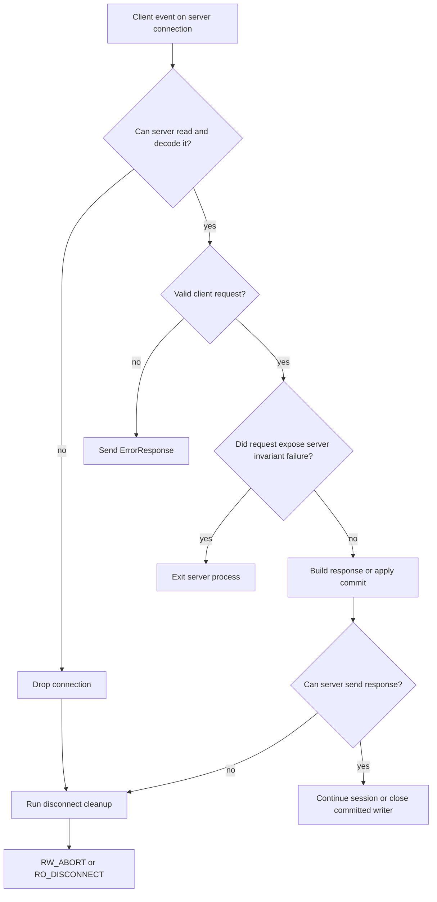
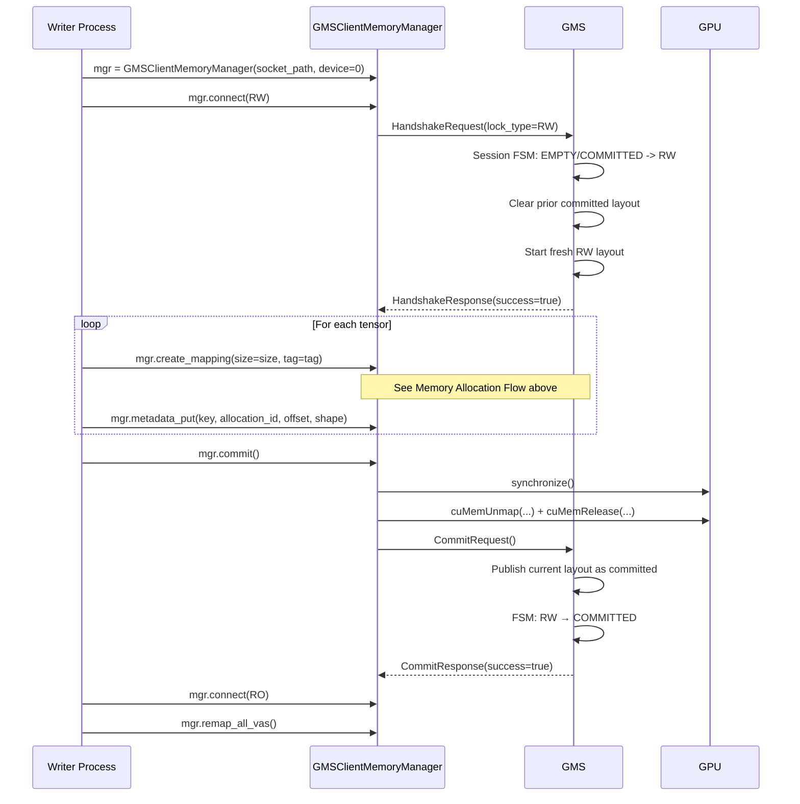
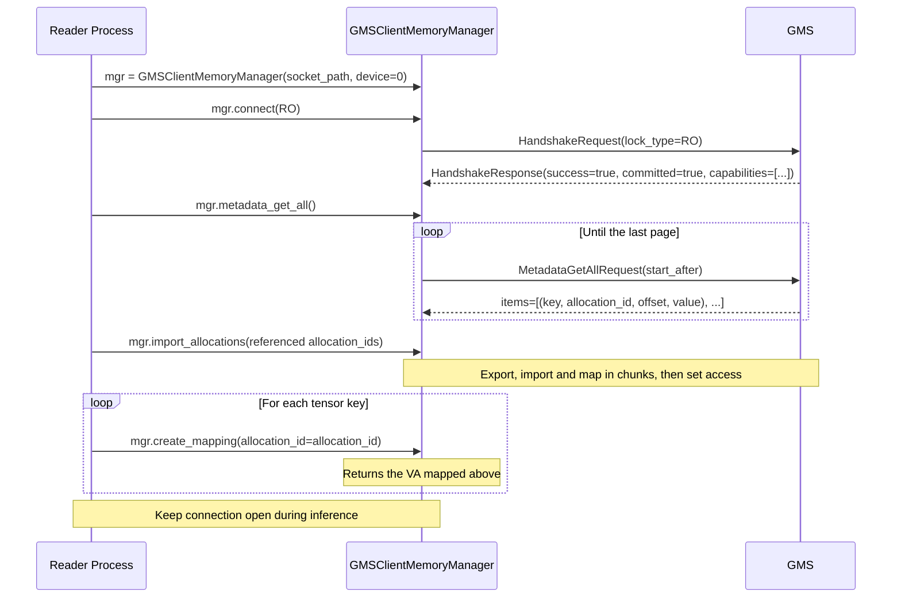
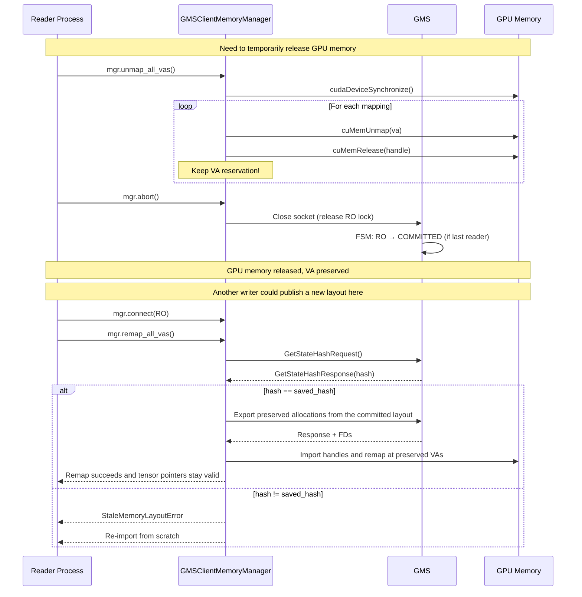

# GPU Memory Service (GMS)

## Overview

The **GPU Memory Service (GMS)** is an out-of-process GPU memory manager that decouples ownership of GPU memory from the processes that use it. This enables:

- **Zero-copy sharing** of GPU memory across multiple processes
- **Data survival** across process crashes
- **Fast model loading** via memory import instead of disk I/O for subsequent workers

GMS provides PyTorch integration via `CUDAPluggableAllocator` and pre-built integrations for inference frameworks like **vLLM** and **SGLang**.

## Problem Statement

In traditional LLM inference deployments, each worker process:
1. Loads model weights from disk/network into GPU memory
2. Owns that GPU memory for the lifetime of the process
3. Cannot share weights with other workers on the same GPU

This leads to:
- **Slow worker startup** (weight loading is I/O bound)
- **Memory waste** (duplicate weights when running multiple workers)
- **No crash resilience** (GPU memory lost when process dies)

## Solution Architecture

```
┌──────────────────────────────────────────────────────────────────────────────────────┐
│                                                                                      │
│  ┌────────────────────┐                  ┌─────────────────────────────────────────┐ │
│  │        GMS         │                  │    GMSClientMemoryManager (Writer)      │ │
│  │                    │                  │                                         │ │
│  │ ┌────────────────┐ │                  │  ┌─────────────────────────────────┐    │ │
│  │ │ Memory Manager │ │ ◄── Unix ───────►│  │         GMS Session             │    │ │
│  │ └────────────────┘ │    Socket        │  └─────────────────────────────────┘    │ │
│  │                    │       +          │                                         │ │
│  │ ┌────────────────┐ │      FD          │  Writer-only: create_mapping, commit    │ │
│  │ │ Session / FSM  │ │  (SCM_RIGHTS)    └─────────────────────────────────────────┘ │
│  │ └────────────────┘ │                                                              │
│  │                    │                  ┌─────────────────────────────────────────┐ │
│  │ ┌────────────────┐ │                  │    GMSClientMemoryManager (Reader)      │ │
│  │ │ Metadata Store │ │                  │                                         │ │
│  │ └────────────────┘ │ ◄── Unix ───────►│  ┌─────────────────────────────────┐    │ │
│  │                    │    Socket        │  │         GMS Session             │    │ │
│  └────────────────────┘       +          │  └─────────────────────────────────┘    │ │
│                              FD          │                                         │ │
│                          (SCM_RIGHTS)    │  Reader-only: create_mapping (import),   │ │
│                                          │               unmap_all_vas, remap      │ │
│                                          └─────────────────────────────────────────┘ │
│                                                                                      │
└──────────────────────────────────────────────────────────────────────────────────────┘
```

## Core Components

GMS follows a client-server architecture where the **server** owns GPU memory allocations and the **clients** map that memory into their own address spaces. The key insight is that the socket connection itself acts as a distributed lock.

### Server

The GMS server runs as an independent process that manages GPU memory without ever mapping it to its own address space. This design allows the server to:

- **Survive GPU driver failures** - no CUDA context means no vulnerability to driver resets
- **Outlive client processes** - memory persists across client crashes
- **Arbitrate access** - enforce single-writer, multiple-reader semantics

The server consists of three main components:

1. **Memory Manager** - Allocates physical GPU memory via CUDA VMM (`cuMemCreate`). It treats shareable file descriptors as ephemeral client connection handles: each export RPC calls `cuMemExportToShareableHandle` lazily and transfers the resulting FD to that client instead of retaining a server-owned FD. Critically, it never calls `cuMemMap` - clients handle all virtual address mapping. Allocation requests retry on OOM until they succeed or the optional retry timeout is reached.

2. **State Machine (FSM)** - Manages global lock state, waiter coordination, and disconnect cleanup.

3. **Metadata Store / Layout State** - `GMS` owns the metadata table and committed layout hash. Allocations and metadata live in one flat store that is cleared on each new writer connect or writer abort.

Each GMS server is responsible for managing memory of only 1 GPU, and does not interact with GMS servers corresponding to other GPUs.

### Client

Clients connect to the server to acquire locks and access GPU memory. The supported client API is:

1. **GMSClientMemoryManager** - High-level client that wraps an internal RPC transport layer and handles all CUDA VMM operations for memory import and mapping safely:
   - Imports file descriptors and converts them to CUDA memory handles
   - Reserves virtual address space and maps physical memory
   - Sets appropriate access permissions (RW for writers, RO for readers)
   - Supports **unmap/remap** for VA-stable memory release under memory pressure

> **Note**: Always use `GMSClientMemoryManager` to interact with GMS from client code. The low-level RPC client is an implementation detail and should not be used directly.

### Memory Allocation and Import Flow

The following diagram shows how `GMSClientMemoryManager` interacts with the server and GPU. **Writers** allocate new memory while **readers** import existing allocations - both flows share the same export/import/map sequence.



---

## State Machine

The server maintains a finite state machine (FSM) that governs lock acquisition and memory access. The state is **derived** from the current connections rather than stored explicitly.

### States and Transitions



### State Descriptions

| State | Description | Can Connect RW | Can Connect RO |
|-------|-------------|:--------------:|:--------------:|
| `EMPTY` | No connections, no committed layout visible | ✓ | ✗ |
| `RW` | Writer connected (exclusive access) | ✗ | ✗ |
| `COMMITTED` | Committed layout visible to readers, no active connections | ✓ | ✓ |
| `RO` | One or more readers connected (shared access) | ✗ | ✓ |

### Events

| Event | Trigger | Description |
|-------|---------|-------------|
| `RW_CONNECT` | Writer connects | Acquires exclusive write lock, clears the previous committed layout immediately, and starts a fresh RW layout build |
| `RW_COMMIT` | Writer calls `commit()` | Publishes the current RW layout as the committed layout and releases the lock |
| `RW_ABORT` | Writer disconnects without commit | Drops the active RW layout and returns to `EMPTY` |
| `RO_CONNECT` | Reader connects | Acquires shared read lock |
| `RO_DISCONNECT` | Reader disconnects | Releases shared lock; if last reader, returns to COMMITTED |

### Lock Semantics

A handshaken socket connection **is** the lock:

- **Crash resilience**: Connection close (including process crash) automatically releases the lock
- **No explicit unlock**: Eliminates forgotten locks and deadlocks
- **Atomic transitions**: State changes happen atomically with socket operations

The only exception is the runtime inspection probes (`GetRuntimeState`, `GetEventHistory`): they connect, fetch diagnostics, and close without entering the lock FSM.

### Layout Lifecycle

Layout creation and publication work like this:



- `RW_CONNECT` starts a fresh RW layout build.
- `RW_COMMIT` publishes the current layout; it does not create another one.
- `RW_ABORT` discards the current RW layout and returns the system to `EMPTY`.
- `RW -> EMPTY` does not require allocating a new layout first; it happens immediately when the writer drops the session before commit.
- There is no RPC that clears the active RW layout while keeping the same writer session alive. To abandon a partially built RW layout, the writer must disconnect or call `abort()`, and any later RW build starts from a fresh `RW_CONNECT`.
- Allocations and metadata live in one flat store that is cleared on `RW_CONNECT` and `RW_ABORT`.
- RO requests are served only from the committed layout, while RW requests mutate only the active layout.
- Read RPCs (`export`, allocation lookup/listing, metadata lookup/listing) operate on that single live store. This is safe because the FSM prevents RW and RO sessions from coexisting.
- `metadata_put` validates allocation ownership and offset bounds, `free` cascades metadata cleanup, and `commit` rejects dangling metadata references.

### Allocation Backpressure on OOM

When a writer requests a new allocation, GMS treats CUDA OOM as a transient condition:

- `cuMemCreate` OOM does **not** immediately fail the request.
- The server retries in a loop and only returns success after allocation is created.
- Server CLI flags:
  - `--alloc-retry-interval` (default `0.5`)
  - `--alloc-retry-timeout` (default unset = wait indefinitely)

This ensures the "new writer gets fresh allocations" workflow can wait for memory reclamation instead of racing into immediate OOM failures.

### Guarantees

- GMS guarantees that its own RPCs do not mix committed and active generations, and that `GMSClientMemoryManager.commit()` performs a CUDA synchronize and unmaps the writer's local mappings before publish.
- After local unmap, `commit()` does not attempt in-process recovery. Non-CUDA failures raise, and CUDA VMM failures exit the process.
- The only non-fatal client connection failure is lock acquisition timeout. Other client-side GMS transport, protocol, and server error responses raise.
- Any non-OOM CUDA VMM failure on either client or server is fatal and exits the process.
- On the server, an untrusted client connection is isolated to that connection: transport loss and response-send failures unwind the connection state, and only server invariant violations or CUDA failures kill the server.
- Runtime-state `allocation_count` and `allocations_cleared` report server-owned allocation handles only. Imported handles in other processes can still keep VRAM alive after the server clears its own layout state.
- GMS *does not* prove that a disconnected or already-submitted writer has no in-flight GPU work left on the device. The mitigation in this design is that new RW layouts use fresh allocations and may wait for memory reclamation before allocation succeeds.

---

### Server Trust Boundary



- `Drop connection` means the server stops trusting that socket and unwinds only that connection's lock state.
- After `RW_COMMIT`, disconnect cleanup only closes the committed writer socket; it does not roll the server back to `RW_ABORT`.
- `Valid client request?` covers mode/state violations, unknown requests, and request validation failures like bad metadata offsets.
- `Did request expose server invariant failure?` covers impossible layout/FSM states and commit-time metadata integrity failures.

## Sequence Diagrams

### Writer Flow (Cold Start)

The first worker loads weights from disk and publishes them to GMS.



### Reader Flow (Warm Start)

Subsequent workers import weights from GMS instead of loading from disk.



The reader imports only the allocations its metadata references. With bulk import off, it skips `import_allocations` and each `create_mapping` imports its allocation as in the Memory Import Flow above. Against a server that does not advertise `metadata_get_all`, `metadata_get_all()` reads with `MetadataListRequest` and one `MetadataGetRequest` per key instead.

### Unmap/Remap Flow (Memory Pressure)

Readers can temporarily release GPU memory while preserving virtual address reservations. This enables "shadow engine" patterns where inactive workers release memory for active ones.



### Auto-Mode (RW_OR_RO)

The `RW_OR_RO` mode automatically selects writer or reader based on server state, simplifying multi-worker deployments.

```mermaid
sequenceDiagram
    participant P as Process
    participant C as GMSClientMemoryManager
    participant S as GMS

    Note over P,S: Auto-mode: try RW only when no committed layout exists

    P->>C: mgr = GMSClientMemoryManager(socket_path, device=0)
    P->>C: mgr.connect(RW_OR_RO)
    C->>S: HandshakeRequest(lock_type=RW_OR_RO)

    alt No committed weights AND no RW holder
        S->>S: Grant RW lock
        S->>S: FSM: EMPTY → RW
        S-->>C: HandshakeResponse(granted=RW, committed=false)
        Note over P: First process - load from disk
    else Weights already committed
        S->>S: Grant RO lock
        S->>S: FSM: COMMITTED → RO
        S-->>C: HandshakeResponse(granted=RO, committed=true)
        Note over P: Subsequent process - import from GMS
    else RW held by another
        S->>S: Wait for current writer to either commit or abort
        alt current writer commits
            S->>S: Grant RO from COMMITTED
            S-->>C: HandshakeResponse(granted=RO, committed=true)
            Note over P: Import published weights
        else current writer aborts
            S->>S: Grant RW from EMPTY
            S-->>C: HandshakeResponse(granted=RW, committed=false)
            Note over P: Previous writer gave up; this process becomes the writer
        end
    end
```

---

## Key Design Decisions

### 1. No VA Mapping on Server

The server never maps memory to virtual addresses (`cuMemMap`). This means:
- **No CUDA context** required on the server
- Server can survive GPU driver resets
- Memory management is fully delegated to clients

### 2. Socket-as-Lock

The socket connection **is** the lock:
- RW lock: Exclusive connection (only one RW at a time)
- RO lock: Shared connection (multiple RO allowed)
- Lock release = socket close (automatic on crash)

Benefits:
- **Crash resilience**: If a reader crashes, its lock is automatically released
- **No explicit unlock**: No forgotten locks or deadlocks

### 3. VA-Stable Unmap/Remap

During `unmap_all_vas()`:
- Physical memory is released (`cuMemUnmap` + `cuMemRelease`)
- VA reservations are **kept** (`cuMemAddressReserve` still valid)

During `remap_all_vas()`:
- Same VAs are reused for mapping
- **Tensor pointers remain valid** (no need to update PyTorch tensors)

### 4. Memory Layout Hash

On commit, the server computes a hash of:
- All allocation layout slots, sizes, aligned sizes, and tags
- All metadata keys, offsets, and values

On `remap_all_vas()`, this hash is checked:
- If match: Safe to remap (layout unchanged)
- If mismatch: Raise `StaleMemoryLayoutError` (must re-import)

The hash is tied to the currently committed layout and is cleared as soon as a writer acquires RW.

**Important**: This detects **structural** changes, not **content** changes.
Weight values can be modified in-place (e.g., RL training updates) as long as the structure is preserved.

---

## Wire Protocol

### Message Format

```
┌──────────────┬────────────────────────────────────────┐
│ Length (4B)  │  msgpack-encoded Message               │
│ big-endian   │                                        │
└──────────────┴────────────────────────────────────────┘
```

### Capabilities

`HandshakeResponse.capabilities` lists the optional requests a server understands beyond the base protocol. Today that is `metadata_get_all` (`MetadataGetAllRequest`, which returns metadata entries under a prefix in key order, one page per round trip).

A server cannot decode a request type it does not know, and it drops the connection, and the client's lock with it, instead of answering. A client must therefore send an optional request only when the handshake advertised it. A server from before the field sends no capabilities, and a client from before the field ignores it.

### FD Passing

File descriptors are passed out-of-band using Unix socket `SCM_RIGHTS`:

```python
# Server side (send FD)
socket.send_fds(sock, [message_bytes], [fd])

# Client side (receive FD)
data, fds, _, _ = socket.recv_fds(sock, bufsize, maxfds=1)
fd = fds[0] if fds else -1
```

---

## API Reference

### GMSClientMemoryManager

The API is organized in two tiers. **Tier 2 (convenience)** is what integrations normally use. **Tier 1 (atomic)** exposes individual operations for advanced callers.

```python
class GMSClientMemoryManager:
    def __init__(
        socket_path: str,
        *,
        device: int = 0,
        bulk_import: Optional[bool] = None,
        fixed_va_window: Optional[Tuple[int, int]] = None,  # (base, size); see "Fixed-VA windows"
    ): ...

    # Properties
    @property granted_lock_type: Optional[GrantedLockType]
    @property is_connected: bool
    @property is_unmapped: bool
    @property total_bytes: int

    # --- Tier 1: Connection ---
    def connect(lock_type: RequestedLockType, timeout_ms: Optional[int] = None) -> None
    def abort() -> None

    # --- Tier 1: Handle ops (server-side, RW only) ---
    def allocate_handle(size: int, tag: str = "default") -> Tuple[str, int]  # Returns allocation_id, layout_slot
    def export_handle(allocation_id: str) -> int                     # Returns FD
    def get_handle_info(allocation_id: str) -> GetAllocationResponse
    def free_handle(allocation_id: str) -> bool
    def commit() -> bool                                             # Sync + unmap local mappings + publish; raises on non-CUDA failure after unmap
    def get_memory_layout_hash() -> str
    def list_handles(tag: Optional[str] = None) -> List[GetAllocationResponse]

    # --- Tier 1: VA ops (local) ---
    def reserve_va(size: int) -> int                                 # Returns VA
    def map_va(fd, va, size, allocation_id, tag) -> int              # Returns handle
    def unmap_va(va: int) -> None                                    # Keeps VA reservation
    def free_va(va: int) -> None                                     # Releases VA reservation

    # --- Tier 1: Metadata ---
    def metadata_put(key: str, allocation_id: str, offset_bytes: int, value: bytes) -> bool
    def metadata_get(key: str) -> Optional[Tuple[str, int, bytes]]
    def metadata_list(prefix: str = "") -> List[str]
    def metadata_get_all(prefix: str = "") -> List[Tuple[str, str, int, bytes]]  # (key, allocation_id, offset_bytes, value), batched when the server supports it
    def metadata_delete(key: str) -> bool

    # --- Tier 2: Convenience ---
    def create_mapping(allocation_id=None, size=0, tag="default") -> int  # Allocate or import
    def import_allocations(allocation_ids: Iterable[str]) -> None    # Import and map many allocations in bulk; all or nothing
    def destroy_mapping(va: int) -> None
    def unmap_all_vas() -> None          # Sync + unmap all, preserve VA reservations
    def remap_all_vas() -> None          # Re-import at preserved VAs (checks layout hash)
    def reallocate_all_handles(tag="default") -> None  # Fresh server handles for preserved VAs
    def close() -> None
```

#### Bulk import

By default, the read-only attach (`materialize_module_from_gms`) and `remap_all_vas()` map allocations in bulk: they export a chunk of up to 256 allocations, import the chunk, map it, and set access once every chunk is mapped. This makes the same driver calls as importing one allocation at a time, without alternating between client and server for each allocation. A bulk import holds up to 256 exported file descriptors at once, fewer when the process is close to its `RLIMIT_NOFILE`, and a failed one leaves nothing mapped.

To import one allocation at a time instead, pass `bulk_import=False` to the constructor or set `DYN_GMS_BULK_IMPORT` to `0`, `false`, `no` or `off` in the engine's environment. The constructor argument takes precedence.

#### Fixed-VA windows

By default the driver picks the address of every mapping, so the same allocation sits at a different address in each process. Pass `fixed_va_window=(base, size)` to put every mapping of a manager inside one address window instead. Off by default; there is no default window, so the caller chooses `base` and `size`.

- The constructor reserves the whole window.
- An imported allocation is mapped at `base` plus the offset of its layout slot, which is the sum of the aligned sizes of the slots before it. Every process that imports the same committed layout maps it at the same addresses, whatever the import order and with bulk import on or off.
- Ranges the manager creates itself (`reserve_va`, a writer's `create_mapping(size=...)`, scratch mappings) are taken from the top of the window down, and released ranges are reused. The two regions never overlap; a range that does not fit raises `RuntimeError`.
- `close()` releases the window, and so does a failed `connect()` while nothing is mapped in it. `close(best_effort=True)` does not.

`base` and `size` must be multiples of the allocation granularity (2 MiB on current NVIDIA GPUs); otherwise the constructor raises `ValueError`. The driver treats `base` as a hint: when any part of the window is already reserved in the process, for example by another manager with the same window, it reserves elsewhere, and the constructor frees that reservation and raises `RuntimeError`. Create these managers before the process launches its first kernel: with HMM addressing (seen with driver 615 on x86), once a process has loaded CUDA modules the driver honors hints only for ranges it has handed out before. `get_or_create_gms_client_memory_manager` and `get_or_create_scratch_manager` take the same argument. Fixed-VA windows are CUDA only; on XPU the constructor raises `NotImplementedError`.

---

## Framework Integration (vLLM / SGLang)

GMS provides pre-built integrations for vLLM and SGLang. Enable GMS by passing `--load-format gms` when launching an engine.

### How It Works

When `--load-format gms` is set:

1. **A GMS server must already be running** for the target GPU device. The engine connects to it via a Unix socket derived from the GPU UUID.
2. The engine uses `RW_OR_RO` mode by default: if no committed layout exists and no writer holds the lock, the first process gets RW and loads weights from disk. If another writer is already active, later clients wait until that writer either commits or aborts; after a commit they get RO to import published weights, and after an abort one of them can become the new RW writer.
3. Both weights and KV cache are managed by GMS, but they use separate tags:
   - `weights`: publish/import flow (`RW_OR_RO`, then `RO` after commit)
   - `kv_cache`: separate RW-only tag for mutable KV-cache memory

#### vLLM

```bash
python -m dynamo.vllm \
  --model <model> \
  --load-format gms \
  --worker-cls gpu_memory_service.integrations.vllm.worker:GMSWorker \
  --enable-sleep-mode \
  --gpu-memory-utilization 0.9
```

The integration uses a custom worker class (`GMSWorker`) that:
- Establishes the GMS connection early in `init_device()` so vLLM's `MemorySnapshot` can account for committed weights
- Registers a custom model loader (`GMSModelLoader`) for the `gms` load format
- Patches `torch.cuda.empty_cache` to avoid releasing GMS-managed memory
- Uses two GMS tags on the GPU:
  - `weights`: normal publish/import flow (`RW_OR_RO`, then `RO` after commit)
  - `kv_cache`: separate RW-only tag for mutable KV-cache memory
- Routes both weight and KV-cache allocation through a `CUDAPluggableAllocator` backed by the appropriate GMS tag

#### SGLang

```bash
python -m dynamo.sglang \
  --model-path <model> \
  --load-format gms \
  --enable-memory-saver \
  --mem-fraction-static 0.9
```

The integration patches `torch_memory_saver` to route both weight and KV-cache operations through GMS:
- Weights (`"weights"`) use the `weights` GMS tag
- KV cache (`"kv_cache"`) uses a separate RW-only `kv_cache` GMS tag
- Other tags are not supported in GMS mode
- The `--enable-memory-saver` flag is required to activate the memory saver pathway

### Shadow Engine Failover (Pause / Resume)

Both integrations support releasing and reclaiming GPU memory for shadow engine patterns. The API names differ by framework:

- **vLLM**: `sleep` / `wake_up` (via `/engine/control/sleep` and `/engine/control/wake_up` HTTP endpoints)
- **SGLang**: `release_memory_occupation` / `resume_memory_occupation` (via the corresponding HTTP endpoints)

Under the hood, pausing calls `unmap_all_vas()` + `abort()` to release GPU memory while preserving VA reservations. Resuming is tag-specific:

- **weights**: `connect(RO)` + `remap_all_vas()`
- **kv_cache**: `connect(RW)` + `reallocate_all_handles("kv_cache")` + `remap_all_vas()`

Tensor pointers remain valid because the original virtual addresses are preserved.

This enables a shadow engine to release its GPU memory, let a primary engine use the GPU, and then reclaim the memory after the primary is killed. The mutable KV cache always moves through a fresh RW layout in its own GMS tag before it is reallocated.

### Configuration via `model_loader_extra_config`

To force read-only mode (import only, never load from disk), pass `gms_read_only` via the framework's `--model-loader-extra-config` flag:

```bash
--model-loader-extra-config '{"gms_read_only": true}'
```

This forces `RO` lock mode instead of the default `RW_OR_RO` auto-detection. The engine will only import existing committed weights and fail if none are available.

To bound how long a restored engine waits for the published weights layout before remapping, pass `gms_ro_connect_timeout_ms`:

```bash
--model-loader-extra-config '{"gms_ro_connect_timeout_ms": 300000}'
```

The default is `null`, which waits indefinitely. Set an integer value to fail after that many milliseconds.

To map every allocation of a tag at a fixed address, pass `gms_fixed_va_windows`: a `[base, size]` window in bytes per tag (integers or `"0x..."` strings, both multiples of the device's VMM granularity):

```bash
--model-loader-extra-config '{"gms_fixed_va_windows": {"weights": ["0x420000000000", 549755813888], "kv_cache": ["0x4a0000000000", 274877906944]}}'
```

Each tag's manager is created with that window (see [Fixed-VA windows](#fixed-va-windows)), so an attached allocation has the same address in every engine, and device pointers recorded by one engine (for example in CUDA graphs) are valid in another. Only the vLLM worker reads the option. With scratch KV (shadow mode), the `kv_cache` window is reserved when the worker initializes its device, before any kernel runs; without scratch KV it is reserved when the KV cache is created, which the driver may not honor.

### CUDA Graph Archive (vLLM)

`dynamo.vllm --gms-graph-archive DIR` lets shadow engines keep a [Foundry](https://github.com/foundry-org/foundry) CUDA-graph archive in `DIR`, a directory shared by the engine containers of one failover pod (for example a pod-local `emptyDir` mounted into both). A replacement shadow then rebuilds its graphs from the archive instead of capturing each size next to the engine that is serving. It needs a Foundry build with the vLLM plugin (the `foundry` entry point in `vllm.general_plugins`), which also writes the completion and refusal records named below; `dynamo.vllm` refuses the flag without it. `integrations/vllm/graph_archive.py` decides per engine:

| Engine | Mode |
|---|---|
| Attaches read-only, no archive yet, none saved before for this identity | **save**: Foundry captures and writes the graphs to `DIR/.staging/<key>.<token>/`; once the engine started and every rank finished, the directory is renamed to `DIR/<key>/` |
| Any engine, archive committed for its identity | **load**: Foundry rebuilds the graphs from `DIR/<key>/` |
| May write the weights (the first engine) and no archive yet, or another engine is saving, or the archive was set aside | **native** capture, Foundry off |

- The key is a digest of the engine arguments that decide which graphs exist, the GMS loader options, the Foundry settings, the package versions and the ranks. It only names the directory: Foundry's own identity check at load is what refuses a mismatched archive.
- An archive Foundry refuses is set aside: Foundry writes `rank_<r>/load_refused.json` when a rank refuses to load and `rank_<r>/save_refused.json` when it refuses to save, and the engine fails to start. A record, `DIR/.quarantine/<key>.<token>/reason.json`, holds each refusing rank's reason and the engine's error; later engines capture natively, and no new save is attempted for that identity. A refused save's staging directory becomes that `.quarantine` directory. A committed archive stays in place, because another engine may be loading it.
- A start in load or save mode that fails without a refusal (or an engine that dies while loading or saving) keeps the archive, since the failure may have nothing to do with it; a failed save's partial directory is dropped so the next engine saves again. After 3 such failures in a row the archive is set aside anyway, with the list of failures in `reason.json`, so a crash loop does not retry it forever. The count is kept in `DIR/.failures/` and reset by any engine that starts in load or save mode; an engine found dead by an engine whose own load then succeeds died before that start and is not counted.
- A set-aside lasts as long as the directory, so with the operator's `emptyDir` until the pod is recreated. To start over in a directory you manage, delete `DIR/<key>/` and `DIR/.quarantine/<key>.*`.
- Archive engines attach read-only, with load diff (`gms_reconstruction_mode: "load_diff"`) and fixed-VA windows (`gms_fixed_va_windows`; by default below Foundry's default region at `0x600000000000`: weights `0x420000000000` + 512 GiB, KV cache `0x4a0000000000` + 256 GiB). An archive engine that is granted the write lock instead (no published weights, e.g. after a GMS server restart) refuses to start, and its next start captures natively, so it can publish the weights. The same applies to an engine that may write the weights and dies while loading.
- Engines coordinate through `flock` on files in `DIR`, so `DIR` must be writable and on a filesystem whose locks the engine containers share (an `emptyDir` is), and the engines must run as the same user, because the lock files are created for their owner only. An engine that cannot write `DIR` or open its lock files captures natively. Engines in different pods do not share a pod-local `DIR`, so each pod keeps its own archive.
- Archive engines run with torch.compile off and, with tensor parallelism, vLLM's custom all-reduce off; the serving engine needs the same arguments as its shadows. The effect of that on steady-state throughput has not been measured.

#### Foundry Settings for GLM-5.2

`--gms-graph-archive-config` is one Foundry TOML for every engine, so SAVE and LOAD always use the same switches (Foundry refuses a LOAD whose switches differ from the SAVE). Measured with GLM-5.2 NVFP4, TP4 + expert parallelism, on 4 GB200 GPUs, vLLM 0.33, through `dynamo.vllm` (time from engine start to a parked shadow; each value is one start):

| Foundry switches | SAVE | LOAD | Native read-only shadow |
|---|---|---|---|
| defaults | 103.4 s, 106.4 s | 85.2 s, 87.2 s | 87.3 s, 89.3 s |
| `skip_cudagraph_memory_profile = true` | 92.6 s | **76.2 s** | (no Foundry) |

- **Set `skip_cudagraph_memory_profile = true`.** At Foundry's defaults a loading engine still runs the CUDA-graph memory estimate, and LOAD is only about 2 s faster than native capture. With the switch, LOAD parks 11–13 s sooner than a native shadow; vLLM's engine initialization takes 11.8 s instead of 24.6–25.0 s. It needs `--num-gpu-blocks-override`, which `--gms-graph-archive` requires anyway.
- **Keep `skip_capture_warmup` off (the default) for GLM-5.2.** Without the warm-up forwards, the sparse-attention indexer allocates about 124 MiB lazily inside a graph break during capture, and Foundry refuses the SAVE (`changed the allocator state while capturing`) on every rank. The archive is then set aside and every shadow captures natively.

Example:

```toml
base_addr = 0x600000000000
region_size = "512GB"
scratch_space_size = "2GB"
skip_cudagraph_memory_profile = true
```
