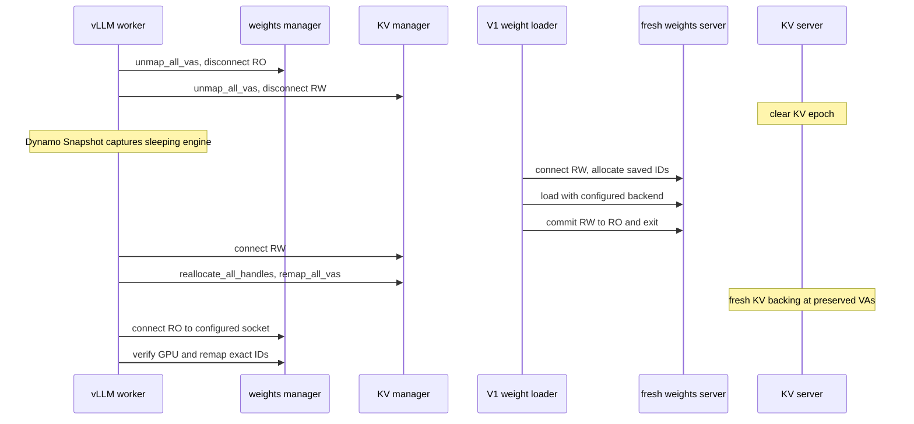

<!--
SPDX-FileCopyrightText: Copyright (c) 2026 NVIDIA CORPORATION & AFFILIATES. All rights reserved.
SPDX-License-Identifier: Apache-2.0
-->

# GPU Memory Service V1

GMS V1 is an experimental, rank-local memory owner for engines restored by
Dynamo Snapshot. It is fail-stop: errors terminate the worker rather than
retrying, rolling back, falling back to native allocation, or continuing after
a partial wake.

## Snapshot assumptions

Dynamo Snapshot captures only after whole-engine GMS sleep. Restore preserves:

- the same Python and Torch process state;
- the same TensorImpls and post-partition StorageImpl graph;
- tensor layouts;
- GMS allocation IDs; and
- CUDA virtual-address reservations.

Model construction, model loading, and non-Parameter storage copy-out do not
run again after restore. Default-allocator copies are ordinary process-owned
Snapshot state.

Committed weight allocations can be saved as raw shards before Snapshot
capture and loaded under the same allocation IDs in a fresh rank-local V1
server. The restored process then imports those allocations at its preserved
virtual addresses.

KV TensorImpls, mapping records, allocation IDs, sizes, and VA reservations also
survive. KV physical backing and contents do not. Wake creates fresh backing
under the saved IDs and maps it at the preserved VAs before vLLM prepares the
cache for use.

## Ownership

`GMSV1Worker._maybe_get_memory_pool_context(tag)` is the vLLM routing seam.
vLLM calls its allocation-scope labels tags. V1 maps the recognized `weights`
and `kv_cache` tags to isolated GMS domains owned by one
`GMSV1SleepModeBackend`; every other tag follows vLLM's normal implementation.

```text
GMSV1Worker
  _maybe_get_memory_pool_context(tag)
    -> GMSV1SleepModeBackend
         owns one CUDAPluggableAllocator
         owns temporary weights MemPool + long-lived KV MemPool
         owns two GMSClientMemoryManager instances
              weights -> weights.sock
              kv      -> kv_cache.sock

sidecar per rank:
  weights.sock  -> GMSServerMemoryManager + independent allocations and sessions
  kv_cache.sock -> GMSServerMemoryManager + independent allocations and sessions
```

The pluggable allocator outlives both MemPools. Allocation callbacks route by
the active domain. Free callbacks route by VA ownership because Torch can free
outside the context that allocated the storage. C free callbacks cannot
reliably propagate Python exceptions, so the backend latches and surfaces the
first callback failure.

V1 reuses the existing
`gpu_memory_service.client.torch.extensions._allocator_ext` native shim
unchanged and permits one V1 allocator/backend owner per process. The default
V0 and `DYN_GMS_USE_V1=true` launch profiles are mutually exclusive. Mixed
initialization is unsupported by contract and prevented by launch/process
topology; no runtime cross-profile arbitration is provided or needed.

Both client domains use the same `GMSClientMemoryManager` class and the same
V0-style operations:

| Operation | Purpose |
|---|---|
| `connect` / `disconnect` | Acquire or release the socket lease |
| `create_mapping` / `destroy_mapping` | Own one server allocation and local VA |
| `commit` | Change the same weights socket and mappings from RW to RO |
| `unmap_all_vas` | Drop imported handles but preserve IDs, sizes, and VAs |
| `reallocate_all_handles` | Recreate ephemeral server backing under saved IDs |
| `remap_all_vas` | Install server backing at saved VAs |
| `close` | Release local mappings and the socket |

Each Unix-domain socket is its lease. A writer excludes all other sessions.
Committed weights can have shared readers. Waiting writers have priority over
new readers. A same-socket commit changes RW to RO atomically. Disconnecting an
uncommitted writer clears its complete allocation epoch before another writer
is admitted. Reader disconnect only releases that reader.

The server retains allocation IDs, aligned sizes, and CUDA handles rather than
persistent export FDs. Each export
creates a transient FD, transfers it with `SCM_RIGHTS`, and closes the server
copy. Client import consumes and closes the received copy. The wire protocol is
a small typed `msgspec.Struct` MessagePack protocol; there is no JSON
compatibility path.

## Checkpoint control

After the engine has slept and both GMS domains are quiescent, an external
controller calls `prepare`. The sidecar atomically requires committed weights
with retained allocations and an empty, uncommitted KV-cache domain, then
fences new admission across both domain sockets. A handshake that races the
fence is rejected under V1's fail-stop contract.

The fence has no expiry. `abort` and `complete` require the active opaque token
and are retry-safe for the same resolution. Because control calls are one-shot,
a replacement controller can call `state` to recover the active token before
explicitly aborting or completing the checkpoint. Access to the mode-`0600`
rank-local socket is the control-plane trust boundary.

## Cold weight storage

GMS saves weight bytes before Snapshot captures the sleeping engine. A size
check cannot detect a shard that changes on disk without changing size. New
checkpoints record a BLAKE3 digest for each shard and verify the bytes during
restore. A mismatch stops the restore before the worker uses those weights.

| Weight-artifact version | Integrity check | Restore behavior |
| --- | --- | --- |
| 2 (new checkpoints) | BLAKE3 for each shard | Rejects missing, truncated, or changed shards, including same-size changes. |
| 1 (legacy checkpoints) | No content digest | Still loads after structural checks, with a warning that same-size corruption cannot be detected. |

The weight-artifact version is independent of the GMS protocol version.
Recapture a version-1 checkpoint with the current saver to add digests: hashing
an old shard now cannot prove what it contained when it was captured.

With `DYN_GMS_USE_V1=true`, the saver reads committed allocation IDs and sizes
from the rank-local `weights` socket, temporarily imports the allocations, and
writes raw shards through the shared snapshot disk writer. It hashes bytes as
they pass through host memory, without rereading the saved files. The manifest
records each allocation's ID, aligned size, shard path, and offset, plus the
size and digest of every shard. By default, paths are relative to the device
artifact directory. `--sharded-ssd-roots` distributes files across per-device
roots using the V0 layout and records absolute paths.

On restore, the loader validates the manifest and shard layout, including the
required digests for version 2. Missing or invalid digests fail the load;
they do not silently fall back to version-1 behavior. The loader requests
`RW_OR_RO` on the `weights` socket. If weights are already committed, it gets
RO and returns without another transfer. Otherwise, it gets RW, recreates the
saved allocation IDs and sizes, and transfers the shards. Backend selection
uses `snapshot.transfer.create_transfer_backend` and the existing V0
configuration:

| Transfer backend | How it verifies the recorded digest |
| --- | --- |
| `nixl` and `sharded-ssd` | Hash the same bytes being copied through pinned host memory, with no extra storage read. |
| `nixl-gds` | Read and verify each shard before direct transfer, because GDS has no CPU-visible staging buffer. Keep files unchanged between verification and transfer. |

After transfer and verification succeed, the loader synchronizes, releases its
temporary mappings, commits the socket from RW to RO, and closes its lease.
The loader process stays running so Kubernetes does not restart the container.
The server keeps the committed backing while the restored worker reconnects RO
and remaps the preserved virtual addresses.

## Weight construction

V1 uses vLLM's normal model loader inside its broad weights allocation scope:

1. Connect `weights` RW and enter the temporary GMS weights MemPool.
2. Run model construction, loading, quantization, and post-load transforms.
3. Leave the GMS MemPool.
4. Copy live non-Parameter tensors from GMS storage to Torch's default
   allocator while preserving TensorImpl identity and non-Parameter aliases.
5. Synchronize CUDA.
6. Destroy the temporary weights MemPool, releasing cached and unreferenced
   blocks through the allocator free callback.
7. Surface any allocator callback failure.
8. Protect surviving Parameter mappings RO and commit the same socket RW to RO.

Destroying the MemPool is V1's pruning operation; it does not free allocations
still owned by live Parameter storage. The free callbacks remove only mappings
for blocks that are no longer retained, leaving the Parameter-backed allocation
set to commit.

The storage copy operates on each overlapping connected component of bounding
storage byte ranges, not on an entire StorageImpl and not once per tensor.
Relative aliases and offsets inside a copied component are preserved. Disjoint
components get separate storage. Absolute non-empty storage offsets may be
rebased. Mixed Parameter/non-Parameter aliasing is deliberately severed.

See `client/parameter_storage.py` for the detailed before/after diagram and
implementation.

The commit log reports Parameter span bytes, retained aligned GMS bytes,
uncovered retained bytes and ratio, copied-out bytes, and retained allocation
count.

## Sleep and wake



Suspend order is weights then KV so the exclusive KV lease remains held until
local weight memory is asleep. Resume order is KV then weights.

Every connection verifies the physical GPU identity. GMS device N, the pod's
N-th GPU, selects both the device-local socket and the `device-<N>` artifact
directory; a predecessor server identity is not persisted. V1 does not
reconstruct models, retain KV contents, scan raw mappings, validate
model-specific layouts, or implement SGLang integration.

## Running V1

Start one V1 process per GPU:

```text
DYN_GMS_USE_V1=true python3 -m gpu_memory_service.cli.server
```

The supervisor reads the GPUs from `/proc/driver/nvidia/gpus` without starting
CUDA and serves GMS device N from the N-th GPU in PCI bus order, the order
engines see with `CUDA_DEVICE_ORDER=PCI_BUS_ID`. Each device's process is pinned
to its GPU with `CUDA_VISIBLE_DEVICES`. To start one device's server directly:

```text
DYN_GMS_USE_V1=true gpu-memory-service --device 0
```

Save or load every visible device (pass `--device N` for one GPU). Artifacts
land under `<checkpoint-dir>/device-<N>`:

```text
DYN_GMS_USE_V1=true python -m gpu_memory_service.cli.snapshot.saver \
  --checkpoint-dir /checkpoints/run/versions/1
DYN_GMS_USE_V1=true python -m gpu_memory_service.cli.snapshot.loader \
  --checkpoint-dir /checkpoints/run/versions/1 \
  --transfer-backend nixl-gds
DYN_GMS_USE_V1=true python3 -m gpu_memory_service.cli.server --enable-loader \
  --checkpoint-dir /checkpoints/run/versions/1 \
  --transfer-backend nixl-gds
```

With `--enable-loader`, each device's server process loads its weights in a
thread and keeps serving.

The loader also accepts `nixl` and `sharded-ssd`, the existing sharded SSD root
and queue flags, and repeatable `--posix-backend-param KEY=VALUE` overrides.
Start the restored worker with `GMS_SOCKET_DIR`. Only the `weights` socket is
used by artifact transfer. `--enable-loader` must come last among server flags.

The operator injects `DYN_GMS_USE_V1=true` on snapshot-coupled GMS pods.
Dynamo vLLM and SGLang backends select the V1 client from that env; no extra
CLI flag is required. vLLM keeps its normal load format and uses
`GMSV1Worker`. SGLang enables `--enable-memory-saver` (a real SGLang
ServerArgs field) from the same env.
