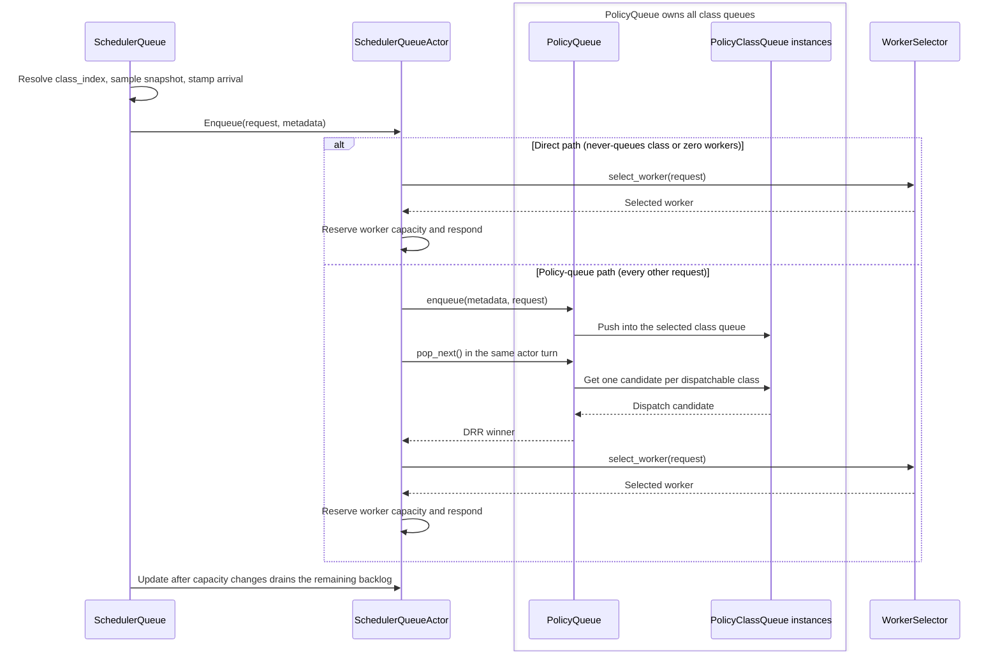

# lib/kv-router/src/scheduling

Scheduling decides whether a request can run now, which worker should receive it, and how its load is recorded while it runs.

## Queue hierarchy

There is one `SchedulerQueueActor` per scheduler. It owns one outer `PolicyQueue`, which owns one `PolicyClassQueue` for every class in the resolved profile.



- `SchedulerQueue` is the public handle. It resolves the class index, samples the
  cache-overlap snapshot, and stamps the arrival offset on the caller task before
  sending the Enqueue command.
- `SchedulerQueueActor` routes every request through the policy queue and drains the
  ready backlog in the same actor turn, so freed capacity can go to another class's
  queued head under DRR rather than to the arriving request. The direct path remains
  only for classes that can never hold a queued entry (any zero per-worker limit) and
  for zero-discovered-worker windows, which surface `NoEndpoints` from selection.
- `PolicyQueue` does not classify requests. It owns all class queues and uses deficit round robin (DRR) to give each class weighted turns.
- Each `PolicyClassQueue` owns ordering and accounting for one class such as `latency`, `agents`, or `batch`.
- An EDF class, the default, orders by due time and then enqueue sequence; strict
  priority and priority jumps do not reorder it. The due time is the classifier's explicit
  deadline, else router ingress plus the final class's `slo_ttft_ms` (resolved once before
  the actor), else absent, which sorts after every finite due time.
- FCFS/LCFS/WSPT classes keep their order: within one strict-priority tier, entries with
  an explicit deadline order earliest-due-first ahead of the rest before the policy score
  applies. Class due times never enter their order.
- Only explicit deadlines enter the deadline index and its conditional actor timer, which
  rejects expired entries. Class due times order EDF but never expire. All deadline math
  uses `tokio::time::Instant` so paused-clock tests stay coherent.
- `SchedulerQueueActor::admit_one` performs final worker selection and reserves worker capacity after either path.
- A single-class profile still uses `PolicyQueue`, but DRR has no cross-class effect.

## Per-class ready storage

`PolicyQueueEntry<T>` is one queued payload plus its class index, immutable dispatch order (due time, policy score, enqueue sequence, strict priority), resolved due time, and token/accounting snapshot. In production, `T` is `QueuedRequest`, which wraps the `SchedulingRequest`, enqueue timestamp, and optional block hashes.

```text
PolicyClassQueue("agents")
└── pending: BTreeSet<PolicyQueueEntry>                   # one dispatch order per class
PolicyQueue
└── deadlines: BTreeMap<(Instant, seq), QueueEntryHandle>  # explicit deadlines only
```

- `pending` holds every queued request of the class in one dispatch order, pinned or not. Worker constraints (exact pins, DP ranks, allow-lists) stay on the request; `PolicyQueue` never reads them and keeps no per-worker queues or indexes.
- A `PolicyClassQueue` does not own worker configuration, capacity, or scoring state. The actor's dispatch gate checks the class head against the workers its constraints allow (only the pinned rank for a pinned request), and worker selection enforces the same constraints after the head dispatches. A pinned request is never routed to another worker.
- The class's last entry dispatches first. An ordered tree, not a heap or hash map, gives worst-case O(log n) insert, dispatch, and removal of a known entry, with no rebuild, scan, or deferred cleanup.
- `enqueue` returns a `QueueEntryHandle` naming the entry's class and order. Enqueue sequences are never reused, so a stale handle matches nothing. The actor keeps the handle in the pending lifecycle state and cancels exactly that entry; a request ID could also name a later attempt. `retain` is a bulk O(n + k log n) operation, not cancellation.
- `PolicyClassQueue::dispatchable_head_cost` checks only the class head, once per `pop_next`. No blocked state is cached, so a capacity hint only wakes the actor; the next drain reads every head again.
- `round_cursor` marks which class receives the next weighted turn. `carry_class` lets a class spend its unused share before that turn, but only if `dispatchable_head_cost` confirms that its head can run.
- Head-of-line blocking is class-wide. A blocked head, such as a request pinned to a full worker, holds every later entry of its class, including requests another worker could serve now; other classes keep competing under DRR. Do not add per-worker subqueues or a scan past the head to bypass it.

## Guardrails

- A request ID identifies at most one active scheduler booking. Duplicate adds
  conflict regardless of the target worker. A serialized migration retry may
  reuse the ID only after the previous booking has been released.
- Before an unpinned retry, exclude every worker already failed by that migration state machine. Preserve caller allowlists and routing constraints. An affinity-derived pin may be invalidated and rebound; an explicit request pin remains exact.
- A failed stream releases its scheduler booking before the error reaches the retry manager. This ordering prevents a later attempt from overlapping stale cleanup.
- Cleanup that can outlive an admitted request attempt must carry its internal `AttemptId`. `RequestGuard` fences scheduler mutations with `(request_id, attempt_id)`. Until handoff, the admission lifecycle lease names its queued entry by `QueueEntryHandle` and its booking by `(request_id, worker, attempt_id)`.
- `SchedulerQueueActor::admit_one` is the required admission path: compute projected
  load, select a worker, skip the capacity reservation if the response receiver
  is closed, then reserve capacity before responding. Failed response delivery
  must release that capacity. Do not bypass this for normal scheduling.
- Do not remove or weaken `admission_gate` without proving selection and
  capacity reservation cannot assign more work than the workers can hold.
- Potential-load projection must go through
  `ActiveSequencesMultiWorker::potential_blocks_and_tokens_at(...)` with
  `SchedulingRequest::prefill_token_deltas()`. Do not scan per-worker
  `ActiveSequences` directly from scheduling.
- `SchedulingRequest` helper methods are the single source for effective
  cached tokens, effective overlap, worker allowance, prefill-token defaults,
  and request block count. Do not duplicate this logic in policies or selectors.
- Weighted shortest processing time (WSPT) must use cache-aware prefill cost: pinned requests use the pinned worker's
  effective cached tokens; unpinned requests use the best allowed worker. Do not
  silently fall back to raw input sequence length (ISL) unless tracking is disabled or cache data is
  absent.
- Pinned-worker and allowed-worker constraints must be validated before
  selection and respected by queue capacity checks, selector candidate
  iteration, and WSPT priority.
- Prefill load hints are computed at scheduler/request boundaries from
  selected-worker `cached_tokens`. Do not move ISL/cache-token math back into
  `ActiveSequences`.
- Selectors should be side-effect free: no capacity reservation, no queue mutation, and no
  `PromptRegistry` mutation.
- Do not hold the pending-queue lock while selecting, reading worker capacity,
  responding, or awaiting. The policy queue is only for waiting requests.
- Do not hold `workers_with_configs.borrow()` across `.await`; take a short
  synchronous snapshot or borrow for selection only.
- Any change to queue ordering, WSPT keys, capacity checks, admission
  serialization, or selector scoring should include focused tests and
  before/after routing or queue benchmarks.
- Keep text and external IDs such as request IDs on standard hash collections.
  Use `FxHashMap` / `FxHashSet` for internal numeric hot-path keys only.

## Public Worker-Selection API

The `plugins::worker_selection` module contains the public Rust contract for custom worker filters, scorers, and pickers. Treat each public item as a versioned external API.

- Do not add a public field, accessor, input group, type, or re-export unless the task explicitly requires a new external policy capability.
- An internal need in the default scorer, logging, tests, or SelectionService does not justify a public API addition.
- Trace a proposed value to its source before you expose it. Record whether it is raw state, a derived estimate, or an intermediate in Dynamo's default formula.
- Expose raw facts or complete user-facing abstractions. Do not expose partial credit, weighted overlap, legacy arithmetic, or another intermediate whose meaning depends on the default policy.
- Keep struct fields private. Add the narrowest accessor that supports the approved use case.
- When a protocol context is projected into a worker-selection type, destructure the source without `..` and handle every field explicitly. Map only approved policy fields. Bind each field that stays internal by name and explain why. A new source field must cause a compile error until its policy meaning, cost, documentation, and contract test are reviewed.
- Return `Option` for absent data. Do not replace absence with a sentinel value.
- Document the source, units, lifetime, staleness, missing-data behavior, weighting, and clamping for each public value.
- Require callers to name each `WorkerInputs` group that they use. Do not add a public `ALL` shortcut.
- Before you add a value to an existing input group, account for its calculation and retained-column cost for every policy that requests that group.
- Do not pass the full `SchedulingRequest`, worker maps, router configuration internals, default-score weights, or host-owned eligibility and reservation state to custom policies.
- The builtin default policy lives in `lib/router-plugins/builtin` and uses only the public policy API. Keep the reference selector test/benchmark-only. Plugins own their score calculation and worker choice.
- Keep eligibility, picker-row validation, accounting, and reservation in the host path.

Before each public API addition:

1. Search all accessors, re-exports, documentation, examples, and external-looking call sites.
2. Add one focused contract test that uses the new value through `WorkerFilter`, `WorkerScorer`, or `WorkerPicker`.
3. Update `docs/fern/pages/developer-guide/knowledge-base/modular-components/router/custom-worker-selection.mdx` and one canonical example.
4. If the signal adds work, storage, allocation, or another scan to the selection path, run the worker-selection benchmark.
