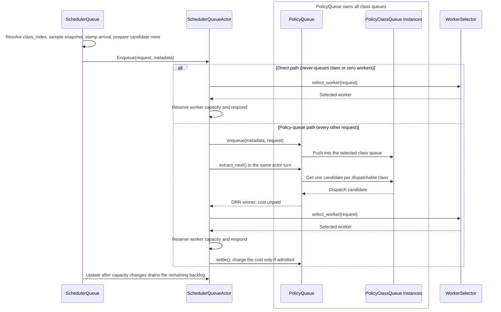

# lib/kv-router/src/scheduling

Scheduling decides whether a request can run now, which worker should receive it, and how its load is recorded while it runs.

## Queue hierarchy

There is one `SchedulerQueueActor` per scheduler. It owns one outer `PolicyQueue`, which owns one `PolicyClassQueue` for every class in the resolved profile.



- `SchedulerQueue` is the public handle. It resolves the class index, samples the
  cache-overlap snapshot, and stamps the arrival offset on the caller task before
  sending the Enqueue command.
- For a selector with a `candidate_preparer`, the handle also builds the candidate
  rows on the caller task: eligibility plus cache, preferred-taint, and fetch inputs.
  The actor fills only load inputs, which depend on its earlier bookings. It uses the
  rows only when configuration generation, availability and overload still match
  preparation and admission happens in the actor turn that received them. Full ranks
  require fresh rows when exclusive affinity or fetch-source eligibility can change;
  otherwise the actor filters full workers from the prepared rows. Rows for a request
  that stays queued are dropped when that turn ends.
- `SchedulerQueueActor` routes every request through the policy queue and drains the
  ready backlog in the same actor turn, so freed capacity can go to another class's
  queued head under DRR rather than to the arriving request. The direct path remains
  only for classes that can never hold a queued entry (any zero per-worker limit) and
  for zero-discovered-worker windows, which surface `NoEndpoints` from selection.
- `PolicyQueue` does not classify requests. It owns all class queues and uses deficit round robin (DRR) to give each class weighted turns.
- Each `PolicyClassQueue` owns ordering and accounting for one class such as `latency`, `agents`, or `batch`.
- Within one strict-priority tier, deadline-bearing entries order earliest-due-first
  ahead of all non-deadline entries before the FCFS/LCFS/WSPT policy score applies; class
  due times never enter their order. An EDF class, the policy-class YAML default, ignores
  strict priority and the score: it orders by the explicit deadline, else router ingress plus
  the class `slo_ttft_ms`, then enqueue order. Due-time keys share one origin fixed at queue
  construction.
- Controlled delay is a per-class setting (`controlled_delay`, default off) of EDF classes;
  configuration rejects it for any other order. The actor's queue
  (`PolicyQueue::with_class_budget_expiry`) fixes each class's expiry at construction: an EDF
  class with controlled delay expires every finite due time, explicit or class budget, at its
  lane roots, because each EDF lane's root carries that lane's earliest due time. Every other
  class, including EDF without it, expires only explicit deadlines, through its own deadline
  index, because a lane root can hide an earlier explicit deadline. Offline replay uses
  `PolicyQueue::new`, where every class expires only explicit deadlines.
- Each class queue has its own expiry timer (`ClassTimers`), armed at that class's earliest
  enforced due time. When it fires, the actor rejects that class's overdue entries, spends no
  DRR credit, and rearms the class at its next due time. A due time is also checked before
  enqueue limits, right before each queue insertion attempt, before each extraction, after an
  optional overlap refresh, right before worker selection, and right before booking or untracked
  delivery. A limit refusal stands only after due times are judged again at a fresh instant (see
  `SchedulerQueueActor::insert_arrival`). Expiry that leaves a class with entries can expose a
  head that runs, so an enqueue that expired entries reports ready work even when it refuses the
  arrival, and the actor drains. A deadline or queue-limit rejection whose response receiver is
  already closed at the rejection check is dropped uncounted, the precedence booking uses.
  All deadline math uses `tokio::time::Instant` so paused-clock tests stay coherent.
- `SchedulerQueueActor::admit_one` performs final worker selection and reserves worker capacity after either path.
- A single-class profile still uses `PolicyQueue`, but DRR has no cross-class effect.

## Per-class ready storage

`PolicyQueueEntry<T>` is one queued payload plus its class index, priority key, enqueue sequence, and token/accounting snapshot. In production, `T` is `QueuedRequest`, which wraps the `SchedulingRequest`, enqueue timestamp, and optional block hashes.

```text
PolicyClassQueue("agents")
├── pending: BinaryHeap<PolicyQueueEntry>                 # shared requests
├── ready_by_worker: FxHashMap<WorkerLane, BinaryHeap<PolicyQueueEntry>>
│   ├── Exact(7, dp_rank=0) → requests hard-pinned to that rank
│   ├── Affinity(7, dp_rank=0) → soft requests targeting that rank
│   └── WorkerAffinity(9) → soft requests targeting any rank of that worker
├── blocked_workers: FxHashSet<WorkerLane>
├── candidate_worker_heads: BTreeSet<WorkerLaneHead>       # one head per unblocked lane
├── fallback_heads: BTreeSet<WorkerLaneHead>               # soft heads awaiting fallback capacity
├── due_entries: BTreeSet<(due key, seq)>                  # explicit deadlines; empty with head expiry
└── expiring_roots: BTreeSet<LaneRoot>                     # every finite-due lane root with head expiry,
                                                           # including blocked and fallback lanes
```

- `pending` is the shared ready heap for requests where the existing selector may choose any eligible worker.
- `ready_by_worker` separates hard pins from ranked and worker-only soft affinity, so a hard
  pin cannot hide a soft request that can fall back. Each lane leaves the map when emptied.
- `candidate_worker_heads` tracks one highest-priority head per unblocked lane. A full lane
  leaves this index until rechecked, including when expiry or cancellation removes its root.
- Affinity lanes wake on target capacity changes, an enqueue to the same target, or the
  100 ms affinity recheck while affinity backlog exists.
- `fallback_heads` contains soft heads whose target is ineligible and whose fallback workers
  are full. These heads are rechecked on every dispatch pass, so another worker's freed
  capacity can admit them before later shared work.
- A `PolicyClassQueue` does not own worker configuration, capacity, or scoring state.
  `WorkerLane` identifies the target and whether it is hard or soft; the actor and selector
  retain worker knowledge. Expiry indexes retain that complete identity, including worker-only targets.
- Every heap uses the class's configured priority ordering. `BinaryHeap::peek()` reads its
  highest-priority root in O(1); push and pop are O(log n).
- `PolicyClassQueue::next_dispatchable` compares the shared root with the highest indexed
  lane head. Healthy blocked lanes stay parked until a wake; fallback heads remain eligible
  for a recheck on every pass.
- `round_cursor` marks which class receives the next weighted turn. `carry_class` lets a class spend its unused share before that turn, but only if `next_dispatchable` confirms that its next request can run.
- `extract_next` returns the winning head with a `DispatchCharge`; `settle` spends that cost
  only for an admitted request. Expiry, cancellation, and failed selection, booking, or delivery
  spend no credit, and the class keeps it for its next head. `pop_next` charges at once, for
  callers without an admission step.
- With head expiry, `take_expired` pops each lane's overdue prefix from `expiring_roots` in
  due order, O(log n) per entry. Every other class finds its expired explicit deadlines in
  `due_entries` and removes them with one scan of the class and a heap rebuild, as cancellation
  does. Removing a blocked root unblocks its successor and updates affinity/fallback indexes.
- A full Worker 7 can block only its own lane head. It cannot hide ready work for Worker 9
  or work that can run on any worker.

## Guardrails

- A request ID identifies at most one active scheduler booking. Duplicate adds
  conflict regardless of the target worker. A serialized migration retry may
  reuse the ID only after the previous booking has been released.
- Before an unpinned retry, exclude every worker already failed by that migration state machine. Preserve caller allowlists and routing constraints. An affinity-derived pin may be invalidated and rebound; an explicit request pin remains exact.
- A failed stream releases its scheduler booking before the error reaches the retry manager. This ordering prevents a later attempt from overlapping stale cleanup.
- Cleanup that can outlive an admitted request attempt must carry its internal `AttemptId`. `RequestGuard` fences scheduler mutations with `(request_id, attempt_id)` and the admission lifecycle lease remains request-ID-only until handoff.
- Prepared candidate rows must not hold anything the actor's bookings change. Load
  inputs are filled on the actor at selection, so each admission still observes
  every earlier booking.
- `SchedulerQueueActor::admit_one` is the required admission path: compute projected
  load, reject a request whose due time has passed, select a worker, skip the capacity
  reservation if the response receiver is closed or the due time has passed, then reserve
  capacity before responding.
  Failed response delivery must release that capacity. Do not bypass this for
  normal scheduling.
- The optional overlap refresh is the only await inside a drain. Scheduler traffic that arrives
  during it is handled at once, each event in a new actor turn, and never abandons it; rows
  prepared before such a turn are not used after it. Never hold a command reply across that
  await. The candidate has left its class queue, so class expiry does not cover it: the refresh
  races the candidate's own due time (see `SchedulerQueueActor::refresh_candidate`, and
  `OverlapScoresRefresh` for the refresh timeout).
- Do not remove or weaken `admission_gate` without proving selection and
  capacity reservation cannot assign more work than the workers can hold.
- Potential-load projection must go through
  `ActiveSequencesMultiWorker::potential_blocks_and_tokens_at(...)` with
  `SchedulingRequest::prefill_token_deltas()`. Do not scan per-worker
  `ActiveSequences` directly from scheduling.
- `SchedulingRequest` helper methods are the single source for effective
  cached tokens, effective overlap, worker allowance, prefill-token defaults,
  and request block count. Do not duplicate this logic in policies or selectors.
- Weighted shortest processing time (WSPT) must use cache-aware prefill cost: pinned requests use the pinned worker's
  effective cached tokens; unpinned requests use the best allowed worker. Do not
  silently fall back to raw input sequence length (ISL) unless tracking is disabled or cache data is
  absent.
- Pinned-worker and allowed-worker constraints must be validated before
  selection and respected by queue capacity checks, selector candidate
  iteration, and WSPT priority.
- Prefill load hints are computed at scheduler/request boundaries from
  selected-worker `cached_tokens`. Do not move ISL/cache-token math back into
  `ActiveSequences`.
- Selectors should be side-effect free: no capacity reservation, no queue mutation, and no
  `PromptRegistry` mutation.
- Do not hold the pending-heap lock while selecting, reading worker capacity,
  responding, or awaiting. The queue heap is only for waiting requests.
- Do not hold `workers_with_configs.borrow()` across `.await`; take a short
  synchronous snapshot or borrow for selection only.
- Any change to queue ordering, WSPT keys, capacity checks, admission
  serialization, or selector scoring should include focused tests and
  before/after routing or queue benchmarks.
- Keep text and external IDs such as request IDs on standard hash collections.
  Use `FxHashMap` / `FxHashSet` for internal numeric hot-path keys only.

## Public Worker-Selection API

The `plugins::worker_selection` module contains the public Rust contract for custom worker filters, scorers, and pickers. Treat each public item as a versioned external API.

- Do not add a public field, accessor, input group, type, or re-export unless the task explicitly requires a new external policy capability.
- An internal need in the default scorer, logging, tests, or SelectionService does not justify a public API addition.
- Trace a proposed value to its source before you expose it. Record whether it is raw state, a derived estimate, or an intermediate in Dynamo's default formula.
- Expose raw facts or complete user-facing abstractions. Do not expose partial credit, weighted overlap, legacy arithmetic, or another intermediate whose meaning depends on the default policy.
- Keep struct fields private. Add the narrowest accessor that supports the approved use case.
- When a protocol context is projected into a worker-selection type, destructure the source without `..` and handle every field explicitly. Map only approved policy fields. Bind each field that stays internal by name and explain why. A new source field must cause a compile error until its policy meaning, cost, documentation, and contract test are reviewed.
- Return `Option` for absent data. Do not replace absence with a sentinel value.
- Document the source, units, lifetime, staleness, missing-data behavior, weighting, and clamping for each public value.
- Require callers to name each `WorkerInputs` group that they use. Do not add a public `ALL` shortcut.
- Before you add a value to an existing input group, account for its calculation and retained-column cost for every policy that requests that group.
- Do not pass the full `SchedulingRequest`, worker maps, router configuration internals, default-score weights, or host-owned eligibility and reservation state to custom policies.
- The builtin default policy lives in `lib/router-plugins/builtin` and uses only the public policy API. Keep the reference selector test/benchmark-only. Plugins own their score calculation and worker choice.
- Keep eligibility, picker-row validation, accounting, and reservation in the host path.

Before each public API addition:

1. Search all accessors, re-exports, documentation, examples, and external-looking call sites.
2. Add one focused contract test that uses the new value through `WorkerFilter`, `WorkerScorer`, or `WorkerPicker`.
3. Update `docs/fern/pages/developer-guide/knowledge-base/modular-components/router/custom-worker-selection.mdx` and one canonical example.
4. If the signal adds work, storage, allocation, or another scan to the selection path, run the worker-selection benchmark.
