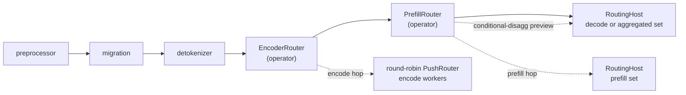
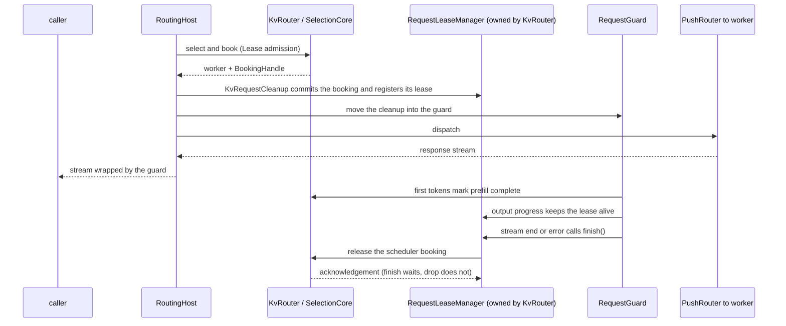

<!--
SPDX-FileCopyrightText: Copyright (c) 2026 NVIDIA CORPORATION & AFFILIATES. All rights reserved.
SPDX-License-Identifier: Apache-2.0
-->

# Router Host Layer

This module is the router's host layer. It embeds the selection core from `lib/kv-router`
(scoring, queues, load tracking) and adds what a running request needs around it: session
affinity, booking ownership, dispatch, cancellation, and the optional encode and prefill hops.
For which processes embed it and where their boundaries are, see
[`components/src/dynamo/router/AGENTS.md`](../../../../components/src/dynamo/router/AGENTS.md).
The module map and the rules for changing this code are in [`AGENTS.md`](AGENTS.md).

## Layer map

The frontend pipeline (`entrypoint/input/common.rs`, `PreprocessedRouting::build_pipeline`)
runs these stages in order:



`RoutingHost` is the pipeline's terminal engine. `EncoderRouter` and `PrefillRouter` are
operators in front of it, not `RoutingHost`s. `PrefillRouter` holds a separate `RoutingHost` for
the prefill worker set (built in `prefill_router/activation.rs`) and sends the prefill hop
through it. It also keeps a handle to the decode `RoutingHost`, which it uses only to preview
decode for conditional disaggregation. `EncoderRouter` sends the encode hop through its own
round-robin `PushRouter`.

A `RoutingHost` serves one worker set. What it holds (composition, not call order):

```text
RoutingHost
 ├─ inner: PushRouter (lib/runtime)  discovery membership, fault detection, transport
 ├─ policy: RoutingPolicy
 │   ├─ Kv(KvRouter)                 KV candidate state; selects and books, never dispatches
 │   │   ├─ Indexer                  which blocks each worker holds
 │   │   ├─ RequestLeaseManager      booking leases, reaper
 │   │   └─ EmbeddedSelection → SelectionService / SelectionCore (lib/kv-router)
 │   │                               classify, queue, score, admit, account load
 │   ├─ Builtin                      round-robin, random, power-of-two, least-loaded
 │   ├─ Direct                       the worker the request names
 │   └─ DeviceAwareWeighted
 ├─ affinity: AffinityCoordinator    session affinity (optional; crate::session_affinity)
 ├─ hosted_occupancy                 in-flight tracking for load-based builtin modes (optional)
 ├─ lora: LoraRouting                LoRA filter (optional)
 └─ request_metrics
```

What a KV request does in `RoutingHost::generate` (call order):

```text
1. validate request-supplied worker pins against discovery
2. decode or aggregated: start, or resume after migration, the classifier lifecycle
3. affinity: acquire the session's slot (hard mode pins the worker; soft mode prefers it)
4. KvRouter → SelectionCore: select and book the worker (Lease admission)
5. track: RequestGuard takes ownership of the booking and records the routing decision
6. PushRouter: dispatch to the worker
7. affinity: bind the session to the worker once the stream starts
   (if dispatch fails under hard affinity and the worker is gone, invalidate the binding)
```

A query-only request (`query_instance_id`) skips step 2, only looks up the session's target in
step 3 without acquiring it, selects with `Query` admission in step 4 so nothing is booked, and
returns the selection instead of steps 5–7.

Selection and booking happen in `KvRouter`. The host owns dispatch and tracks the request until
its booking is released:



Discovery builds the pipeline once per Decode or Aggregated worker set
(`discovery/watcher.rs`). Only a Decode set gets a real `PrefillRouter`; every other set gets a
disabled one that always passes requests through. Prefill worker sets, and Encode worker sets
that serve no model type of their own, build no pipeline: they are reached only through these
hops.

## Per-stage roles

| Stage | Router | Selection | Books | Notes |
|---|---|---|---|---|
| Aggregated | `RoutingHost` of the aggregated set | KV or builtin | Yes (KV) | Owns the request's classifier lifecycle. |
| Decode | `RoutingHost` of the decode set | KV with the decode profile written by `PrefillRouter` | Yes (KV) | Owns the request's classifier lifecycle. |
| Prefill | `PrefillRouter` → prefill `RoutingHost` | KV or builtin; a prefill card that declares `router_config` overrides the decode set's mode | Yes (KV) | Never starts the classifier; a prefill retry must leave a parked decode lifecycle alone. |
| Encode | `EncoderRouter` | Round-robin `PushRouter`; no `KvRouter` | No | On failure, falls back to inline encoding downstream. |

### Prefill hop

- Sends a copy of the request with `max_tokens = 1` under its own cancellation context, so
  prefill survives a client disconnect once decode depends on its KV.
- If the prefill worker publishes bootstrap information, prefill runs in the background and
  decode is routed immediately. Otherwise the hop waits for `disaggregated_params`.
- A prefill that finishes the whole request (for example EOS on the one-token step) is returned
  directly; decode does not run.
- `into_decode_request` writes the handoff into the decode request: `bootstrap_info` or
  `prefill_result`, `routing.prefill_worker_id`, `migration_link`, and `staged_kv_cleanup = true`.
- Merges the prefill worker's KV-transfer topology constraints into the decode request's
  `routing_constraints`.
- Rewrites the decode request's `router_config_override`. `assume_kv_reuse` and
  `track_prefill_tokens` set decode's load accounting. Decode's overlap credit is fixed when the
  selection policy is built, from the worker role and whether conditional disaggregation is
  enabled; the per-request override no longer reaches scoring.

### Conditional disaggregation

1. Strip any client-supplied bypass annotation: only the router may bypass remote prefill.
2. Preview decode with `RoutingHost::preview_kv_route`: advisory, no booking, no affinity binding.
3. The policy decides from prompt and cached tokens, plus the prefill pool's load when the
   policy needs it.
4. If a decode busy threshold is configured, a busy or unknown decode worker vetoes the bypass.
5. On bypass, `plan_kv_route_from_preview` admits the previewed worker (re-selected with
   admission and pinned to it), and `dispatch_kv_plan` sends the request with the bypass
   annotation. Otherwise the request takes the remote prefill path.

A failed decision falls back to remote prefill, except for `Cancelled` and `InvalidArgument`
errors, which return to the client.

## What selection reads from a request

| Input | Source |
|---|---|
| Request id, cancellation | the `Context` around the request |
| Policy class | context metadata key `policy-class` (header `x-dynamo-meta-policy-class`) |
| Session-affinity id | the `Context`, set by the HTTP layer |
| Agent session context | `PreprocessedRequest::agent_context` |
| Tokens, multimodal block info | `PreprocessedRequest::block_mm_routing_info` |
| Pins, DP ranks, priority, LoRA, cache namespace, constraints, allowed workers | `PreprocessedRequest::routing` (`RoutingHints`), from `nvext` and `x-dynamo-*` headers |
| Scoring and accounting overrides | `PreprocessedRequest::router_config_override` |
| Excluded workers, parked classifier lifecycle | `PreprocessedRequest::migration_state` |
| Staged KV that only this decode can release | `PreprocessedRequest::staged_kv_cleanup` |
| Query-only selection (KV plane) | annotation `query_instance_id` in `PreprocessedRequest::annotations` |

## Admission modes

`SelectionCore` has four `SelectionAdmission` modes; `KvRouter` uses the first three:

- **Advisory**: no queue and no booking. Used by previews and load probes.
- **Query**: queued and admitted, but books nothing.
- **Lease**: queued, admitted, and booked; the caller owns the booking handle. Every dispatched
  KV route uses it.
- **Book**: queued, admitted, and booked as a reservation the core holds under a selection id.
  Used by `SelectionCore::select_and_reserve_with_policy_class` (the standalone selection
  service), not by this module.

On the KV plane, a request annotated `query_instance_id` returns its selection without
dispatching or updating router state. Builtin modes have no query path: they still select a
worker and dispatch the request.

## Booking lifecycle (KV)

A booking belongs to the selection core's scheduler. A `Lease` admission returns it in a
`BookingHandle`, which still releases it if dropped. `KvRequestCleanup` commits the handle and
registers the booking with `RequestLeaseManager`; from then on this module is responsible for
releasing it.

1. **Admit.** A `Lease` admission returns a `BookingHandle` for one scheduler attempt.
2. **Own.** `KvRequestCleanup` commits the handle and registers a local `RequestAttemptLease`
   with the `RequestLeaseManager`, plus an approximate-LRU lease when the approximate indexer is
   on. A `RoutePlan` (preview or plan path) holds this cleanup until dispatch.
3. **Track.** At dispatch, `RequestGuard` takes ownership. The first output tokens mark prefill
   complete on the booking, and output progress keeps the lease alive.
4. **Release.** Stream end, error, or drop releases the lease, which enqueues the scheduler
   release. `finish()` waits for the scheduler to acknowledge it.
5. **Expire.** The reaper scans once per active-request expiry interval with a second-chance
   clock: one scan marks an idle lease quiet and the next reclaims it. A lease is reclaimed one
   to two intervals after its last progress.

`register_detached` is the other registration: the booking is tracked by request id and
released by `KvRouter::free`, not by a handle. `KvRouter::add_request` uses it.

Booking descriptors carry the attempt id, so late cleanup from an old attempt cannot release a
newer booking that reused the same request id and worker.

## Cancellation

- By default a client disconnect cancels selection and dispatch at once.
- A decode request with `staged_kv_cleanup` set is the exception: it still reaches its worker,
  because only that decode worker's KV-transfer-complete path frees the blocks remote prefill
  staged for it. The stages it still runs share one `CleanupBudget`, which starts the first
  time a stage sees the stopped context. When the budget runs out, the stage gives up and logs
  that the staged blocks will sit until they expire.
- A request that took the conditional bypass reached decode without staged KV, so it cancels
  normally.

## Prefill activation

`PrefillRouter` resolves its state from one snapshot:

- **Active**: run the prefill hop.
- **Pending**: a target is set but its binding is still being built. Fail closed with a
  retryable error; a decode-only worker cannot run the request without the hop.
- **Untargeted**: no prefill target. Pass through to the next stage.

`ModelManager::reconcile_discovery_topology` sets the target only when the namespace has
exactly one prefill worker set and one decode worker set. The encoder target follows the
`encoder_result_handoff` rules there. In Direct mode the prefill hop requires
`routing.prefill_worker_id`. See [`../discovery/AGENTS.md`](../discovery/AGENTS.md) for worker-set
admission and succession.

## Choose the operation by its effects

| Operation | Admission | Booking | Dispatch | Result |
|---|---|---|---|---|
| `preview_kv_route` | Skipped | None | None | One `RoutePreview`: worker/rank and cache/load signals |
| `plan_kv_route_from_preview` | Yes, for the previewed target | Owned by plan | None | `RoutePlan`, or failure |
| `dispatch_kv_plan` | Uses the existing plan | Transferred into request cleanup | Yes | Backend response stream |
| KV `RoutingHost::generate`, ordinary request | Yes | Owned by request cleanup | Yes | Backend response stream |
| KV `RoutingHost::generate`, `query_instance_id` | Yes | None | None | One routing-data response |

“Select” names an operation, not one ownership contract. Standalone `/select`
does not book; the admitted selection used by ordinary generation does.
Read the exact API and admission mode before assuming either behavior.

Sources: [preview, plan, and dispatch](routing_host/kv.rs),
[generate](routing_host.rs), and the
[selection-service modes](../../../kv-router/src/services/selection/README.md).

## RequestPhase identifies the routing hop

The routing `RequestPhase` has `Prefill`, `Decode`, and `Aggregated` variants.
It determines phase-specific routing and timing records and helps select the
relevant worker pin and lifecycle handling. It does not reserve capacity or
prove that backend computation has finished. A decode route can execute
prefill locally when remote prefill is bypassed.

Decode and aggregated selection own the logical request's classifier lifecycle.
The prefill hop leaves that lifecycle to the decode owner. Another module's
classifier state enum with the same name is a different type.

Sources: [RequestPhase](../protocols/common/timing.rs) and
[classifier lifecycle ownership](routing_host/kv.rs).

## Preview is an observation

A successful preview returns one chosen worker and data-parallel rank, not a
candidate list. Signals include overlap blocks, cached tokens, potential decode
blocks, and optional total KV capacity. The configured policy, worker constraints,
and affinity handling determine the choice; it is not a maximum-raw-cache-hit
contract.

Preview bypasses queue admission. Worker eligibility still matters, but preview
does not establish that the request is admittable or reserve capacity. A worker
can leave, another request can consume capacity, or the request can be cancelled
before the later admission completes.

`plan_kv_route_from_preview` checks the request ID and supplies the previewed
worker as the planned target to admitted selection. It carries forward the same
cleanup budget. A successful plan is the commitment point.

Making successful preview guarantee a booking would change its ownership and
cancellation contract. Such an API would need to return an owned plan or booking.
The current [conditional-prefill caller](prefill_router/README.md) deliberately
makes its topology decision before that commitment.

## Ordinary generation and conditional planning

Ordinary KV generation calls `select_with_affinity`, installs tracking with
`track_selection`, and calls `dispatch_selection`. Conditional disaggregation
uses the explicit preview → plan-from-preview → dispatch-plan sequence. The
prefill execution hop has its own `select_and_dispatch_kv_prefill` helper.

The dispatched path installs `kv_hint`, handles affinity, tracks generated output
blocks and approximate cache state, advances classifier state, and cleans up the
stream. Selection alone does not perform these effects.

The current branch does not expose a general `plan_kv_route`, `RouteRequest`,
`RouteBooking`, `RoutePlan::into_booking`, or `RoutePlan::detach_booking` API.
A generalized schedule-only design could share an owned plan between frontend
execution and EPP, but it must define those ownership transfers rather than
assuming the narrower conditional plan already serves every caller. See the
[frontend integration discussion](../README.md).

## PushRouter construction

`PushRouter::from_client_with_dispatch` accepts an injected dispatch implementation.
Its repository call sites are tests, including routing-host, prefill, and runtime
response-stream tests. Production construction uses `from_client` or
`from_client_with_monitor`. Public visibility alone does not establish production
use, and repository search cannot rule out external consumers.

Source: [PushRouter constructors](../../../runtime/src/pipeline/network/egress/push_router.rs).
