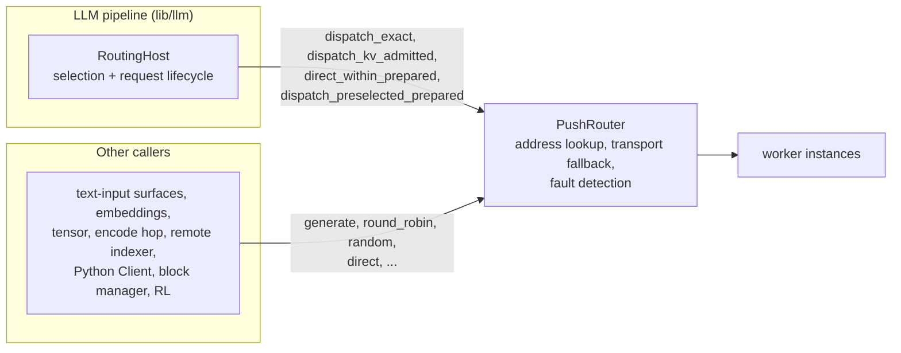

<!--
SPDX-FileCopyrightText: Copyright (c) 2026 NVIDIA CORPORATION & AFFILIATES. All rights reserved.
SPDX-License-Identifier: Apache-2.0
-->

# Request-Plane Egress

This module sends requests from a client process to worker instances. `PushRouter`
(`push_router.rs`) is its entry point. It turns a worker ID into an address, sends the request
on the request plane, and watches the response for worker faults. The rules for changing this
code are in [`AGENTS.md`](AGENTS.md).

| File | Contents |
|------|----------|
| `push_router.rs` | `PushRouter`, `RouterMode`, `PushRouterOptions`, transport fallback, fault detection |
| `addressed_router.rs` | `AddressedPushRouter`, the default final hop, and the `StreamingDispatch` trait an alternate transport implements |
| `unified_client.rs`, `tcp_client.rs`, `nats_client.rs` | `RequestPlaneClient` and its TCP and NATS implementations |
| `route_span.rs` | The `router.route_request` tracing span for one routed attempt |

Worker-selection policies (round-robin, random, power of two choices, least loaded,
device-aware weighted) and per-worker occupancy counters live in
[`lib/runtime/src/routing_policy/`](../../../routing_policy/mod.rs), not here.

## Two uses of `PushRouter`

1. **Transport under `RoutingHost`.**
   [`RoutingHost`](../../../../../llm/src/kv_router/routing_host.rs) is the terminal engine of the
   LLM pipeline. It selects the worker: the KV plane goes through `KvRouter`, and the built-in
   plane covers RoundRobin, Random, PowerOfTwoChoices, LeastLoaded, DeviceAwareWeighted and
   Direct. It owns the request lifecycle through `RequestGuard`. It calls `PushRouter` only to
   send to a worker it has already chosen and booked. Here `PushRouter` is a basic dispatcher:
   address lookup, transport fallback and fault detection. Selection, booking, affinity and
   cleanup are not its job.
2. **A direct `AsyncEngine`.** Callers that are not typed for `PreprocessedRequest` and
   `LLMEngineOutput` use `PushRouter<T, U>` as their engine. `generate` selects a worker by
   `RouterMode` with `PushRouter`'s own pickers and occupancy counters, then sends. This path
   exists because `RoutingHost` is specific to the LLM types. It is less complete than
   `RoutingHost`; see [What the direct engine lacks](#what-the-direct-engine-lacks).

New routing orchestration belongs in `RoutingHost` (a new `RoutingPolicy` mode in
`routing_host.rs`) or in a worker-selection policy that `RoutingHost` runs: a first-party policy
in `lib/runtime/src/routing_policy/`, or a router plugin under `lib/router-plugins/`. Do not add
it as a new `PushRouter` selection mode.

## Public API by use case

### Construction

| Function | Called by |
|----------|-----------|
| `from_client(client, mode)` | Python bindings `Endpoint.client`, block manager controller, RL, sidecar testkit, runtime examples and tests |
| `from_client_with_monitor(client, mode, monitor)` | `discovery/watcher.rs` (every text-input surface, Tokens+Embeddings, Tensor), `kv_router/encoder_router.rs` |
| `from_client_no_fault_detection(client, mode)` | `kv_router/indexer/remote.rs` (query and recording routers) |
| `from_client_with_options(client, mode, options)` | `RoutingHostBuilder` (`routing_host/builder.rs`), which passes the multimodal cache index and an optional `StreamingDispatch` |
| `router_mode()` | `RoutingHost` built-in telemetry |

`PushRouterOptions` sets the worker load monitor, the multimodal cache index for
DeviceAwareWeighted, a replacement final hop (`dispatch`), and `fault_detection`. The public
`client` field is read by the Python bindings and by `RoutingHost`.

### Transport for `RoutingHost`

These send to a worker that `RoutingHost` already selected. Each `*_prepared` variant runs the
caller's `prepare(request, worker_id)` after transport resolution, with the worker that will
actually receive the request. `RoutingHost` uses that callback to move its `RequestGuard`
booking (`retarget_worker`) and set the DP rank.

| Function | Fallback | Called by |
|----------|----------|-----------|
| `dispatch_kv_admitted` | `Deny`; skips the overload recheck because KV admission already booked the load | `routing_host/kv.rs` (KV mode only) |
| `dispatch_exact` | `Deny` | `routing_host/builtin.rs` for request-supplied or affinity-pinned targets |
| `dispatch_preselected_prepared` | `Allow`, after confirming the worker is still discovered | `routing_host/builtin.rs` for PowerOfTwoChoices, LeastLoaded, DeviceAwareWeighted |
| `direct_within_prepared(.., None)` | `Allow` | `routing_host/builtin.rs` for RoundRobin, Random, and Direct mode |
| `direct_within_prepared(.., Some(set))` | `Within(set)` | `routing_host/builtin.rs` for LoRA-filtered selection |

### Selection inputs for `RoutingHost`

`RoutingHost` reads these to make its own decision. They do not send anything.

| Function | Called by |
|----------|-----------|
| `selectable_worker_ids`, `with_selectable_worker_ids` | `routing_host.rs`, `routing_host/builtin.rs`, `routing_host/occupancy.rs`; `selectable_worker_ids` also by the sidecar testkit |
| `ensure_routable` | `routing_host/builtin.rs`, `routing_host/occupancy.rs` for pinned workers |
| `routing_occupancy_state` | `routing_host/occupancy.rs` (`HostedOccupancy`) |
| `select_device_aware_and_reserve` | `routing_host/builtin.rs` for DeviceAwareWeighted; the caller owns the returned `OccupancyReservation` |
| `peek_next_worker` | `RoutingHost::peek_next_worker` for DeviceAwareWeighted, used by prefill queries (`prefill_router/query.rs`) |

### Direct engine, by mode

`AsyncEngine<SingleIn<T>, ManyOut<U>>::generate` dispatches on the configured `RouterMode`. KV
and Direct return an error, because those modes need `RoutingHost`. The per-mode methods are
public so that a caller can pick a mode explicitly.

| Function | Mode | Called by |
|----------|------|-----------|
| `generate` | configured | `discovery/watcher.rs` engines (embeddings, classify, pooling, rerank, chat, completions, images, videos, audio, Tokens+Embeddings, Tensor), `encoder_router.rs`, `image_edits.rs` (requests without input images), sidecar testkit, tests |
| `round_robin` | RoundRobin | `indexer/remote.rs`, Python `Client.round_robin` |
| `random` | Random | Python `Client.random` and `Client.generate` (which always uses random), runtime examples |
| `power_of_two_choices`, `least_loaded` | PowerOfTwoChoices, LeastLoaded | through `generate` only |
| `device_aware_weighted` | DeviceAwareWeighted | Python `Client.device_aware_weighted`, `generate` |
| `select_and_dispatch(request, prepare)` | configured | `discovery/image_edits.rs`, which validates image-edit admission against the final worker in `prepare` |
| `select_and_dispatch_exact` | configured, no fallback | no caller outside this module's tests |

The bidirectional engine (`AsyncEngine<ManyIn<T>, ManyOut<U>>`) serves the Realtime surface. It
supports only RoundRobin and Random ([#10320](https://github.com/ai-dynamo/dynamo/issues/10320))
and uses `select_next_worker` for its sticky selection.

### Explicit target

| Function | Fallback | Called by |
|----------|----------|-----------|
| `direct(request, worker_id)` | `Deny` | Python `Client.direct`, `block_manager/controller/client.rs`, `lib/rl/src/lib.rs` |
| `direct_within(request, worker_id, set)` | `Allow` or `Within(set)` | no caller outside this module's tests |

### Test support

`occupancy_for_test` is available with `cfg(test)` or the `testing` feature.

## Transport fallback

`resolve_transport` looks up the selected worker's address. If the worker is no longer in
discovery, the caller's `TransportFallback` decides what happens:

| Policy | Behavior | Used by |
|--------|----------|---------|
| `Allow` | Send to another free worker instead | Direct-engine modes, bidirectional engine, `RoutingHost` RoundRobin/Random/Direct and occupancy modes |
| `Within(set)` | Send to another free worker, but only one in `set` | `RoutingHost` LoRA routing |
| `Deny` | Fail with `CannotConnect` | `direct`, `dispatch_exact`, `dispatch_kv_admitted` |

When fallback picks a new worker, the `prepare` callback receives it, so the owner of an
occupancy booking can move the booking to that worker. When no permitted worker is free, the
error is `Unavailable`.

## Fault detection

With fault detection on (the default), `PushRouter` does the following:

- Rejects a selected worker that is marked overloaded (`WorkerOverloaded`). KV-admitted dispatch
  skips this check.
- Marks a worker overloaded for a short lease when the worker refuses the request. A refusal
  from a single DP rank leaves the worker routable.
- Reports a worker down (`report_instance_down`) on connection and other inhibiting errors,
  before or during the stream.
- Ends a stream that is silent for longer than `DYN_HTTP_BACKEND_STREAM_TIMEOUT_SECS` with a
  `ResponseTimeout` error, and reports the worker down.
- Bounds the wait for a response stream with `DYN_RESPONSE_STREAM_ESTABLISH_TIMEOUT_SECS`.

`from_client_no_fault_detection` turns all of this off, for recovery and query paths that must
reach a worker whatever its health.

## What the direct engine lacks

Compared with `RoutingHost`, the direct engine has none of the following:

- KV-aware routing (`RouterMode::KV`) and Direct mode through `generate`.
- Session affinity and request-supplied worker targets.
- LoRA replica filtering and the matching `Within` fallback.
- `RequestGuard`: router request metrics, the cleanup budget on client disconnect, the rule
  that a decode leg carrying staged KV is not dropped, and migration failure attribution.
- Recording the selected worker on the request tracker.
- The encode and prefill hops, and previews for prefill queries.
- Load-aware modes on the bidirectional engine.

Its occupancy booking is released when the response stream ends or is dropped
(`OccupancyTrackedStream`), not by a request guard.

[#13513](https://github.com/ai-dynamo/dynamo/pull/13513) and
[#13519](https://github.com/ai-dynamo/dynamo/pull/13519) moved the LLM built-in modes into
`RoutingHost`, and [#13558](https://github.com/ai-dynamo/dynamo/pull/13558) removed the older
LLM routers. The direct engine remains for the generic `T`/`U` callers listed above.
