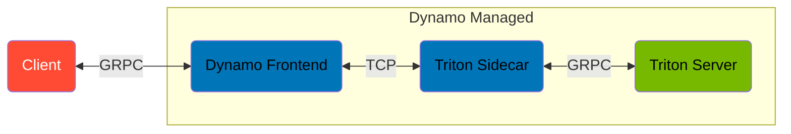
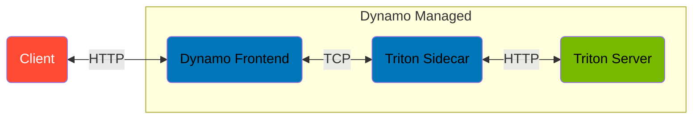

<!--
SPDX-FileCopyrightText: Copyright (c) 2026 NVIDIA CORPORATION & AFFILIATES. All rights reserved.
SPDX-License-Identifier: Apache-2.0
-->

# Triton Sidecar

> [!WARNING]
> **Experimental.** The sidecars and their deployment examples are experimental.
> Flags and behavior may change without notice.

`dynamo-triton-sidecar` connects Dynamo to a separately managed NVIDIA Triton Inference Server over its KServe v2 gRPC API, its KServe v2 HTTP/REST API, or both.
It registers one Dynamo endpoint for every ready Triton model and forwards unary model-infer requests without loading Triton or GPU libraries into the sidecar process.
By default each model is served as a KServe tensor model.
Using `--classify <model>` and `--embeddings <model>` options, serve the named text models through the frontend's OpenAI `/v1/classify` and `/v1/embeddings` endpoints instead (see [OpenAI classify and embeddings](#openai-classify-and-embeddings)).

Inference protocol selection is required during sidecar startup.
Select which protocols are supported using the options describe below.
At least one is required.

```bash
# gRPC only, on localhost:8001
dynamo-triton-sidecar --grpc --discovery-backend file

# HTTP only, on localhost:8000
dynamo-triton-sidecar --http --discovery-backend file

# Both, on Triton's default ports
dynamo-triton-sidecar --grpc --http --discovery-backend file

# Both, on a remote server
dynamo-triton-sidecar \
  --grpc triton.example.com:8001 \
  --http https://triton.example.com/prefix \
  --discovery-backend file
```

| Option            | Environment Variable        | Value                                                                               |      No Value    |
| :---------------- | :-------------------------- | :---------------------------------------------------------------------------------- | :--------------: |
| `--grpc`          | `DYN_SIDECAR_GRPC_ENDPOINT` | port, `host:port`, or a plaintext `http://` / `grpc://` URL                         | `localhost:8001` |
| `--http`          | `DYN_SIDECAR_HTTP_ENDPOINT` | port, `host:port`, or an `http://` / `https://` URL, optionally with a path prefix  | `localhost:8000` |
| `--grpc-endpoint` | `DYN_SIDECAR_GRPC_ENDPOINT` | `host:port`, or a plaintext `http://` / `grpc://` URL                               |      _ERROR_     |
| `--http-endpoint` | `DYN_SIDECAR_HTTP_ENDPOINT` | `host:port`, or an `http://` / `https://` URL, optionally with a path prefix        |      _ERROR_     |

A bare option, such as `--http`, will be interpreted as `localhost:8000`.
A bare port, such as `--grpc 9001`, will be interpreted as `localhost:<port>`.
The environment variables accept the values as `--grpc` and `--http` and apply only when neither option is provided.
At startup, the sidecar writes each endpoint it uses back to its environment variable in full, such as `http://localhost:8000`, so subprocesses have access to the active values.

`--grpc-endpoint` and `--http-endpoint` are the same as `--grpc` and `--http`, matching the options of the other Dynamo sidecars: each takes a required `host:port` or URL.
Both require a value to be provided and neither support bare port values.
When multiple `--gprc` and/or `--grpc-endpoint` options are provided, the last provided value is accepted.
Same rule applied to the `--http` and `--http-endpoint` options.

> [!WARNING]
> Unlike the `--grpc` and `--http` options, the `--grpc-endpoint` and `--http-endpoint` options require a value and **do not** support `<port>` only values.

When both protocols are enabled:

- Model discovery and model configuration use gRPC.
- Startup waits until both endpoints report ready. If a model to serve is not ready on both, startup fails, the error names one such model, and no model is served.
- Inference requests alternate between gRPC and HTTP.

The HTTP transport uses Triton's binary tensor data extension for every input and output.
Therefore tensors are transferred as raw bytes as they do over gRPC.
Triton's JSON model configuration is converted to the same protobuf `ModelConfig` that gRPC returns.
Therefore Dynamo exposes identical model metadata on either protocol.
The `--grpc-connect-attempt-timeout-secs <value>`, `--grpc-retry-interval-secs <value>`, and `--grpc-startup-deadline-secs <value>` options also govern the HTTP transport.
The `--grpc-connections <value>` option applies only to gRPC.

Ready models are discovered through Triton's `RepositoryIndex` API.
Use `--export <model>` to restrict which models hosted by Triton Server are available via the sidecar's interface.
Repeat `--export <model>`, or pass a comma-separated list of models, to serve several models.

## OpenAI Classify and Embeddings

Each model is served through one endpoint, chosen by the flags that name it:

| Flag                                                         | Frontend Endpoint            | Registration                        |
| :----------------------------------------------------------- | :--------------------------- | :---------------------------------- |
| (none, the default) or `--export <model>`                    | KServe gRPC Tensor Inference | `Tensor` input, `TensorBased` model |
| `--classify <model>` (`DYN_TRITON_CLASSIFY_MODELS`)          | `POST /v1/classify`          | `Text` input, `Classify` model      |
| `--embeddings <model>` (`DYN_TRITON_EMBEDDINGS_MODELS`)      | `POST /v1/embeddings`        | `Text` input, `Embedding` model     |

Repeat `--classify <model>` and `--embeddings <model>` options, or pass a comma-separated list, to serve several models using a single option.
A single Triton Server can serve tensor, classify, and embeddings models side-by-side.
A model cannot be passed via both options; to do so will cause a failure during sidecar startup.
The named models are served in addition to any `--export <model>` models.
During auto-discovery, each named model must be reported as ready by Triton Server.

```bash
dynamo-triton-sidecar --grpc \
  --classify text_classifier \
  --embeddings embeddings_model \
  --discovery-backend file
```

A classify or embeddings model must declare exactly one `TYPE_STRING` input with `dims: [1]` or `dims: [-1]` and exactly one `TYPE_FP32` output.
A named model that does not meet these requirements fails during sidecar startup; the model's name will be provided in the error message.

- Each request's text prompts are sent to Triton as one `BYTES` tensor, shaped `[N, 1]` for a batching model and `[N]` otherwise, and Triton returns one `FP32` row per prompt.
- Ensemble steps (tokenizer, encoder, and so on) that are not named are served as tensor models like any other model; pass `--export <model>` to register only the models you want.
- Token-ID input is rejected, as are request controls owned by the Triton model: `use_activation`, `add_special_tokens`, `truncate_prompt_tokens`, `truncation_side`, `mm_processor_kwargs`, `cache_salt`, and non-zero `priority` for classify; `dimensions`, `add_special_tokens`, and `truncate_prompt_tokens` for embeddings.
- Classify labels come from the output's `label_filename`.
  Triton exposes labels only through its classification extension, which rounds scores, so the sidecar reads probabilities from the raw output and fetches the labels once per model with one extra classification request.
- Embeddings travel to the frontend as base64 little-endian `FP32`; the frontend returns floats unless the client asks for `encoding_format: "base64"`.
- Health-check probes answer from Triton's model readiness without running inference.

## Metrics

Metrics related to the health, performance, and current state of Triton Server must be collected directly from the Triton Server process.
The Triton Sidecar does not collect or provide metrics for Triton Server.

To ensure that Triton Server metrics are available, use the `--allow-metrics=true` option when starting the Triton Server process.
The network port Trion Server provides metrics data can be controlled using the `--metrics-port=<port>` option.
Metrics are served over port `8002` by default.

For additional information, see [NVIDIA Triton Inference Server Metrics](https://docs.nvidia.com/deeplearning/triton-inference-server/user-guide/docs/user_guide/metrics.html).

Triton Sidecar metrics are available on port `8081` when `DYN_SYSTEM_PORT=8081` is set before starting the sidecar process.

## Dataflow Diagrams

### KServe v2 gRPC



### OpenAI `v1/classify` and `v1/embeddings`



## Support Matrix

| Feature                           | Supported                                  |
| :-------------------------------- | :----------------------------------------- |
| KServe v2 unary tensor inference  | Yes                                        |
| KServe v2 gRPC transport          | Yes                                        |
| KServe v2 HTTP/REST transport     | Yes, with the binary tensor data extension |
| Multiple models per Triton server | Yes                                        |
| Typed and raw tensor contents     | Yes                                        |
| Limiting reachable models         | Yes, with `--export <model>`               |
| Classification output parameters  | Passed through                             |
| Bidirectional streaming inference | No                                         |
| Shared-memory tensor I/O          | No                                         |
| OpenAI `/v1/classify` (text in)   | Yes, with `--classify <model>`             |
| OpenAI `/v1/embeddings` (text in) | Yes, with `--embeddings <model>`           |
| OpenAI `/v1/pooling`              | No                                         |
| Dynamic model repository updates  | No; requires a sidecar restart             |
