<!--
SPDX-FileCopyrightText: Copyright (c) 2025-2026 NVIDIA CORPORATION & AFFILIATES. All rights reserved.
SPDX-License-Identifier: Apache-2.0

Note to AI agents: keep this README minimal (intro, support matrix, launch example,
Kubernetes example, topologies). Do not edit it unless the user explicitly asks
you to.
-->

# TensorRT-LLM sidecar

> [!WARNING]
> **Experimental.** The sidecars and their deployment examples are
> experimental. Manifests, flags, and behavior may change without notice.

`dynamo-trtllm-sidecar` connects a Dynamo worker to TensorRT-LLM's OpenEngine
gRPC server. See the [sidecar overview](../README.md) for installation.

The sidecar reads model metadata from `--model-path`, which must be accessible
to the sidecar. It requires the engine to report a non-empty served model name
through `GetModelInfo` and registers that name. Configure the engine with
`--served_model_name` to choose the name clients use. Without it, TensorRT-LLM
may report its model path as the name. Engines without `GetModelInfo` are not
supported, even when `--context-length` is supplied.

> [!TIP]
> For the best and latest support, use the upstream TensorRT-LLM nightly image,
> which carries the latest gRPC server updates. Nightly builds are the
> `nvcr.io/nvidia/tensorrt-llm/release:<version>.dev<date>` tags on
> [NGC](https://catalog.ngc.nvidia.com/orgs/nvidia/tensorrt-llm/containers/release/-).
> The standalone launch and deployment examples use
> `nvcr.io/nvidia/tensorrt-llm/release:1.4.0rc4.dev202611130009`, which includes
> image/video URL passthrough, audio input, native KVCM2 event streaming, OpenEngine routing load support,
> and image-aware KV routing ([NVIDIA/TensorRT-LLM#21125](https://github.com/NVIDIA/TensorRT-LLM/pull/21125)).
> The nightly CI job tests image, video, and audio passthrough against the latest regular upstream nightly;
> it also supports manual dispatch. The examples below stay pinned to the validated version.

## Support matrix

| Feature | Supported |
|---------|-----------|
| Aggregated | Yes |
| Disaggregated | Yes |
| KV routing | Yes |
| Kubernetes multinode tensor parallelism (TP) and attention data parallelism (DP) | Yes |

For child-agent context affinity, enable frontend session affinity and TensorRT-LLM conversation affinity. Set `TRTLLM_SUBAGENT_AFFINITY_AUTH_KEY` on the prefill sidecar and set `internal_request_auth_key` to the same private value in the OpenEngine server YAML configuration. The sidecar requires the server to advertise signed affinity support. It sends the child's own conversation ID and a signed parent hint for context requests; decode requests retain the child's identity. The gateway must authorize client parent-session headers before they reach the router.

See [support notes](../SUPPORT_NOTES.md#tensorrt-llm) for feature restrictions and operational limits.

## Run locally

See [`launch/`](launch/) for all topologies. For example, aggregated serving on
one GPU:

```bash
export DYN_DISCOVERY_BACKEND=file   # single host: no etcd or NATS needed
lib/sidecar/trtllm/launch/agg.sh
```

For KV-aware routing, use `launch/agg_kv_router.sh` (two GPUs) or `launch/disagg_kv_router.sh` (four GPUs). Both enable OpenEngine load metrics and publish one ZMQ event source per worker.

In a second terminal:

```bash
curl -s localhost:8000/v1/chat/completions \
  -H 'Content-Type: application/json' \
  -d '{"model":"Qwen/Qwen3-0.6B","messages":[{"role":"user","content":"Hello"}],"max_tokens":32}'
```

### Audio (Whisper)

Audio requires a runtime containing upstream audio support, such as the example
pin above. The nightly audio lane runs real Whisper-tiny
inference and checks the transcript and authoritative token usage. Full frontend
HTTP CI is tracked separately from that adapter-to-engine test.

Whisper-tiny has no chat template and accepts text task prefixes rather than
token-ID input. Supply `--custom-jinja-template` to the sidecar. An empty template
selects the checkpoint's default transcription task; a template may instead emit
a complete language/task prefix, for example
`<|startoftranscript|><|fr|><|translate|><|notimestamps|>`.

Run these processes in separate terminals with the appropriate Dynamo and
TensorRT-LLM environments, using `DYN_DISCOVERY_BACKEND=file` on a single host:

```bash
python3 -m dynamo.frontend --migration-limit 0

# In the audio-capable TensorRT-LLM environment, from the repository root:
python3 -m tensorrt_llm.commands.serve openai/whisper-tiny \
  --grpc --grpc-protocol openengine --host 127.0.0.1 --port 30001 \
  --max_seq_len 1500 --extra_llm_api_options lib/sidecar/trtllm/ci/whisper.yaml

# In the Dynamo environment:
WHISPER_TEMPLATE=$(mktemp --suffix=.jinja)
dynamo-trtllm-sidecar --grpc-endpoint 127.0.0.1:30001 \
  --model-path openai/whisper-tiny --custom-jinja-template "$WHISPER_TEMPLATE"
```

Send audio using a chat content item with `"type":"audio_url"` and
`"audio_url":{"url":"https://.../speech.wav"}` (or a data URI).
For text-input models, **keep frontend `--migration-limit 0`**: retry migration
currently extends token IDs, while these engines receive the original formatted
text, which can restart a partially delivered transcript. Worker-advertised
migration restrictions need separate frontend support. The aggregated launcher
preserves explicit engine settings, including `guided_decoding_backend: null`.

## Deploy on Kubernetes

The manifests pin compatible Dynamo 1.7.0 frontend and runtime images
with `runtimeVersionOverride: "1.7.0"`. Use an operator that supports the
engine-primary native-sidecar layout. If you change the images, keep the
frontend, runtime, and operator versions compatible. Create the
`hf-token-secret` Secret that the manifests read before applying them.

See [`deploy/`](deploy/) for all manifests. For example, aggregated serving:

```bash
kubectl create secret generic hf-token-secret -n <namespace> \
  --from-literal=HF_TOKEN=<your-hf-token>
kubectl apply -f lib/sidecar/trtllm/deploy/agg.yaml -n <namespace>
kubectl port-forward -n <namespace> svc/trtllm-sidecar-agg-frontend 8000:8000
```

For KV routing, use `deploy/agg_kv_router.yaml` or `deploy/disagg_kv_router.yaml`. These examples pin matching Dynamo 1.7.0 frontend and sidecar images and `nvcr.io/nvidia/tensorrt-llm/release:1.4.0rc4.dev202611130009` for the engine.

Multinode deployments use complete `leader` and `worker` role PodTemplates. See
[`multinode_tp.yaml`](deploy/multinode_tp.yaml), [`multinode_dp.yaml`](deploy/multinode_dp.yaml),
and the [TensorRT-LLM sidecar guide](https://github.com/ai-dynamo/dynamo/blob/main/docs/fern/pages/developer-guide/knowledge-base/modular-components/backends/tensorrt-llm/sidecar.md#deploy-on-kubernetes).

## Topologies

The frontend sends inference requests to each engine's leader sidecar, which forwards them to OpenEngine over gRPC and polls routing load for all attention-DP ranks. Each sidecar discovers its node's KV event sources through OpenEngine and relays local KV events through Dynamo's event plane. Follower sidecars do not serve inference requests.

### Single-Node TP

One engine on one node, with one sidecar.



### Multi-Node TP

One engine spans two nodes. Only the leader node has a sidecar; the follower
node holds the remaining TP ranks.



### Multi-Node DP

Every rank publishes KV events on its own node. The leader sidecar registers all ranks and serves requests; a worker sidecar relays its node-local events without serving. The sidecar forwards the selected attention-DP rank to OpenEngine for KV-aware routing.


