<!--
SPDX-FileCopyrightText: Copyright (c) 2025-2026 NVIDIA CORPORATION & AFFILIATES. All rights reserved.
SPDX-License-Identifier: Apache-2.0

Note to AI agents: keep this README minimal (intro, support matrix, launch example,
Kubernetes example, topologies). Do not edit it unless the user explicitly asks
you to.
-->

# TensorRT-LLM sidecar

> [!WARNING]
> **Experimental.** The sidecars and their deployment examples are
> experimental. Manifests, flags, and behavior may change without notice.

`dynamo-trtllm-sidecar` connects a Dynamo worker to TensorRT-LLM's OpenEngine
gRPC server. See the [sidecar overview](../README.md) for installation.

> [!TIP]
> For the best and latest support, use the upstream TensorRT-LLM nightly image,
> which carries the latest gRPC server updates. Nightly builds are the
> `nvcr.io/nvidia/tensorrt-llm/release:<version>.dev<date>` tags on
> [NGC](https://catalog.ngc.nvidia.com/orgs/nvidia/tensorrt-llm/containers/release/-).
> KV routing is available in
> `nvcr.io/nvidia/tensorrt-llm/release:1.4.0a0.dev202610180820`, which includes
> native KVCM2 event streaming and OpenEngine routing load support.

## Support matrix

| Feature | Supported |
|---------|-----------|
| Aggregated | Yes |
| Disaggregated | Yes |
| KV routing | Yes |

For child-agent context affinity, enable frontend session affinity and TensorRT-LLM conversation affinity. Set `TRTLLM_SUBAGENT_AFFINITY_AUTH_KEY` on the prefill sidecar and set `internal_request_auth_key` to the same private value in the OpenEngine server YAML configuration. The sidecar requires the server to advertise signed affinity support. It sends the child's own conversation ID and a signed parent hint for context requests; decode requests retain the child's identity. The gateway must authorize client parent-session headers before they reach the router.

## Run locally

See [`launch/`](launch/) for all topologies. For example, aggregated serving on
one GPU:

```bash
export DYN_DISCOVERY_BACKEND=file   # single host: no etcd or NATS needed
lib/sidecar/trtllm/launch/agg.sh
```

For KV-aware routing, use `launch/agg_kv_router.sh` (two GPUs) or `launch/disagg_kv_router.sh` (four GPUs). Both enable OpenEngine load metrics and publish one ZMQ event source per worker.

In a second terminal:

```bash
curl -s localhost:8000/v1/chat/completions \
  -H 'Content-Type: application/json' \
  -d '{"model":"Qwen/Qwen3-0.6B","messages":[{"role":"user","content":"Hello"}],"max_tokens":32}'
```

## Deploy on Kubernetes

The manifests pin compatible Dynamo frontend and TensorRT-LLM runtime nightlies
with `runtimeVersionOverride: "1.6.0"`. Use an operator that supports the
engine-primary native-sidecar layout. If you change the images, keep the
frontend, runtime, and operator versions compatible. Create the
`hf-token-secret` Secret that the manifests read before applying them.

See [`deploy/`](deploy/) for all manifests. For example, aggregated serving:

```bash
kubectl create secret generic hf-token-secret -n <namespace> \
  --from-literal=HF_TOKEN=<your-hf-token>
kubectl apply -f lib/sidecar/trtllm/deploy/agg.yaml -n <namespace>
kubectl port-forward -n <namespace> svc/trtllm-sidecar-agg-frontend 8000:8000
```

For KV routing, use `deploy/agg_kv_router.yaml` or `deploy/disagg_kv_router.yaml`. These examples pin matching Dynamo frontend and sidecar nightlies (`20261023-75d0686`) and `nvcr.io/nvidia/tensorrt-llm/release:1.4.0a0.dev202610180820` for the engine.

## Topologies

The frontend sends inference requests to each engine's leader sidecar, which forwards them to OpenEngine over gRPC and polls routing load for all attention-DP ranks. Each sidecar discovers its node's KV event sources through OpenEngine and relays local KV events through Dynamo's event plane. Follower sidecars do not serve inference requests.

### Single-Node TP

One engine on one node, with one sidecar.



### Multi-Node TP

One engine spans two nodes. Only the leader node has a sidecar; the follower
node holds the remaining TP ranks.



### Multi-Node DP

The sidecar forwards the selected attention-DP rank to OpenEngine for KV-aware routing.


